# Coded-language report — the Bermann/Lehrhaupt letters

*Markdown mirror of the blot-lab coded-language report page. Generated 2026-10-16 from `coded-language-findings.md`.*

## Method

Nine worker subagents examined 53 scanned letters (letters 1–54, no 3.pdf) in batches of 5–7, applying 8 technique families to every letter: (i) visible text, (ii) lighter words, (iii) subtle markings, (iv) word skips/layout, (v) anagram-like pairs, (vi) Jewish religious code patterns, (vii) cryptography, (viii) historical comparison. Sources: German transcripts, Helen Hunter translations with footnotes, and the scans rendered at 170 dpi and read page by page. Fresh eyes throughout: no prior analysis files were read, no context graph consulted. All mechanical tests (sentence/line initials, last letters, word-initial triples, strict anagram scans) were run per letter and came back negative unless noted.

**Confidence:** **high** = evidence directly supports it; **medium** = suggestive, needs corroboration; **low** = speculative; **none** = examined, nothing found. *Citations in italics* point at Helen Hunter's translation footnotes or the German transcripts. "Drive link (private)" opens the original scan on the family's Drive.

## Letter 13 — 1923-03-25 (reiss. 1939-10-26), IKG Wien (certificate) (1)

[Drive link (private)](https://drive.google.com/file/d/1wKI-0azesUoLuwqRUsRjc9tYyQPWFJzR/view?usp=drivesdk) — original scan of letter 13

### i) Visible text: plain-sight references — confidence: high

*Method.* read transcript/translation/HH footnotes against scan.

marriage 25.3.1923, register "Sch Reihe Zahl 19"; groom b. 15.1.1897 Wiznitz, parents Perez Lehrhaupt/Sara Bermann, Wien II Rueppgasse 18; bride b. 10.5.1895 Brzozow *HH footnote 1*, parents Markus Moses Katz/Malke Willner, Wien II Zirkusgasse 11; witnesses Jakob Willner, Bilko Schaje; Rabbi Sigmund Fürst, Große Schiffgasse 8 [*HH footnote 2*: Schiffschul]. Reissued 26.10.1939 — obtained in the emigration-paper push just before Ewa's Jan/Feb 1940 emigration. the document IS a primary source; the reissue date is itself an emigration-logistics fact.

### ii) Lighter words vs. surrounding text — confidence: high

Uniform print + handwriting; nothing.

### iii) Subtle markings near words — confidence: high

Red/purple round stamp "MATRIKELAMT DER ISRAELITISCHEN KULTUSGEMEINDE IN WIEN", registrar's signature flourish, faint large circular IKG seal mid-page, one foxing dot above "Bräutigam:". Official marks only.

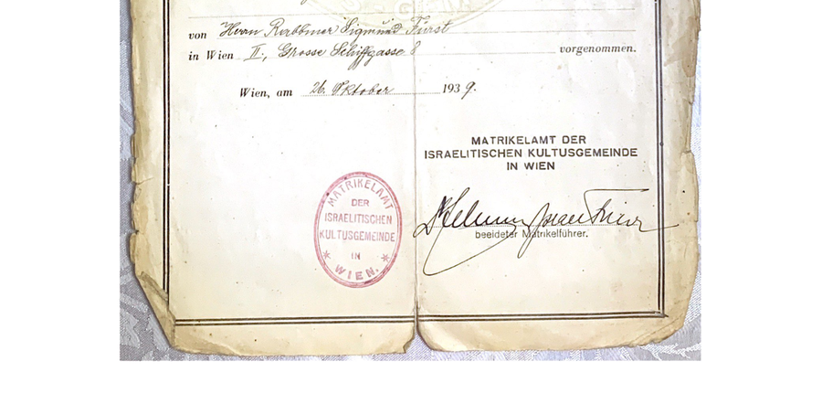

### iv) Word skips and insertions — confidence: high

Form layout normal; "[text loss]" at bride's birthplace. Nothing.

### v) Same spelling, different letter order — confidence: high

"r[ecte]"/"false" are Latin legal terms (recte = name correction), not transpositions.

### vi) Jewish religious code patterns — confidence: none

N/A.

### vii) Cryptography and messaging techniques — confidence: none

N/A.

### viii) WWI Austrian plain-sight conventions — confidence: high

Standard IKG reissue; such Oct-1939 reissues served emigration dossiers, consistent with the affidavit threads in letters 8/10/12.

**Verdict.** official certificate, no coded content; the 26.10.1939 reissue date places it in the emigration-paperwork chain.

## Letter 31 — 1940-01-14, Mali Bermann → Onkel Jakob Willner (2)

[Drive link (private)](https://drive.google.com/file/d/1dzkgWjebFx4b5bkH6lYQOsrvyDyOga13/view?usp=drivesdk) — original scan of letter 31

### i) Visible text: plain-sight references — confidence: medium

*Method.* transcript + translation + HH footnote vs scans.

"sie hat zwar schon die Vorladung zu Untersuchung, aber jetzt wird man nur vorgenommen wenn man schon die Schifffskarte hat. Und von wo soll sie sie nehmen?" ("although she has got a summons to the examination interview they will only see people now who already have a ship ticket — and how is she supposed to get one of those?"). "daß die Kinder שי׳ am 1. Dec[ember] nach Amerika gefahren sind. Auch hofft sie dieser Tage zu fahren. Was mit Papa sein wird weiß ich nicht." ("the children [she'yichyu] left for America on 1 December and she is hoping to set off too in the next few days. I don't know what will happen with Papa."). "Ich habe gleich nach Erhalt dieses Briefes zu Tante Erna nach Amerika geschrieben, daß sie dort bei den Verwandten irgend etwas bewirkt" (wrote to Aunt Erna in America about relatives and the affidavit). "daß es helfen wird wie einen Toten Bankes" ("about as helpful as cupping a corpse", *HH footnote 0* — Yiddish idiom for "useless"). "Fini Kaufmann ist beigekommen, ich weiß aber nicht wo sie sich aufhält" ("Fini Kaufmann came by, but I don't know where she is staying"). Hebrew header top-right of p.1: "ב״ה, יום א׳..." ("with G-d's help, Sunday..."), a standard Orthodox letter opening. explicit emigration logistics under Nazi bureaucracy, stated plainly — the opposite of coded. "שי׳" is the standard she'yichyu blessing, not a signal.

### ii) Lighter words vs. surrounding text — confidence: high

Blue ink with regular darker-lighter line alternation — fountain-pen re-dip pattern; "G-tt"/"G-ttes" with omitted 'o' (divine-name orthography). Nothing systematic.

### iii) Subtle markings near words — confidence: medium

Tiny reddish dot above the "Mali" signature [uncertain — likely scan artifact]; torn left edge with text loss (transcript-marked, physical damage, not redaction). Nothing else.

### iv) Word skips and insertions — confidence: high

Torn-edge text loss; the 23-zero number on its own line; otherwise standard. Nothing coded.

### v) Same spelling, different letter order — confidence: high

Zero pairs; "Mali" vs "Mala" are diminutive variants of "Malka" across letters.

### vi) Jewish religious code patterns — confidence: high

"ב״ה" header, "שי׳", "G-tt", "Mit G-ttes Hilfe", "Toten Bankes" idiom — every item a standard Orthodox formula, naturally placed; no gezeirah-shava linkage, no gematria.

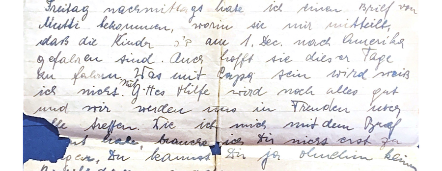

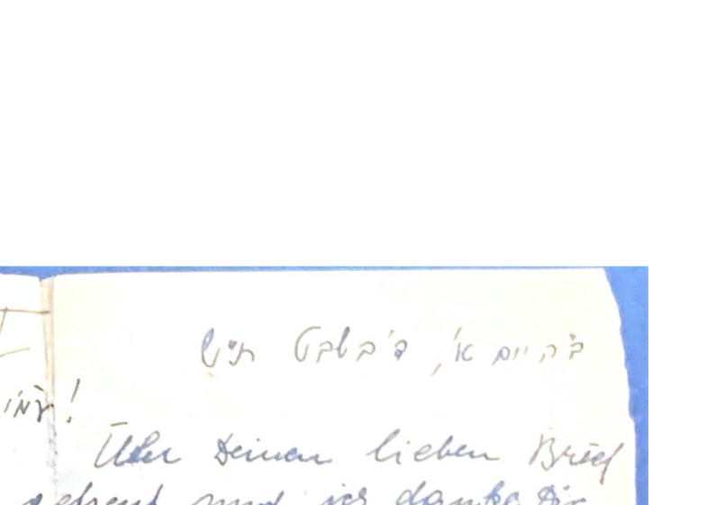

### vii) Cryptography and messaging techniques — confidence: high

Sentence-initials, line-initials, last letters all listed — no words/names. The zero-string "100000000000000000000000" counts 23 zeros (10^23): hyperbole, not gematria.

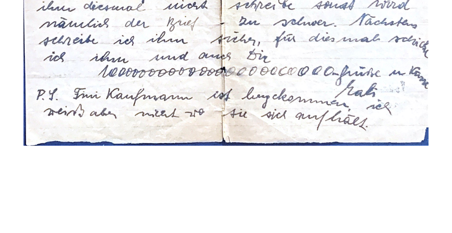

### viii) WWI Austrian plain-sight conventions — confidence: medium

Everything stated plainly in Jan 1940; no jargon code with recoverable meanings. Notable for its explicitness.

**Verdict.** no coded message. The most historically explicit letter of the corpus (summons, ship tickets, a dated sailing, affidavit-seeking); religious formulas are dense but standard.

## Letter 33 — 1940-02-11, Josef Bermann (+Klara, Mali, 3rd author) → Ewa Bermann (3)

[Drive link (private)](https://drive.google.com/file/d/1KCZLOTCWglWa3mRDBtblmSeqTUMBg-vi/view?usp=drivesdk) — original scan of letter 33

### i) Visible text: plain-sight references — confidence: medium

"daß sollst alles mögliche einwenden und mir eine Ausreisemöglichkeit verschaffen nach Amerika" ("you must do everything you can to try and find some way for me to leave the country [for America]"); "ich habe einen Gruß bei der Kalman von der Mali erhalten" ("I got a message from Mali in a letter from Kalman" — greeting relayed via a third party's letter); "Ist Jo[el?] schon in Amerika denn hat vorige Woche geschriebe daß er das Visum erhalten hat und wird demnachst fahren" (*HH footnote 0*: name end obscured by blot; Joel inferred); "Taube Ettels [Peretz] wird so G[ott] will demachst nach America fahren auch die Frau Dornhelm wird hoffentlich in 14 Tage fahren. sie hat schon das Visum bekomen" (Peretz and Frau Dornhelm's travel, visa obtained); "Ruchel Lea wohnt bei mir" (residence fact); "Berta hat auch schon schon lange ihrer Mutter nicht geschrieben" (doubled "schon" — a slip). visa/travel facts are primary-source-relevant (Joel's visa, Dornhelm's visa, Peretz's planned sailing). The Kalman-relayed greeting is ordinary wartime-post relay, not deception design.

### ii) Lighter words vs. surrounding text — confidence: medium

Josef's text dark brown-black; p.2 shows large washed-out gray patches following moisture-damage contours, not word boundaries; the p.1 margins' third-author note is a different author's lighter lavender/blue ink, not lighter words within one hand. No deliberate lighter words.

### iii) Subtle markings near words — confidence: low

emphasis/processing marks only.

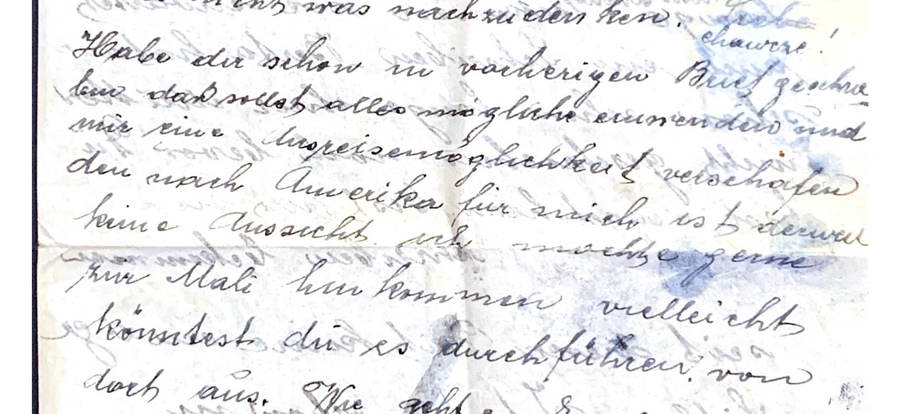

### iv) Word skips and insertions — confidence: medium

The third author's note ("beste grusse der Schwester Rosa un[d] F[a]m[i]l[ie] ...", signed vertically along the left edge "R [?] Korn") is written into the top and bottom margins of p.1 in reverse (upside-down) orientation in the lighter blue ink — the sheet was turned 180° and the empty margins used. The third author's main letter is on the reverse of p.3, which was not scanned (CSV confirms). The note's content is an ordinary greeting — no concealment of substance.

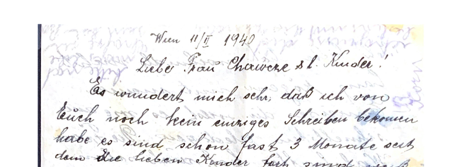

### v) Same spelling, different letter order — confidence: high

"Berta" (Josef) vs "Bertha" (third author) — inconsistent h-spelling of the same name within the one letter; "Malin" is a declined form of "Mali" (*HH footnote 1*); "Chawcze/Chafze/Chajtsche" are dialect variants across authors. No true permutation pairs.

### vi) Jewish religious code patterns — confidence: medium

"cheder", "G[ott] s[ei] d[ank]", "so G[ott] will" — idiomatic, natural.

### vii) Cryptography and messaging techniques — confidence: high

Josef's 19 sentence-initials ("E w C H W W k C I d D B I B R P s s E") and Klara/Mali's 7 ("E b a i W w G") form no words; last letters/word-initials nothing; no book-cipher references.

### viii) WWI Austrian plain-sight conventions — confidence: medium

February 1940 Vienna — emigration, not deportation; "Ausreisemöglichkeit", "Einreise", "Visum", "fahren" all literal.

**Verdict.** no coded message. Notable: reversed-orientation third-author marginalia, a retraced "cheder", the penciled "1463", and a Kalman-relayed greeting.

## Letter 46 — 1940-02-12 / 1940-04-25, Josef Bermann (+ others) → Chava/Ewa (7)

[Drive link (private)](https://drive.google.com/file/d/1tfcn8PtMoqwDU9rS1456SYXw49dfR6Me/view?usp=drivesdk) — original scan of letter 46

### i) Visible text: plain-sight references — confidence: high

12 Feb (Josef): "ich habe von vielen Leuten gehört Wann man minderjahrige in America hat besteht eine Möglichkeit daß die Kinder können ihre Eltern anfordern so daß die Quote einfach entfällt oder kommt man in einer bevorzugte Quote" (children in America can petition for their parents — quota route); "Die Frau Dornhelm hat auch zur Untersuchung hoffentlich fahr sie auch"; "du sollst zur Frau Fli[ck] gehen" *[uncertain]*; "da wurde Adi aufgenommen durch die Empfehlung von Herzog" (Adi placed through Herzog's recommendation). 25 Apr (Josef): "sage der Mali sie soll dem Perez aufsuchen und ihm erinnern, daß er der Ruchel Lea schreiben soll denn sie ist sehr nachdenklich über sein so langes Schweigen" (a message to be sent); "Ruchel Lea wohnt bei mir auch Taube Ettel [will] zu mir herziehen sie wird vielleicht ihre Wohnung aufgeben"; "Von der Schwägerin Riwke haben wir eine Karte an Ruchale angefragt... Nächstens werden wir die Karte beilegen von der Riwke und lieben Kindern" (Riwke's card to be enclosed). "Liebe Schwester!" (other author): "die Frau Felde hat gesagt der H. Fink freut sich sehr das du schon dort bist"; "von H. Kessel Perez war [Hebrew/Yiddish] einschreiben" (registered letter from Mr. Kessel, Perez). Lea Frohlich [?]: "Liebe Berta ich bitte zu sagen meinen lieben Sohn daß ich weiß nicht wohin er hat das [Spesen?] hingeschickt ich kan mit den Transport nicht mehr daran komen" ("tell my dear son I don't know where he sent the [expenses?] — I can no longer make the transport"). no coded message; the emigration-bureaucracy vocabulary (Quote, Untersuchung, Einreise/Ausreise, Transport, Luftpost) is the plain technical language of 1940 Vienna. Primary-source leads: the 10 Feb 1940 telegram; the quota/children-petition route; Herzog's placement of Adi; Lea's missed transport and Berta's son's "Spesen".

### ii) Lighter words vs. surrounding text — confidence: high

Four hands — Josef's brown ink; "Liebe Schwester!" author's darker pencil-like hand; reverse-orientation author's uniformly faint faded ink; Lea's very dark bold ink. No individual words lighter within any hand.

### iii) Subtle markings near words — confidence: medium

P.2 header: "Wien 25. April 1940" over a scribbled-out line; a full line between greeting and "Den Brief vom 16 Feber" scribbled out (likely a first attempt at the date line); "16" corrected (HH: 14 also possible). P.1 top-left (upside-down letter): header block heavily scribbled over — crossed-out address/name header, illegible at available resolution *[uncertain]*. P.3 quota paragraph: dense crossing-out and interlinear rewriting + two ink blots (pen blobs). P.5: purple stamps "1654" and "764" bottom-left (archival/filing); p.2: "326" penciled (filing number, different hand). P.7 (Lea): large ink blobs near "[Spesen?]" and "Transport" — heavy nib, words readable, no deliberate obliteration. No dots/ticks/margin marks/circles/underlining.

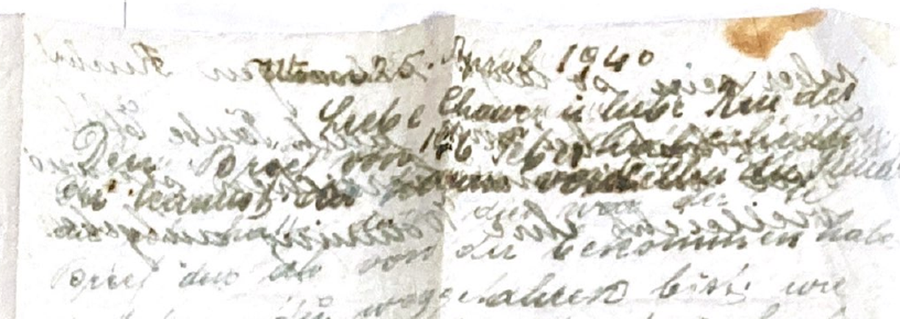

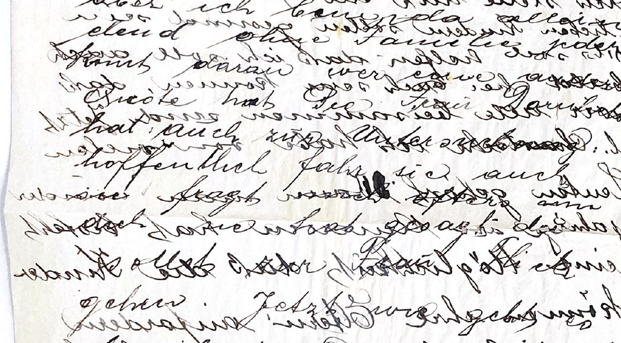

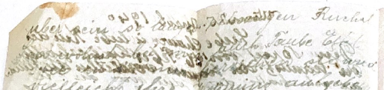

### iv) Word skips and insertions — confidence: high

Second author's letter written upside-down in remaining space of the folded sheet (space reuse); Lea's letter is the END of a letter whose first page was not scanned; quota-paragraph and "dennen" revisions are normal corrections. Nothing coded.

### v) Same spelling, different letter order — confidence: medium

One genuine pair: "Fröste" ("die Fröste größer") vs "öfters" ("sie fragt mich öfters") — true permutation (f,r,ö,s,t,e) but across two different authors and subjects: coincidence. "Chawtsche/Chawcze/Chajcze" natural alternation; "Perez/Peretz" two authors' spellings.

### vi) Jewish religious code patterns — confidence: high

Conventional blessings ("soll helfen daß...", "guten Jontew", "der beschafer soll eich imer Segnen"); "die Feiertage" (Passover) natural; the trillion kisses hyperbole. Nothing signal-like.

### vii) Cryptography and messaging techniques — confidence: high

Sentence-initials, paragraph-initials, finals listed — nothing; no date/number anomalies beyond corrected "16 Feber"; no book-cipher references.

### viii) WWI Austrian plain-sight conventions — confidence: high

"Transport" (Lea: "ich kan mit den Transport nicht mehr daran komen") is the historically loaded term — in 1940 Vienna an emigration transport, stated plainly that she cannot make it. Openly anxious, no forced cheer.

**Verdict.** no coded message. A multi-author mail packet; corrections, blots, filing stamps, and one illegible scribbled-out header are ordinary writing/archival artifacts. The historically loaded word "Transport" appears — in 1940, an emigration transport, stated plainly.

## Letter 4 — 1940-04-07, Klara, Mali, Jossel → Ewa Berman, Jacob Willner (3)

[Drive link (private)](https://drive.google.com/file/d/1vVMz0-se8LP6VDCLkjCW294uZa9OmZoz/view?usp=drivesdk) — original scan of letter 4

### i) Visible text: plain-sight references — confidence: high

"mit dem Liebesgaben Paket was Jakob schreibt wan Euch wirklich möglich ist, so bitte sehr" ("regarding the care package that Jakob mentioned, if you really are able to, then yes please" — HH footnote: 'care package' may be anachronistic; the sense is a gift parcel of needed things); "ich freue mich sehr, daß der l[iebe] Joel G[ott] s[ei] d[ank] in Amerika ist, und daß Ihr schon bald [Hebrew/Yiddish] fahren w[unclear]kön[n]en, Gebe [Hebrew/Yiddish] das Ihr eine glückliche Reise haben solt"; the child's quoted question: "sie sagt nur, warum Mutti sind wir nicht mitn Onkel Joel, Onkel Kalman, oder Onkel Jakob gefahren, wir häten können alle nach Amerika dan fahren"; "von die l[iebe] Eva, Kinder, auch l[iebe] Mina habe kein Post bekom[m]en, aber die F[rau] Stern hat von l[ieber] Mina ein Brief und eine Karte erhalten" (third-party mail report); penciled "382/67" top-right of p.1. no coded message; parcel discussion and emigration-journey context are the facts.

### ii) Lighter words vs. surrounding text — confidence: high

Klara's hand uniformly dark Kurrent; Jossel's two notes in a lighter thinner hand — authorship difference, not selective lightness.

### iii) Subtle markings near words — confidence: medium

Heavy authorial corrections in Klara's dark ink: "und, daß" over-dark; "haben" blacked out in "eine glückliche Reise haben solt"; a whole word struck through before "mit dem Liebesgaben Paket"; "Alle" in "läßt Alle schön grüßen" struck/overwritten; on p.3 a small dense ink BLOT between "Können" and "alle" in "wir häten Können [blot] alle nach Amerika dan fahren" — at 300 dpi resolves to a small ink blob, possibly covering a 2–3-letter word, unresolvable; the transcript's reading stands ("alle" is written after the blot). Faint pencil "24"(?) top of p.3 — likely archival. No dots/ticks/circles/underlining.

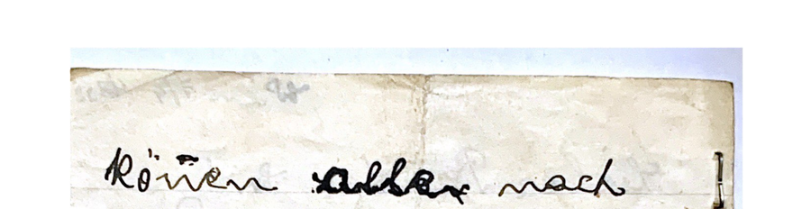

### iv) Word skips and insertions — confidence: high

Jossel's second note ("Lieber Jakob. Ich wünsche Euch eine glückliche Reise und gruße Euch bestens Euer Josel Berman / ich habe mehr kein Zeit zu schreiben") written VERTICALLY along the right margin of the facing page — squeezed in because the page was full (space-maximising, cf. letter 6's rotated sections). Folded sheet with writing in multiple directions; bottom half of p.3 blank with show-through. No skipped words.

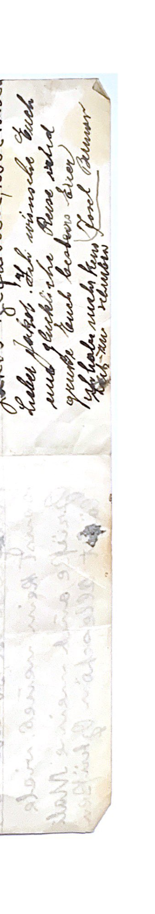

### v) Same spelling, different letter order — confidence: high

"Kousin"/"Kusine" — masculine/feminine grammatical pair, not a transposition. Nothing else.

### vi) Jewish religious code patterns — confidence: high

Hebrew/Yiddish abbreviations open each section ("[Hebrew/Yiddish]" — ב"ה-style), standard Orthodox epistolary convention, used naturally and repeatedly. No holidays, no liturgical quotes, no gezeirah-shava linkage.

### vii) Cryptography and messaging techniques — confidence: high

Line-initials, sentence-initials, line-lasts, sentence-lasts listed — no words formed. "382/67" penciled, ordinary. No book-cipher references; mail references ("Dein l[ieben] Brief", "was Jakob schreibt") are ordinary bookkeeping. Misspellings (Kousin, bekomen, zusamen) are normal phonetics.

### viii) WWI Austrian plain-sight conventions — confidence: high

Open emigration and parcel discussion under 1940 civilian censorship; no euphemism, no forced-cheer formulas.

**Verdict.** no coded message. Ordinary multi-author family letter; the "Liebesgaben Paket" discussion is the concrete logistics fact; one small ink blot is unresolvable but does not affect the reading.

## Letter 24 — 1940-04-10, Josef Bermann (+ Ruchalen) → Ewa Bermann (1 sheet)

[Drive link (private)](https://drive.google.com/file/d/11Xol-2ReM9vrqDK9kCyX9YYCrruZCD05/view?usp=drivesdk) — original scan of letter 24

### i) Visible text: plain-sight references — confidence: medium

family news + emigration logistics (examinations, affidavit, mail gaps). No money amounts, no routes, no deportation euphemisms. The multi-author, multi-direction layout is space-maximizing, not steganography.

### ii) Lighter words vs. surrounding text — confidence: high

Ruchalen's ENTIRE contribution (bottom half, vertical columns, top-edge continuation) is in markedly lighter blue-grey ink than Josef's brown — a different pen/ink, authorship-related, consistent across her whole text. Within each author's text the ink is uniform. No selective lightening.

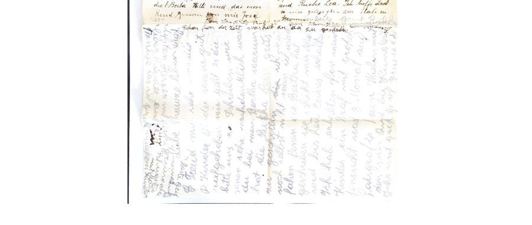

### iii) Subtle markings near words — confidence: medium

One deletion in Ruchalen's text (unresolvable); an irregular dark ink blot with satellite spot at the left edge where Ruchalen's letter begins (accidental spill morphology, obscures nothing critical); no underlines/dots/circles/carets/margin ticks in Josef's text; the fold-note across the central fold is in a smaller darker hand (editorial/explanatory note, per HH). Nothing indicating a marking code.

### iv) Word skips and insertions — confidence: high

Josef: two normal columns (right then left). Ruchalen: vertical columns at 90° plus an upside-down continuation along the top edge; the fold-note squeezed across the central fold; text blurred along fold lines (per HH). No skipped words, no squeezed insertions, no cross-out-and-rewrite beyond the single deletion.

### v) Same spelling, different letter order — confidence: high

Only permutation pair "als"/"las" — both ordinary German words in normal use. Inconsistent spellings (Bertha/Berta, Ruche Lea/Ruchel Lea/Ruchalen, Wielen/Willi, Chawze, Fategrafie, Afidawid, senene) are Ruchalen's phonetic/Yiddish-influenced orthography, not transposition play.

### vi) Jewish religious code patterns — confidence: high

"lustigen Pesach" (timely); Ruchalen's "bis Hundert Jahr" blessing; Hebrew/Yiddish closing fragment — all natural, context-appropriate formulae. No placed/liturgical signaling; no gezeirah-shava pairs; the 10^14 kisses are hyperbole, not gematria.

### vii) Cryptography and messaging techniques — confidence: high

Josef's sentence-initials (WEBBWWBWWDIVBBB), last letters, Ruchalen's initials (L-E-I-b-b), word-initial strings checked; the vertical columns are continuous prose, not word stacks. No nulls, no book-cipher references, no diagonal reads.

### viii) WWI Austrian plain-sight conventions — confidence: high

April 1940, pre-deportation; the letter concerns legal emigration steps. No "emigrated/resettled" euphemisms, no forced-cheer formulas; no censor stamps visible (presumably traveled in an envelope).

**Verdict.** no hidden message. A two-author family letter whose forensic interest is purely material: two inks, multi-directional space-filling layout, one deletion, one accidental ink blot, one fold-note. Content value is as primary-source pointers (20 April 1940 examination appointments; Bertha's missing affidavit; the unidentified "Rojse").

## Letter 47 — 1940-04-17, Josef Bermann → Kinder (1)

[Drive link (private)](https://drive.google.com/file/d/1RprTyNLtUjpyCJtN3EsMoidOoKPnGeuW/view?usp=drivesdk) — original scan of letter 47

### i) Visible text: plain-sight references — confidence: high

"Euern lieben Brief samt Fotographie habe gestern erhalten" — nearly 3 months without mail; "am liebsten mochte ich zu Euch fliehen daß ich es abpusln kann und das Wort O Mamma hören" ("what I would like most is to run away to you, smother it [the 2½-year-old] with kisses, and hear it say 'O Mamma'"); "Es wundert mich sehrr, daß habe von Peretz keine Nachricht noch wan Chawcze [?] Reise hat Mali geschrieben daß man soll ihm die Papiere schicken seit dieser Zeit habe kein einziges Schreiben erhalten" (no news from Peretz; before Chawcze's journey Mali wrote that his papers should be sent to him; since then not a single letter); "Auch danke Euch sehr für die Zuschrift von der Frau Teper"; penciled "1473 1419b" at bottom — dark pencil, different hand (filing numbers). openly emotional; no money sums, ships, affidavits, or euphemisms. Primary-source leads: the enclosed photograph; Frau Teper's message; Mali's letter about Peretz's papers.

### ii) Lighter words vs. surrounding text — confidence: high

Entire letter uniformly faint light ink (pencil or faded pen) — the letter's normal medium; the penciled "1473 1419b" is darker (later hand); scattered small dark foxing/mold dots. No selectively lighter words.

### iii) Subtle markings near words — confidence: high

No underlines, dots-as-marks, ticks, margin marks, circled words, corrections; dark spots are foxing/age spots; blurred blue-green smudge above "1419 b" [uncertain — offset stamp or smudge]. The "1473" is partially overwritten by the letter's last line ("schauet daß er mir schreiben soll" runs over/around it) — confirming the numbers were added after writing.

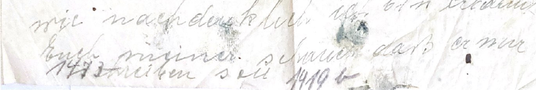

### iv) Word skips and insertions — confidence: high

None; letter ends unsigned (end possibly missing).

### v) Same spelling, different letter order — confidence: high

Zero pairs; "Chawze/Chawcze" natural alternation.

### vi) Jewish religious code patterns — confidence: high

"Got soll helfen", "mit Masel", "O Mamma" — no holidays named, no Hebrew insertions, no gematria ("2 ½ Jahre" = child's age; "3 Monate" without mail).

### vii) Cryptography and messaging techniques — confidence: high

Sentence-initials WIEIUALS, finals NRNTNLRB, paragraph-initials WLE — nothing; "soll" ×8 natural; no book-cipher references.

### viii) WWI Austrian plain-sight conventions — confidence: high

No euphemisms; "die Papiere" for Peretz is the plain emigration-paperwork term; open anxiety, no forced cheer.

**Verdict.** no hidden or coded message. Openly emotional letter about the children's photograph, the toddler, and worry over Peretz; "1473 1419b" is a later filing hand.

## Letter 35 — 1940-05-07, Klara → Ewa Bermann (2)

[Drive link (private)](https://drive.google.com/file/d/1FFaEe-Kb9WdGLSjxuN-sjRq9GXKq8JAU/view?usp=drivesdk) — original scan of letter 35

### i) Visible text: plain-sight references — confidence: medium

"die Cwote unsere, geht sehr gut, wan ich Glück hab, kommen wir bald daran." ("Things are going very well for us in terms of the quota — if I'm lucky, it will be our turn soon." — "Cwote" = dialect spelling of "Quote"); "und habe den zweiten Tag Pesach ein Paket erhalten, nur war es anstat aus Antwerpen von Amsterdam, Absender Abrahams" ("on the second day of Passover I received a parcel, but instead of coming from Antwerp it had come from Amsterdam, sent by Abrahams" [?]) + "ich bin neugerig ob von Kindergarten hat man veranlast zu schicken oder ist es von l. Kalman" ("I'm curious whether the kindergarten arranged to send it or whether it's from dear Kalman") — a parcel arrived from an unexpected city via an unexpected sender; she questions its provenance because routing/sender don't match expectation; "Der Josel schreibt heute auch ein Brief er will unbeding auf erholung fahren, er wart nur Antwort von seine Tante, ich rede ihm nicht drein" ("Josel is also writing today; he is dead set on going away for a rest/recuperation [Erholung], he's just waiting to hear back from his aunt; I'm not going to interfere") — "auf Erholung fahren" is unusual phrasing for a man in Vienna in May 1940; "Josel" is Josef Bermann (Moshe, 2026-10-16; the family diminutive of Josef, cf. "Jossel Bermann" in the 1938 Lehmann); "die Rosa Hirsch ist hier, aber sie wird noch einmahl zu ihre Kusine fahren" (Roza Hirsch in Vienna, visiting her cousin); "Dir die gewünschte Adresse Max Feld Haifa POB 1073 Jagur" ("Here is the address you asked for: Max Feld, Haifa P.O. Box 1073, Yagur" — a Palestine contact; primary-source lead); "der Herr Fink ist [deletion] gekommen er lässt Dich schön grüßen auch die Frau Feld" (one word struck through before "gekommen"); "wan Ihr wilt so gut sein bitte schreibt was man brauchen kan, was Dringends man mus mitnemen" ("please write what things are needed, what urgent things one must take with one" — emigration packing question, with "bitte schreibt" inserted above the line); "zwar ist lachhaft wan ich anfrag, den ich kom noch nicht in betracht, zu fahren". the quota sentence, the Max Feld/Yagur address, and the Amsterdam-parcel provenance question are the primary-source items. The "Erholung" trip is the letter's oddest phrasing — flagged as unusual, not as code (no recoverable second meaning). The Amsterdam-instead-of-Antwerp parcel is logistically explicable (three days before the May 10, 1940 invasion of the Low Countries; parcel rerouting is plausible).

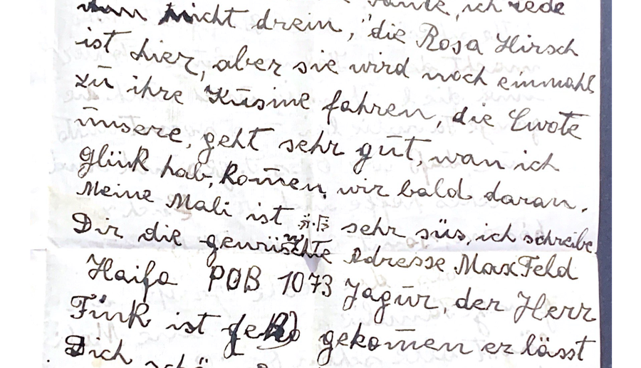

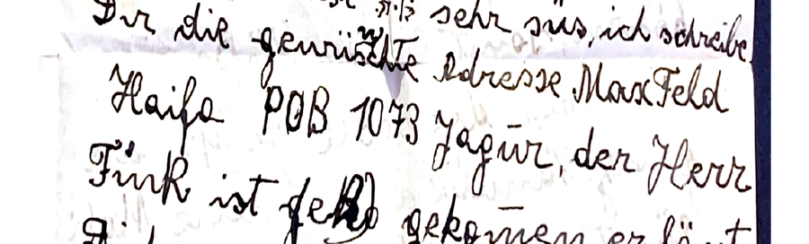

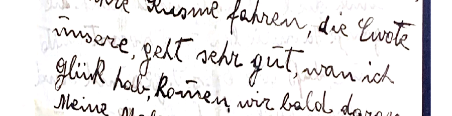

### ii) Lighter words vs. surrounding text — confidence: medium

Uniform brown-black ink; darker rewrites ("Kusine", "nicht", "anstat", "Dich") are emphasis/retracing; the penciled corner number is lighter but a different hand/medium.

### iii) Subtle markings near words — confidence: medium

insertions are for correctness/emphasis; deletions are ordinary false starts; the corner number is most plausibly archival.

### iv) Word skips and insertions — confidence: high

The two above-line insertions; otherwise normal full-page layout; letter ends "sonst kein neues, küße" with no signature (HH footnote: unsigned — the end may be missing).

### v) Same spelling, different letter order — confidence: high

"Paket" vs "Pakerl" (diminutive, dialect — grammatical); "Cwote" for "Quote" (dialect spelling, single instance). No letter-permutation pairs.

### vi) Jewish religious code patterns — confidence: medium

"zu Pesach ein Paket" (Passover parcel — calendrical; Passover 1940 began the evening of April 23, so "second day of Passover" ≈ April 24-25, consistent with a May 7 letter); an illegible Hebrew word after "Meine Mali ist". No quotes, no holiday double meanings.

### vii) Cryptography and messaging techniques — confidence: high

22 sentence-initials ("G d W d u i D e e i d a d w M i d e w z a s") form no words; paragraph initials (G, D) nothing; no book-cipher references; capitals follow German norms; no n-th-letter pattern.

### viii) WWI Austrian plain-sight conventions — confidence: medium

May 1940 Vienna, emigration context; "Quote", "Paket", "fahren" all literal. No deportation euphemisms; no forced phrases.

**Verdict.** no coded message. Quota optimism, the questioned Amsterdam parcel, the odd "Erholung" trip for Josef ("Josel"), two emphasized insertions.

> **Private annotation.** 49.pdf is a verified duplicate of 35.pdf (near-identical scans); findings were made on 35.pdf.

## Letter 25 — ~1940-06+ (undated), Josef Bermann → Ewa Bermann (2)

[Drive link (private)](https://drive.google.com/file/d/1KSlQOL0u1IO1h8Wz8t9Dih_fHGD8aD29/view?usp=drivesdk) — original scan of letter 25

### i) Visible text: plain-sight references — confidence: medium

"Teile Euch mit daß bin auf Arbeit in Oberdonau es geht mir Gott sei dank sehr gut habe genug zu essen verdiene auch für ganzes Auskommen" ("I inform you that I am on work-duty in Upper Danube; I am doing very well, thank God, have enough to eat, and earn my full livelihood" — HH footnote: Reichsgau Upper Danube) — a work claim tied to a named place; whether the labor deployment was voluntary or forced cannot be determined from this letter; "habe schon 2 mal geschrieben habe" / "seit den 1ten Juni" / "schon fast 3 Monate kein Schreiben" (written twice since 1 June; ~3 months with no letter — mail-gap accounting); "von der liebe Mali habe seitden du weggefahren bist kein einziges Schreiben" (no letter from Mali since Ewa left — establishing this Mali is NOT in Vienna with Josef); "Hast Du liebe Eva für meine Ausreise was unternommen" (direct emigration ask); "zur Mali ich soll hinkommen besteht vorlaüfig für keine Moglichkeit vielleicht wird sich spater ergeben ob ich zur Mali werde fahren konnen" ("as for joining Mali, there is for now no possibility" — plainly stated, no euphemism); "Bitte wanes Dir moglich ist per Flugpost zu schreiben damit ich soll nicht so lange warten"; penciled "1820–2622" (upper-left, p.1) and printed "146" (bottom-right edge, p.2 — typeset, likely a pre-printed stationery sheet number). intelligence value as a dated labor-posting record (Oberdonau, post-1-June, pre-autumn 1940) and mail-gap record. No money amounts, no routes beyond the airmail request, no odd repetitions, no non sequiturs. The cheerful formula is conventional, not a forced-deception signal on textual evidence alone.

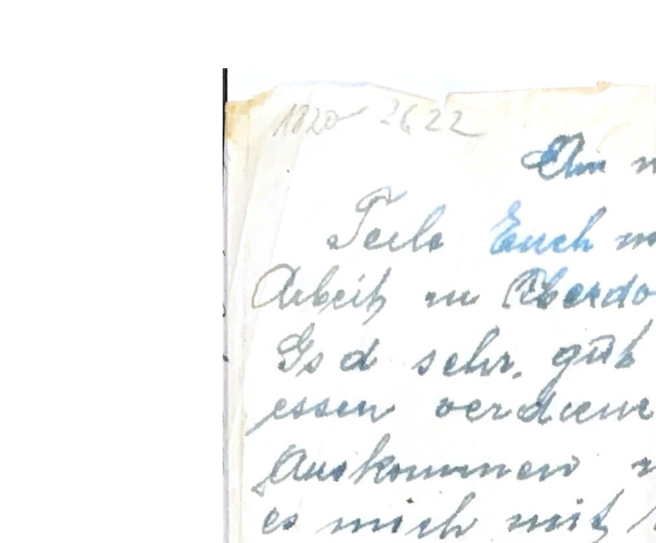

### ii) Lighter words vs. surrounding text — confidence: medium

Ink cycles darker-blue to faded grey-blue: salutation "An meine Lieben" and "Euch" in "Teile Euch mit" distinctly darker; later "1ten Juni" and "keine" also darker; each darker passage followed by gradual fading; p.2 first lines brownish-dark, fading below — consistent with a fountain pen freshly re-inked/re-dipped at intervals, not word-selective emphasis; the darker words ("Euch", "1ten Juni", "keine") form no message.

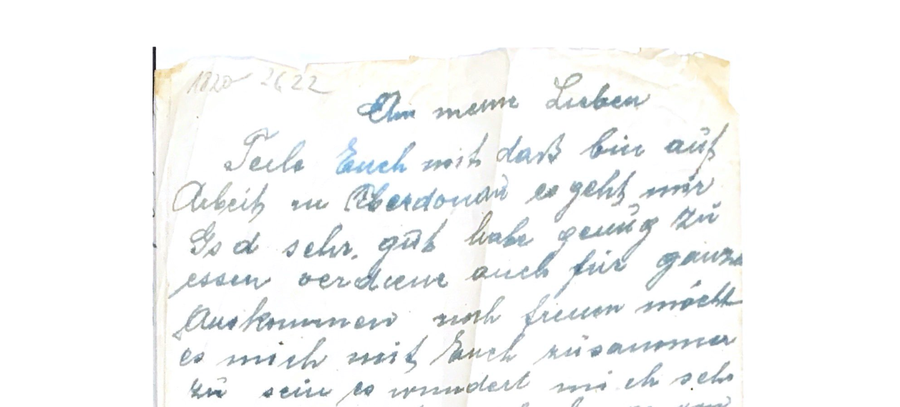

### iii) Subtle markings near words — confidence: medium

Prominent black ink blot mid-p.1 (over "kein einziges Schreiben") with satellite spatter + smaller dark spots (on "2 mal") + scattered specks on p.2 — accidental-spill morphology; no underlines, circles, dots, ticks, corrections. The printed "146" and penciled "1820–2622" as noted in (i).

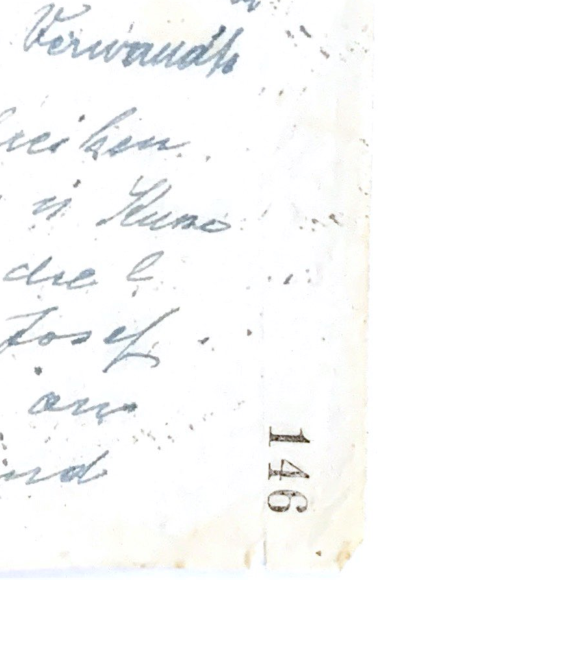

### iv) Word skips and insertions — confidence: high

Regular lines; no insertions, cross-outs, margin cramming, or orientation changes.

### v) Same spelling, different letter order — confidence: high

No permutation pairs; "vorlaüfig" (vorläufig), "Moglichkeit", "Flugpost" — consistent phonetic/dialectal forms.

### vi) Jewish religious code patterns — confidence: high

"Gott sei Dank" — standard idiom, not a placed quote. No Hebrew, no holidays, no blessings.

### vii) Cryptography and messaging techniques — confidence: high

Sentence-initials AHBHWWBW, finals INNNTTNE, word-initial strings — no words/names; message-about-message limited to the two earlier letters and the mail gap (ordinary). No systematic misspellings.

### viii) WWI Austrian plain-sight conventions — confidence: high

Predates the deportation period and the camp Briefaktion system (1942–44); the cheerful formula matches ordinary family reassurance; "auf Arbeit in Oberdonau" stated openly.

**Verdict.** no hidden message. A plain reassurance-and-logistics letter; its research value is the dated Oberdonau labor posting and the mail-gap record (two letters since 1 June, ~3 months without word). The worker disambiguated two distinct Malis here — Chaja Willner's daughter Mali in Vienna (letter 23) vs Josef and Ewa's daughter Mali, already abroad (letter 25).

> **Private annotation.** Identity note: the findings disambiguate two Malis — Chaja Willner's daughter Mali in Vienna (letter 23) vs Josef and Ewa's daughter Mali, already abroad (letter 25). Do not conflate.

## Letter 1 — 1940-07-10 (?), Chaja Willner → Ewa Bermann (2 (card))

[Drive link (private)](https://drive.google.com/file/d/14_kKzirvB1SfUL9HtiRuoRHIgjrrl1Cu/view?usp=drivesdk) — original scan of letter 1

### i) Visible text: plain-sight references — confidence: medium

"der Josef ferdient, er arbeitet in Steiermarkt" ("Josef is earning, he is working in Styria" — HH footnote: author writes 'Steiermarkt' for 'Steiermark'); "die Taube Etel, kan jezt auf Rumänische Kwote fahren, nur mus der Birger schreiben das er Birgt für sie, so wird sie alein fahren." ("Taube Etel can now travel on the Romanian quota, only the sponsor [Bürge] must write that he vouches [bürgt] for her, then she will travel alone." — concrete, primary-source-producing: quota application + a named guarantor letter in the USA); "bitte nochmals gleich Antwort"; "die Kinder sollen zu schreiben bitte" twice; "sonst werden sie auch von mir nie hören" ("or else they will never hear from me either" — emotional pressure, not code); family roll call "die Familie Kalman Fam[ilie] Joel Fam[ilie] Erna [?] Mann [?] Edit [?] und Onkel, Sabina Fam[ilie] Regina Fam[ilie]"; "Lily Hönig [?] auch Minne [?]" (HH footnotes: 'Erna Mann' likeliest reading of an unclear entry; 'Edit' partially obscured by a blot; 'Lily Hönig' also appears in letter 51; 'Minne' could read 'Annie'); penciled "– 14 nov [?]" along the lower edge of the address side (possibly the recipient's reply-date annotation). Dating discrepancy: hand writes "Wien den 10/8 40" (translation header: 10 August 1940) but the CSV dates it 1940-07-10, HH's footnote records a Vienna postmark "1 7.40" (July 1940) and a New York receiving postmark "JUL 20 1940" — a card written 10 August cannot arrive in New York on 20 July; likeliest: the month digit is a "7" misread as "8" (or vice versa), i.e. 10 July 1940. the Romanian-quota/sponsor passage is the one concrete fact with primary-source potential. No "emigrated/resettled" euphemisms; emigration discussed openly; no money amounts; no "write that…" instructions.

### ii) Lighter words vs. surrounding text — confidence: medium

Two distinct ink densities: a long central block in markedly DARKER, heavier ink than the surrounding lighter brown ink — from "auch Du mein Liebe kanst an Josef öfterer schreiben den er ganz besorgt ist, von dein stielschweigen, schreib ein Flugpost Brief die Kinder sollen zu schreiben bitte auch Jakob Familie sollen zu schreiben, der Josef ferdient, er arbeitet in Steiermarkt, die Taube Etel, kan jezt auf Rumänische Kwote fahren, nur mus der Birger schreiben das er Birgt für sie, so wird sie alein fahren." Most plausibly two sittings with two pens (or a re-inked pen); the dark block happens to contain the emigration-logistics content. Not a code channel. The heavy deletion of "einige" before "Worten" is in the same dark ink.

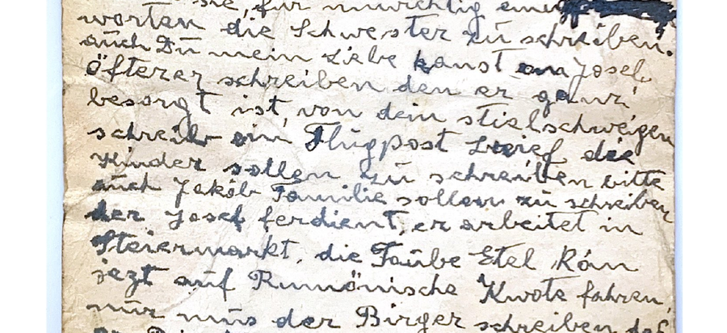

### iii) Subtle markings near words — confidence: high

The word "einige" before "Worten die Schwester zu schreiben" heavily scribbled out in dark ink; on the address side, "Antwort an Josef" written over with a heavy underline/emphasis ("an Josef" in thick strokes); a wavy vertical line down the left edge of the message side is a paper crease/tear artifact, not a mark; postal marks: round "Wehrmacht High Command" stamp (HH footnote, partially obscuring sender address), "Deutsches Reich" stamp, Vienna and New York postmarks, blue "MIT LUFTPOST / PAR AVION" sticker — all postal, not authorial.

### iv) Word skips and insertions — confidence: high

Densely filled card; message continues onto the address side (left column) and finishes along the left edge ("Paar Worten schreiben Euere Chaja") — space-maximising, standard. No squeezed insertions above/below lines; no crossed-out-and-rewritten words beyond the "einige" deletion.

### v) Same spelling, different letter order — confidence: high

No exact anagram pairs (mechanical exact-grouping + Levenshtein ≤2, hand-filtered). Near-miss pairs are distinct people/words (Joel/Josef, Etel/Joel, Mina/Minne, Maly/Mann) or grammatical variants (schon/schön). "Minne" vs "Mina" vs "Annie *[uncertain]*" is a transcription-uncertainty cluster, not a transposition.

### vi) Jewish religious code patterns — confidence: high

None — no Hebrew insertions, no holiday references, no liturgical quotes (contrast letters 4, 6, 7 which use ב"ה-style abbreviations).

### vii) Cryptography and messaging techniques — confidence: high

Line-initials (WLDSPAWSFN), sentence-initials (WLDSAUASMEUALMSPAWSFN), line-lasts (NRNNARIEAV), sentence-lasts — no words formed. Numbers ("10/8 40", "24/6 40", "3 Monat", "94 Sheriff Str", "67/14", "14 nov [?]") all ordinary dates/addresses. Misspellings (ferdient, Kwote, Birger/Birgt, fergessen, stielschweigen, Steiermarkt) are systematic phonetic/Yiddish-influenced errors of a semi-literate writer — not deliberate.

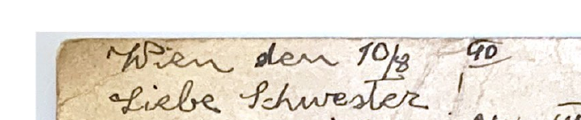

### viii) WWI Austrian plain-sight conventions — confidence: medium

Predates the deportation period; open emigration vocabulary ("in U.S.A.", "Rumänische Kwote fahren") rather than euphemism. The repeated "X ferdient" formula also appears in letters 2, 3, 5 — a plain-sight reassurance convention ("we are getting by / not a burden"), with no evidence of a prearranged second meaning.

**Verdict.** no coded message. One concrete emigration-logistics fact (Romanian quota + sponsor letter for Taube Etel, summer 1940); one physical curiosity (two ink densities suggesting two sittings). Dating internally inconsistent.

> **Private annotation.** Data quality: the hand date reads "10/8 40" but the July 1940 postmarks (and the CSV) point to 10 July 1940 — treat the August reading as a likely misread.

## Letter 17 — 1940-07-18, Chaja Willner → Jakob Willner (2 (card))

[Drive link (private)](https://drive.google.com/file/d/1SkcIprabv1BFQtZWtaxqDEXa32E20gAc/view?usp=drivesdk) — original scan of letter 17

### i) Visible text: plain-sight references — confidence: low

"der Salomon hat mir die Adresse geschickt von Dir l. Bruder, er hat ein Brief von Dir erhalten" (addresses relayed through a third party; describes another person's message); "die l. Ewa hat afor die Ostern geschrieben das zu Ostern nimt sie die Kinder zu sich" ("dear Ewa wrote before Easter that at Easter she will take the children to her") — a specific dated plan (Easter = 24 Mar 1940), reported secondhand, stated as still unfulfilled ("und wir warten noch auf den Brief"); "ich hab den Josef fon dem Brief nicht gesagt" ("I didn't tell Josef about that letter") — deliberate withholding of information from Josef, motive unstated; "der Josef ferdient, er ist in [?] noch dort" ("Josef is earning; he is still in the same place" — the location word illegible, overwritten by the postmark area *[uncertain]*); "ich weiß nicht wan ich daran kom nach U.S.A."; "der Schwager kan leider alein nicht schreiben weil er Finger weh hat". the Easter plan + the withheld letter + the blacked-out passage form the densest anomaly cluster; read at face value still coherent (a failed family-reunion plan, sparing Josef bad news, a second thought blacked out). No decodable second message.

### ii) Lighter words vs. surrounding text — confidence: medium

Penciled "1268 [?]–1345" along the lower edge (faint; "1268" per transcript, crop-confirmed); stamped "1517" in a box below "Absender:" (light blue-grey office stamp). No lighter message words; both are filing/office numbers, not authorial.

### iii) Subtle markings near words — confidence: low

A cluster of words in markedly HEAVIER ink than surrounding text, all inside the Easter sentence: "afor" (very heavy), "nimt" (heavy), "zu" (in "die Kinder zu", heavy), "das" (in "das zu Ostern", heavier), "zum" (in "weder zum Josef", heavier) — confirmed in crop, confined to one sentence; consistent with either deliberate emphasis/marking or a freshly-dipped pen pressed harder on verbs; the marked words read "afor… nimt… zu… (sich)… zum…" — no clear hidden message. Separately: a blot on the "D" of "Dir" ("Brief von Dir erhalten"); a dark blot over "Schwägerin" in the salutation; small ink speckles below "Brief nicht gesagt" — nib blobs. Three lines blacked out in heavy black ink immediately after "soll die Ewa und Kinder mir schreiben" (*HH footnote 2*: "Several words blotted out with black ink over three lines"; crop confirms two broad bars) — content unrecoverable; cannot determine author vs. censor from the image alone (the ink matches the writing pen).

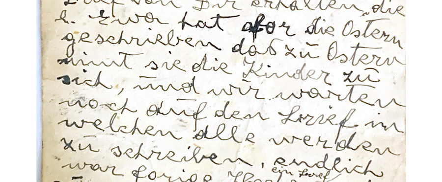

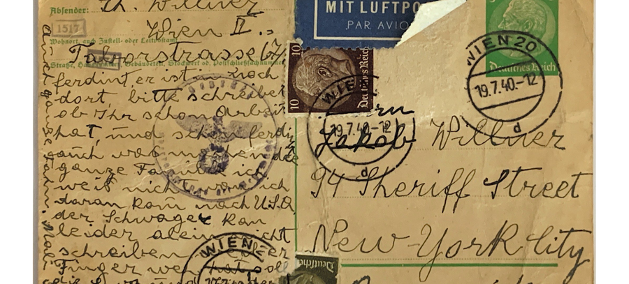

### iv) Word skips and insertions — confidence: medium

"ein Brief" squeezed in TINY above the line between "forige Woche" and "weder" ("endlich war forige Woche [ein Brief] weder zum Josef zugeschrieben noch von Euch ein Wort"); text continues along the left-hand and top edges, rotated 90° ("auch ganze Fam[ilie]. Mali Küßt [unclear] auch alle Eure Chaja") — postcard space economy. The blackout sits between "soll die Ewa und Kinder mir schreiben" and "sonst [grüße] küße Euch vielmal".

### v) Same spelling, different letter order — confidence: high

No pairs; "Mali" here vs "Maly" in letters 18/19 is i/y alternation; "afor" is dialectal "vor" with prosthetic 'a', not a transposition.

### vi) Jewish religious code patterns — confidence: medium

"Ostern" (Easter) used as the date anchor of Ewa's plan — a Christian holiday used by a Jewish writer as a calendar reference (common in Austrian usage; the family also uses "Jom Kipor" in letter 18). No Hebrew phrases, no liturgical quotes. Possible double-meaning ("take the children to herself" = bring them to America?) is speculation — the sentence reads as a real, failed plan.

### vii) Cryptography and messaging techniques — confidence: medium

Sentence-initials ([pE]d]SAd[M[S[] — transcript-markup noise, no pattern), word-initials (no pattern), last-letters (no pattern); numbers "1517" (office stamp), "1268–1345" (pencil filing number); postmark "WIEN 20 | 19.7.40.-12 | d" consistent with the 18/7/40 letter date. No diagonal reads, no capitalization patterns.

### viii) WWI Austrian plain-sight conventions — confidence: medium

Withholding a letter's existence from Josef, blacking out three lines, and relaying addresses via Salomon are all consistent with ordinary caution under censorship rather than a formal cipher (no known WWII civilian-letter cipher uses heavy pen pressure as its carrier). The Wehrmacht "Checked" stamp (*HH footnote 5*) confirms the card went through military censorship — motive for caution, not evidence of code.

**Verdict.** no decodable code, but the densest anomaly cluster of the mid-1940 cards: heavy-ink words inside the Easter-plan sentence, a deliberately withheld letter, and three blacked-out lines. Best read as a worried family card with self-censorship, not a cipher.

## Letter 23 — 1940-08-13, Chaja Willner → Ewa Bermann (2 (card))

[Drive link (private)](https://drive.google.com/file/d/1X9hVUR9rtz_o4lqqHq22nTLQRsyC4xtR/view?usp=drivesdk) — original scan of letter 23

### i) Visible text: plain-sight references — confidence: medium

"Deine l. Karte von 1/7 und Brief von 8/7 habe den 9/8 erhalten" (five-week wartime transit); "wegen die l. Mali ihre Papiere hat glaub ich, daß schon, 3 Monat daß der Josef hat zum A. Konsul geschrieben, er soll sie überschiken" (HH footnote: phrasing ambiguous — either way, a dated contact with the US consul ~May 1940 about Mali's papers — primary-source pointer: consulate correspondence/visa file); "bitte schreibe ob Du ferdienst"; "der Josef hat mir gegeben ein Brief ich soll ihm Dir schicken" (Josef's letter physically carried inside Chaja's mailing) and "habe grad Deine Schwägerin getrofen und sie wolte apaar Worten zu Ruchale schreiben, habe ihr gegeben" (documented chain of custody with the sister-in-law adding words for Ruchale) — descriptions of other messages, mundane relay logistics; "fon mir wie Ihr schon weist hätte schon zu Untersuchung nur müsste ich die Schiffskarten haben wan es wirklich möglich ist bitte sehr über Lisabonn mir zu schiken" (visa medical examination; "Schiffskarten" via Lisbon — the known emigration route; no prices, dates, ship names); "habe Euch ein Rekomandierten Brief geschrieben habt Ihr den erhalten" (registered letter — mail-reliability checking); "meine Mali sekiert mich sehr oft wan werden wir schon nach U.S.A. fahren" (note: this is Chaja's Mali in Vienna, distinct from Josef and Ewa's daughter Mali — see letter 25); "fon Schwager ist sehr oft Post. es geht ihm gut." (an unidentified brother-in-law in regular contact); "bittesollen die Kinder auch zu schreiben zu Dein Brief" (mundane relay instruction); penciled "2511-1399a [?]" along the lower edge (faint, origin unknown); purple boxed stamps "1517" and a boxed stamp reading "1932" [uncertain — HH suggests "1532" [?]]; round censor stamp with swastika, partially legible "…mando der … Geprüft" (HH footnote: "Checked [?] | Wehrmacht High Command"); "MIT LUFTPOST / PAR AVION" sticker; Deutsches Reich 6pf stamp. dense with emigration-logistics facts that could produce primary sources (consulate file re Mali's papers ~May 1940; Chaja's pending examination; Lisbon-route ship tickets; the registered letter). No money amounts, no coded euphemisms, no odd repetitions. The "Untersuchung"/"Schiffskarten"/"Lisabonn" vocabulary is the plain language of 1940 Vienna emigration efforts — used openly in a demonstrably censored postcard.

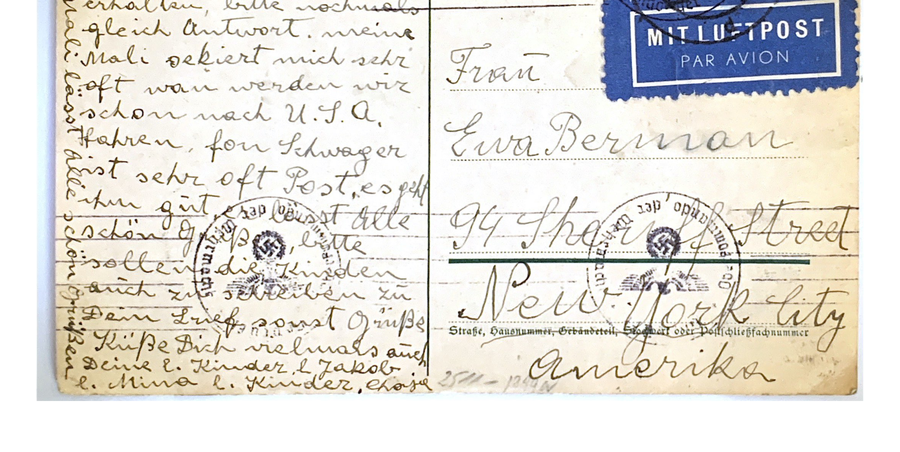

### ii) Lighter words vs. surrounding text — confidence: high

Uniform brownish ink; the date's "40" is underlined (see iii). No selectively lighter words.

### iii) Subtle markings near words — confidence: medium

The "40" in "Wien den 13/8 40" is underlined; the digit "3" in "3 Monat" is written larger and darker than surrounding text — emphasis of the date and the waiting time, consistent with the letter's anxious theme (three months without Mali's papers), not a code. A dark smudge/stamp remnant at the top-right corner of the message side (likely stamp/ink transfer). The small stroke over "Schwägerin" is the ä umlaut.

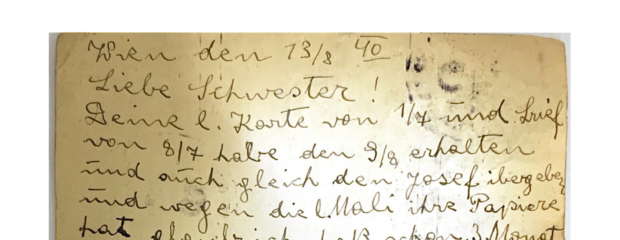

### iv) Word skips and insertions — confidence: high

Message side filled top to bottom; letter continues onto the address side's left half and concludes with a vertical line "auch Mali lässt Alle schön grüßen" along the left edge — normal postcard practice. No squeezed insertions, cross-outs, skipped or rewritten words.

### v) Same spelling, different letter order — confidence: high

No true pairs (scripted strict permutation scan). Inconsistent spellings ("Lisabonn", "ferdienst", "Rekomandierten", "getrofen") are Chaja's consistent phonetic/dialectal spelling, also seen across the corpus.

### vi) Jewish religious code patterns — confidence: high

None present.

### vii) Cryptography and messaging techniques — confidence: high

Message-side line-initials (26 lines: W-L-D-v-u-u-h-d-g-b-v-w-u-s-g-s-g-W-h-w-w-z-i-e-ü-h), sentence-initials (WDDMSAFFEECS), sentence-finals (RTTUSANTTRIA), per-sentence word-initial strings — no initials sequence spells a word or name; last letters likewise random. Misspellings dialectal, not systematic.

### viii) WWI Austrian plain-sight conventions — confidence: high

The card demonstrably passed military censorship (Wehrmacht "Geprüft" stamp), August 1940, pre-deportation; the family is actively pursuing legal emigration (consul, medical exam, Lisbon tickets). None of the known deportation euphemisms appear, correctly for the date. The letter's "code-like" density is fully explained by emigration logistics under censorship.

**Verdict.** no hidden message. A plain, censorship-passed August 1940 emigration-logistics postcard whose value is as a primary-source pointer. The fact that this vocabulary passed Wehrmacht censorship is itself evidence against a hidden layer.

## Letter 14 — 1940-08-28, Klara → Ewa Bermann (1)

[Drive link (private)](https://drive.google.com/file/d/1K5-6i9_tlWXtiNVnCaNfI1ZzwI5TlKra/view?usp=drivesdk) — original scan of letter 14

### i) Visible text: plain-sight references — confidence: low

"habe schon zu Untersuchung man bekommt leider jetzt von der Isr. K. keine Schiffskarten überhaupt gar nichts." ("I have already [been summoned] for the examination; unfortunately one gets no ship tickets at all from the IKG now." — *HH footnote 2*: grammar garbled; the "examination" is an emigration-procedure step); "zu Etlen habe geschreiben und keine Antwort sie hat amir nie geantwortet." ("I wrote to Etlen and got no answer; she never answered me." — "Etlen" sits at the crumpled right edge; *HH footnote 4* notes a possibly obscured letter after the 'n'; crop confirms "Etlen" with the edge crumple immediately after — most plausibly "Etel" (Ettel = Taube Ettel Biller, the writer's sister), but the 'n' is clearly written, so *[uncertain]*); "zu Schlome habe geschrieben [deletion] er gibt mir immer auf 2 Karten Antwort" ("he always answers one of every two cards"); "der Josef ferdient es geht im ganz gut" (the "X is earning" formula); penciled "1398a" upper-left. emigration-logistics facts primary-source-rich (IKG emigration files). No deportation euphemisms (too early); no jargon code. The 1-in-2 reply ratio and unanswered Etlen are plain correspondence facts.

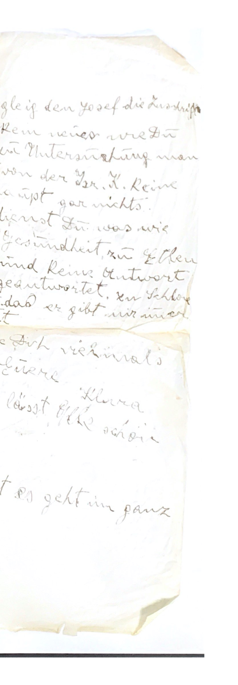

### ii) Lighter words vs. surrounding text — confidence: medium

"1398a" (upper left) and the date line "Wien den 28/8 40" in noticeably lighter, pencil-like script vs. the dark-ink body; the "40" followed by a dark ink blob (heavy period). "1398a" is almost certainly a later archival filing number, not the author's hand. Nothing suggesting deliberate lightening of message words.

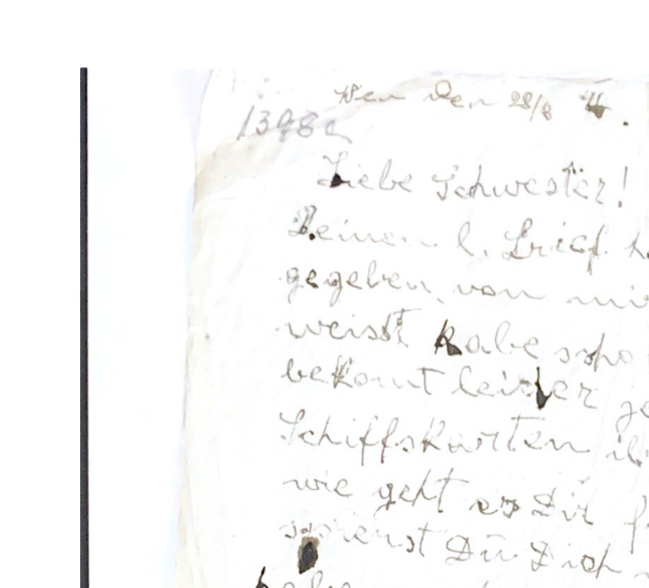

### iii) Subtle markings near words — confidence: low

Dark ink blots on/near: "habe" (line 4), "leider" (line 5), left margin before "habe geschrieben" (line 8), start of "grüßen"; a blot on the "L" of "Liebe Schwester!"; a small superscript mark above "der" in the PS [uncertain — stray stroke]. Blots look like pen blobs from a scratchy nib, not placed marks.

### iv) Word skips and insertions — confidence: medium

Page written in TWO COLUMNS (left first, then right); the transcript reconstructs reading order. One [deletion] at "zu Schlome habe geschrieben" — content unrecoverable (blotted). Two-column layout is paper economy, not code layout.

### v) Same spelling, different letter order — confidence: high

Only hit: "geschreiben" vs "geschrieben" ("zu Etlen habe geschreiben" vs "zu Schlome habe geschrieben") — true anagrams (transposed 'e'/'i'), but the first is Klara's misspelling of the correct form: natural error, not code. No name/place transpositions.

### vi) Jewish religious code patterns — confidence: high

None present.

### vii) Cryptography and messaging techniques — confidence: medium

Sentence-initials ([p]Dw]z]Psd — transcript-markup noise, no pattern), word-initials (no pattern); number "1398a" = filing number; date reads clearly "28/8" on the scan — resolving the CSV's "June or Aug 28, 1940" toward 28 August. No "as I wrote on page X" references; misspellings ("geschreiben", "ferdienst", "amir") consistent dialectal writing.

### viii) WWI Austrian plain-sight conventions — confidence: medium

"Untersuchung" + IKG ship tickets + "Josef is earning" are straightforward emigration-era plain text, Aug 1940 — before deportations, so the "emigrated"=deported euphemism family does not apply. Unanswered letters and the 1:2 reply ratio are ordinary wartime-mail facts.

**Verdict.** no coded message. A plain emigration-logistics letter; its facts (IKG ship-ticket stoppage, Untersuchung summons, Josef employed) are primary-source leads. Minor anomalies: pencil filing number "1398a", the "Etlen"[?] name at the crumpled edge, one blotted deletion.

## Letter 37 — 1940-09-18, (Chaja Willner?) fragment (1)

[Drive link (private)](https://drive.google.com/file/d/1JgQEsc51ae88FuFxM3XAEnQPeyu4iejS/view?usp=drivesdk) — original scan of letter 37

### i) Visible text: plain-sight references — confidence: medium

"ich habe von Am[erikanischem] K[onsul] ein 14 Bogen erhalten" (14 forms from the American Consul); "aber momentahn weist men noch nicht, ob Staatenlose werden fahren können, aber es heisst, Sontag am 22/9 wird men wissen ob wir werden fahren können" (whether stateless persons will be able to travel; decision expected Sunday 22 Sept 1940 — 22 September 1940 was indeed a Sunday, supporting the 1940 dating); "dan werden sie soviel machen daß sie werden Telegrafieren nach U.S.A. wan ich will, um Schiffskarten" (the IKG would telegraph the USA for ship tickets); "ist mein Pass abgelaufen, auch Unbeden [?]" (passport expired, plus an illegible word — *HH footnote 1*: "Unbeden" makes no clear sense; hypothesis [low confidence]: truncated "Unbedenklichkeitsbescheinigung", the tax-clearance certificate required for emigration); "wan 20 herein gehn komen 2 durch" (only 2 of 20 pass the consulate interview); "nur 14 Bögen" ("only 14 forms" — "nur" underlined); "Eueren Eueren l. Brief von 23/8 40" ("Eueren" doubled — a slip; "40" underlined); letter ends mid-thought ("und ich will doch ein Glück haben.") with no signature — the end is missing. No money amounts; no deportation euphemisms (Sept 1940). the stateless-persons decision date, the telegraph-for-tickets chain, and the 2-of-20 statistic are the primary-source facts. The "Unbeden" word is an unresolved reading, not a code.

### ii) Lighter words vs. surrounding text — confidence: high

Uniform brown ink throughout; no pressure or medium changes.

### iii) Subtle markings near words — confidence: medium

The "40" in "Wien den 18/9 40" written darker, over another digit — a corrected year; "40" underlined in "Euern l. Brief von 23/8 40"; "nur" underlined in "nur 14 Bögen"; "müst" struck through and replaced ("müst [struck] ich den Bogen ausfülen und einschicken"); "U.S.A." in Latin capitals mid-text; "Am. K."/"Am. Kons." abbreviations. The emphasis/correction marks on dates and quantities are consistent with the letter's anxious focus on paperwork, not signaling.

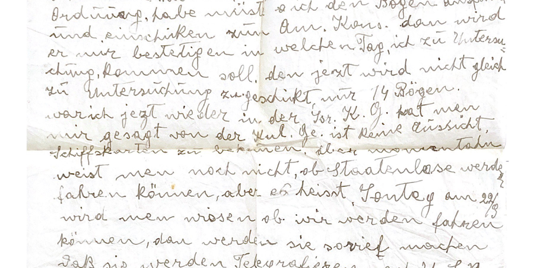

### iv) Word skips and insertions — confidence: medium

Single page ending abruptly mid-thought; no margin cramming, no insertions; jumbled word order in places ("jetzt, meine lieben wegen mein fahren nach U.S.A. ist so") reflects unedited drafting. The fragmentary ending is a preservation gap, not a layout signal.

### v) Same spelling, different letter order — confidence: high

"Bogen"/"Bögen" (singular/plural — grammatical); "Isr. K. G."/"Kul. ge."/"K. G." (abbreviation variants of Kultusgemeinde); "Untersuchung"/"Untersuchin" (line-break hyphenation). No letter-permutation pairs.

### vi) Jewish religious code patterns — confidence: medium

"Sontag am 22/9" calendrically consistent (Sunday); "und ich will doch ein Glück haben" plain. No Hebrew, no quotes, no holiday double meanings.

### vii) Cryptography and messaging techniques — confidence: high

23 sentence-initials ("E u j i u u d d w h a a d j a u i d i j w n u") — no words/names. Numbers (14, 22/9, 20, 2) are literal paperwork quantities.

### viii) WWI Austrian plain-sight conventions — confidence: medium

Straightforward emigration-paperwork letter; "Schiffskarten", "Untersuchung", "Telegrafieren nach U.S.A." all literal. No euphemisms, no forced phrases, no jargon with hidden meanings.

**Verdict.** no coded message. A plain, anxious, unfinished emigration-status letter. Primary-source value: the 14 consul forms, the 22 Sept 1940 stateless-persons decision date, the IKG-telegraph arrangement, and the 2-of-20 interview statistic.

## Letter 18 — 1940-10-07, Chaja Willner → Jakob Willner (2 (card))

[Drive link (private)](https://drive.google.com/file/d/1pLet-zttxwIM_I-aTHGZfN-0q55lSHP6/view?usp=drivesdk) — original scan of letter 18

### i) Visible text: plain-sight references — confidence: medium

"die Hias hat mir gesagt von die 50 Dollar was Ihr geschickt hat ich hoffe das sie werden mir den Rest Betrag zu geben zu Schiffskarten" ("HIAS told me about the 50 dollars you sent; I hope they will give me the remaining sum for ship tickets") — money amount + HIAS + ship tickets in one sentence; "nur leider vorleifig kann man nicht fahren auch der Am. K. gibt kein Visum" ("unfortunately one can't travel for the time being, and the American consul isn't issuing any visas either" — dated 7 Oct 1940: a factual claim about US visa issuance, primary-source-checkable); "fileicht wird der Schwager zu Jom Kipor uns besuchen" (Yom Kippur 1940 fell on 12 Oct, 5 days after the letter date: natural timing); "Gebe der l. Gott die Maly soll a Rfua schlajme bkerew haben" ("May God grant Maly a refuah shleimah bekarov [a speedy complete recovery]"); PS along the left edge: "Frau Stern habe vorige Woche getrofen sie hat Post fon H. Stern und Kinder [?] schreiben ihr sehr gute Briefe" ("I met Mrs. Stern last week; she gets mail from Mr. Stern and the children write her very good letters" — a description of other people's correspondence included without clear purpose: the classic "descriptions of other messages" flag, but reads as plain emigrant gossip). no jargon code; the Frau Stern PS is gossip-shaped, not signal-shaped.

### ii) Lighter words vs. surrounding text — confidence: medium

Faint pencil "184–1682" [uncertain: first digit could be 1 or 2] at the bottom-right of the address side (crop-confirmed); blue office stamps "282" and "23b [?]" right of the sender address. No lighter message words; filing/office numbers.

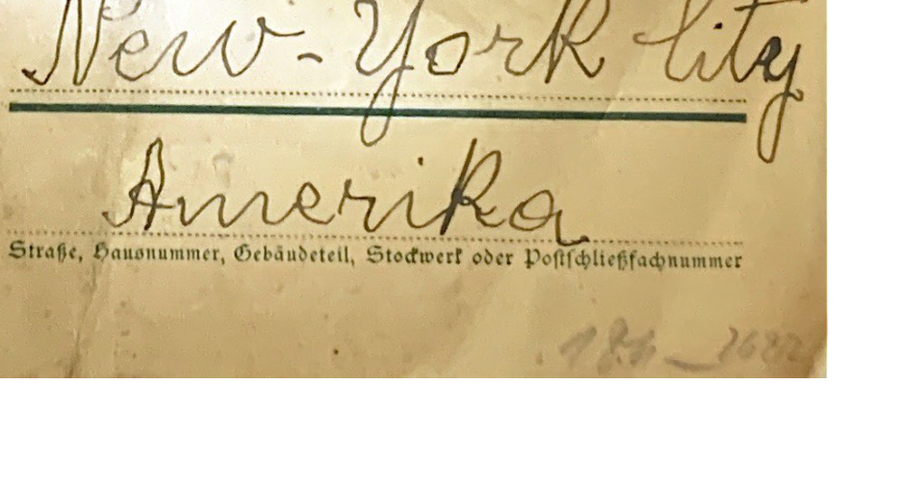

### iii) Subtle markings near words — confidence: low

A heavy black INK BLOT runs through the middle of "Rfua" ("die Maly soll a Rfua schlajme" — the "fu" obscured, the blot drips below the line toward "bkerew"); a smaller blot after "schlaj" in "schlajme"; blots on "vielmals", on the "t" of "sollt", on the final "e" of "Alle"; a smudge over "Neu" ("ein glücklich Neu Jahr"); a rust-brown spot at the left margin over the "die Maly soll" line (foxing/rust, not ink). The "Rfua" blot has the character of a pen blob (mid-word at a pen lift), not a placed mark; no pattern across the blots. Not evidence of marking.

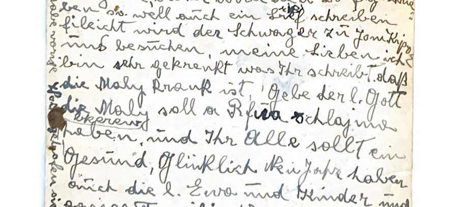

### iv) Word skips and insertions — confidence: high

The conclusion and PS run vertically along the left-hand edge in two tight columns — postcard space economy. Date "Wien den 7/10" with "40" underlined.

### v) Same spelling, different letter order — confidence: high

One hit: "Frau" vs "Rfua" ("Frau Stern" / "a Rfua schlajme") — exact letter-permutations, but across two languages (German "woman" vs. Hebrew רפואה transliterated "refuah"): coincidence; the "Rfua" token is half covered by the blot. No other pairs; "Maly" spelling consistent.

### vi) Jewish religious code patterns — confidence: high

"a Rfua schlajme bkerew" appears TWICE — standard "refuah shleimah bekarov" formula for the sick Mali, not a signal; "zu Jom Kipor" calendrical (correct season); "Neu Jahr" wishes on 7 Oct 1940 fall in the holiday season — natural. Formulas used naturally and repeatedly, exactly as a worried relative writes.

### vii) Cryptography and messaging techniques — confidence: medium

Sentence-initials ([pEd],[ — markup noise, no pattern), word-initials (no pattern); numbers "282"/"23b" office stamps; postmark "WIEN 20 … 10-17" partially legible (*HH footnote 3*); underlining only on the date's "40".

### viii) WWI Austrian plain-sight conventions — confidence: medium

HIAS + dollar amounts + ship tickets + "the consul gives no visas" is the textbook plain-sight emigration-logistics vocabulary of 1940 civilian mail — facts a censor would pass, and facts historians can verify against HIAS and consular records. The "50 Dollar … den Rest Betrag … zu Schiffskarten" chain is money tied to a border crossing in the plain sense (paying for tickets), not a coded amount.

**Verdict.** no coded message. The richest factual letter of its batch for primary sources (HIAS, $50, ship tickets, visa stoppage, Oct 1940). The "Rfua" blot and "Frau"/"Rfua" anagram are curiosities without evidentiary weight.

## Letter 8 — 1941-01-27, Josef Bermann → Ewa Bermann (2)

[Drive link (private)](https://drive.google.com/file/d/1wqK8j-pllLkvgXGsRmyVxJMLfl3yANH5/view?usp=drivesdk) — original scan of letter 8

### i) Visible text: plain-sight references — confidence: high

"ich konnte ausreisen wan ich 300 Mark hatte das ich dort abwarten könnte bitte mir in die Hand zu geben das sich jemand mir zur meiner Ausreise verhelfen meiner annim[m]t" ("I could emigrate if I had 300 marks, to wait things out there; please put it into my hand; [I pray] that someone takes it upon themselves to help me with my emigration") — margin note, p.2 lower margin continuing up the right edge; a concrete sum tied to a border crossing, "mir in die Hand zu geben" suggesting hand-carried cash; "daß für mich verschiedene Papiere eingelangt sind" ("various papers have arrived for me" at the American consul) vs. "aber ich habe bis den heutigen Tag keine Verständigung" ("but I have had no notification to this day") — a consulate paper trail that never reached him; "rumänische Quote kommt überhaupt nicht in Betracht außer von dort aus. daß Du fest daran arbeiten sollst" ("the Romanian quota is completely out of the question, except from over there. You must work hard at it" — *HH footnote 1* flags the garbled conjunction) — the quota can't be worked from his side; Ewa must work it from the US; "daß ich gehört habe daß eine Frau einen Mann oder Kinder ihren Vater anfordern können" ("that I have heard a wife can petition for her husband, or children for their father") — the family-reunification affidavit mechanism described as news; "So bitte Euch wan es möglich ist schreibt Flugpost jeder soll dazuschreiben" — mail-routing instruction after ~3 months of silence. no coded message, but dense emigration-logistics facts that could produce primary sources: the 300-Mark ask (possible money-transfer record), the phantom consul papers, the Romanian-quota instruction. The margin note's placement suggests an urgent afterthought.

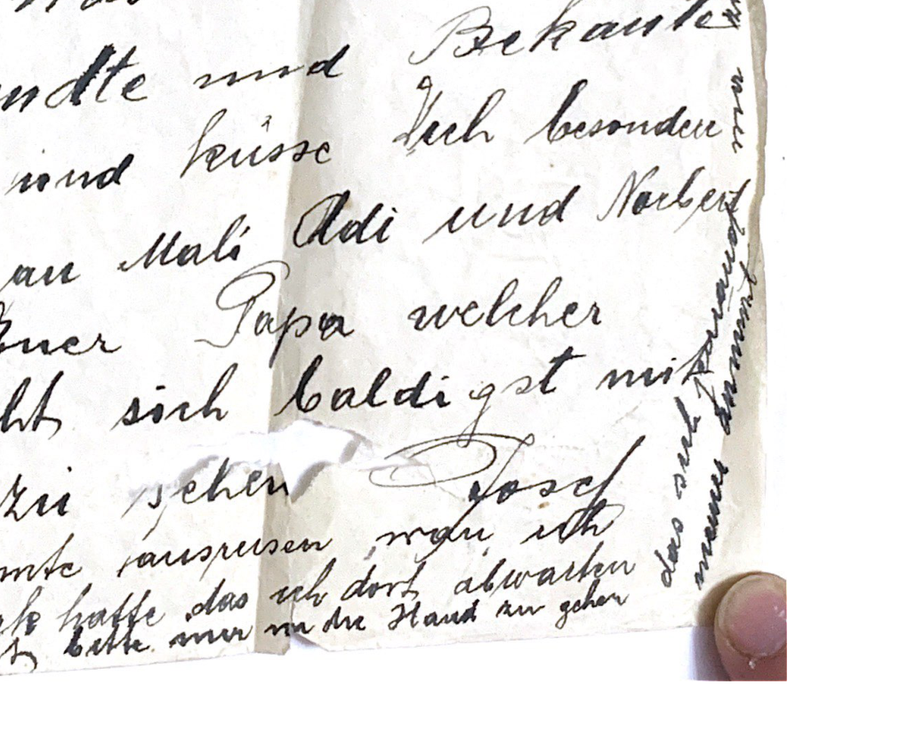

### ii) Lighter words vs. surrounding text — confidence: high

Ink uniform dark on both pages; margin note same ink, smaller. Penciled "162[?]/1906" upper-left is a later archival hand. Nothing.

### iii) Subtle markings near words — confidence: medium

P.1: heavy black deletion blob before "3 Monate" in "daß ich schon fast [deletion] 3 Monate von Euch keine Nachricht bekomme" (self-correction, the "3" partly swallowed). Emphasis-by-pressure on "sehr", "fast", "Flugpost", "Ausreise", "300 Mark", and the whole "rumänische Quote kommt überhaupt nicht in Betracht" clause — natural emphasis, not code.

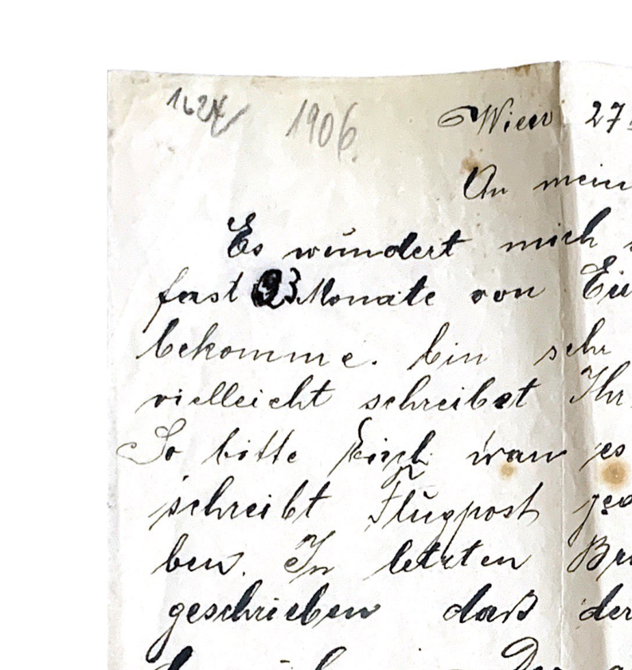

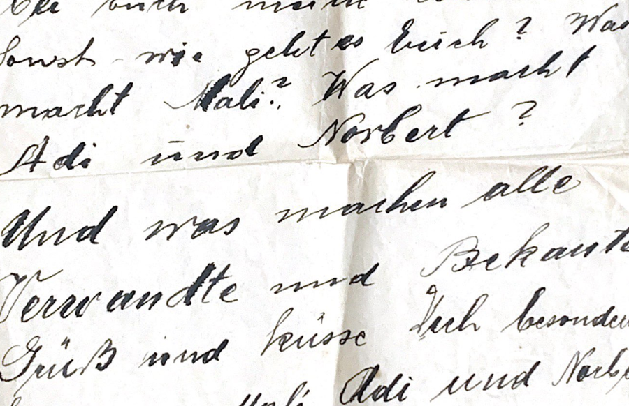

### iv) Word skips and insertions — confidence: medium

The margin note crammed into the lower margin, running vertically up the right edge of p.2 (afterthought insertion). A struck-through false start precedes the "Josef" signature. Urgency artifacts, not code.

### v) Same spelling, different letter order — confidence: high

Mechanical check over 227 words: zero letter-permutation pairs. "wan"/"wenn", "pr"/"per" are his consistent phonetic spelling.

### vi) Jewish religious code patterns — confidence: high

No Hebrew, holidays, or liturgical quotes.

### vii) Cryptography and messaging techniques — confidence: high

True line-initials from scan (p.1 "EfbvSsbgCdebVmdrnasiz"; p.2 "edKkswAbSmAUVGkvwe"; margin "i3kdm") and sentence-initials ("pbIdWWU") form no words. No n-th-letter patterns, no book-cipher references.

### viii) WWI Austrian plain-sight conventions — confidence: medium

The 300-Mark hand-carry ask is stated openly (not veiled in jargon code); "Ausreise" used plainly. No deportation euphemisms (predates deportations). Candid emigration logistics.

**Verdict.** no hidden message. Forensic value is plain-sight: the 300-Mark hand-carry request, the phantom American-consul papers, the Romanian-quota instruction to Ewa.

## Letter 19 — 1941-02-11, Chaja Willner → Jakob Willner (2 (card))

[Drive link (private)](https://drive.google.com/file/d/1o02IqbEyZ1GGZ-b3bf_WLK1Jrd0rPhhv/view?usp=drivesdk) — original scan of letter 19

### i) Visible text: plain-sight references — confidence: medium

"ich habe der Ewa geschrieben sie soll den Josef Geld schicken ch glaub sie brauch nicht schicken, mir braucht Ihr auch nichts mehr schicken den ich übersidel" ("I wrote to Ewa to send Josef money, but I don't think she needs to; you needn't send me anything more either, since I'm moving."); "wen Ihr schreibt auf Tante Chawes Adresse sie wird mir fileicht die Briefe übergeben" ("if you write to Aunt Chawe's address she will perhaps pass the letters on to me") — a forwarding arrangement; "Tante Chawe" is the writer herself referred to in the third person (the children's "Aunt Chawe"; she signs "Chaja"); the sender address on the card is still Taborstrasse 67/14; "bis jetzt habe jede Woche geschrieben aber jetzt braucht Ihr nicht besorgt sein was ch will nicht so oft schreiben."; "was hat die l. Ewa müssen im Spital gehn?" (Ewa hospitalized in New York, early 1941); "sonst geht es mir sehr gut" (the reassurance formula); "meine Maltschi schickt Dir 10000000000000 Pusis" ("my Maltschi sends you 10,000,000,000,000 kisses" — the zero count verified mechanically in the crop: "1" followed by exactly 13 zeros, 10 trillion, matching the transcript — playful hyperbole, not a code number). the moving + forwarding-address + write-less-often cluster is the classic pattern that can mask a deportation, but here it is explicitly tied to "ich übersidle" (I'm moving house), Feb 1941 — seven months before the Vienna deportations began (Oct 1941). Read plainly: a house move with mail forwarding. The operationally notable fact is the "Tante Chawe" forwarding cut-out. No euphemisms.

### ii) Lighter words vs. surrounding text — confidence: medium

Penciled "962–29" at the lower left of the address side (clear filing number). A large RED/ORANGE CRAYON stroke (part of an X) crosses the continuation text on the address side — not the author's pen. The purple Wehrmacht eagle censor stamp ("…der Wehrmacht", "1866") sits mid-card. No lighter message words.

### iii) Subtle markings near words — confidence: low

"geht" and "sehr" in "sonst geht es mir sehr gut" written in markedly heavier ink (confirmed on message-side view) — same sporadic heavy-ink phenomenon as letter 17, here on the reassurance sentence; visually real, meaning unresolved — pen pressure or emphasis; the two words yield no message ("geht… sehr"). Blots on "Dir" ("schickt Dir"), on "Ihr", on "Grüssen"; "ergere" ("ich ergere mich sehr") overstruck/corrected mid-word — ordinary self-correction.

### iv) Word skips and insertions — confidence: high

Two letters in one card: the main letter to Jakob + wife, then "Goldiger Erich!" (to the recipients' son Erich) continuing onto the address side. No squeezed insertions like letter 17's "ein Brief".

### v) Same spelling, different letter order — confidence: high

No pairs; "Chaja" (signature, letter 17) vs "Tante Chawe" — j/w alternation, dialectal; "Mali" (17) vs "Maly" (18, 19) i/y alternation.

### vi) Jewish religious code patterns — confidence: high

"Gebe der Ewiger", "G. s. d." twice — standard formulas. No holidays, no liturgical quotes.

### vii) Cryptography and messaging techniques — confidence: medium

DATE ANOMALY — the letter is dated "Wien den 11/2 1941" (the "11" unambiguous in crop; "1941" underlined) but the Vienna postmark reads "2.2.41-16" (crop-confirmed, no leading "1"). A letter cannot be postmarked 9 days before it was written. Most plausible: the writer misdated (meant 1/2 or 2/2 — a "11/2" slip for "1/2" fits the 2.2.41 postmark exactly). Sentence-initials ([pEi]sIsA, — markup noise, no pattern), word-initials (no pattern). The date anomaly is almost certainly a writer's slip, not a date cipher (a cipher would not put the "wrong" date where the censor checks it first).

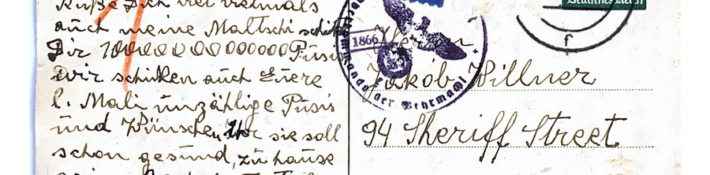

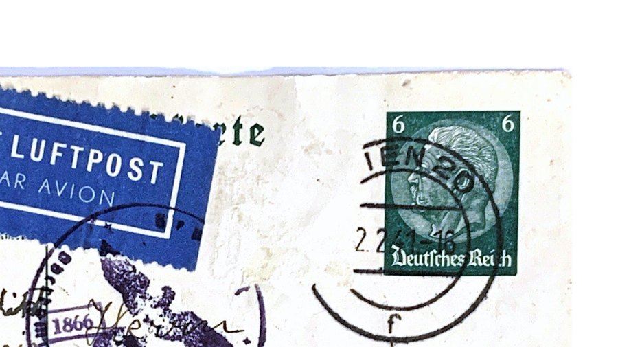

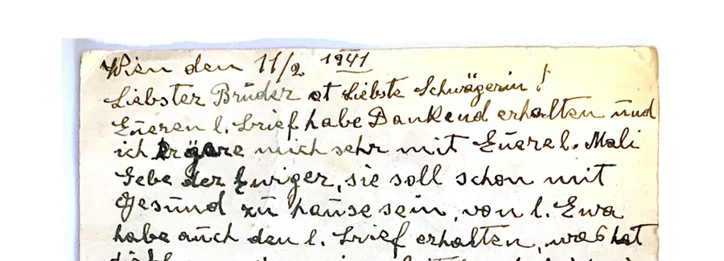

### viii) WWI Austrian plain-sight conventions — confidence: medium

"I'm moving, write via Tante Chawe, don't worry if I write less" is the surface shape of the later deportation-era reassurance letter, but in Feb 1941 Vienna it is premature for that reading, and the letter gives the mundane reason itself (Übersiedlung). No "emigrated"/"resettled"/"on a journey" euphemisms. The censor's eagle stamp + red crayon mark show the card was inspected — and passed.

**Verdict.** no coded message. Notable operational fact: the move and the "Tante Chawe" forwarding arrangement (Feb 1941). Notable anomaly: the 2.2.41 postmark vs. 11/2/41 letter date — best explained as a dating slip.

## Letter 36 — 1941-03-01, Chaja Willner + Maly → Ewa Bermann (2)

[Drive link (private)](https://drive.google.com/file/d/1IpXQUzgyA99J3wPy29L5m6ixnDSXxzTI/view?usp=drivesdk) — original scan of letter 36

### i) Visible text: plain-sight references — confidence: low

"Der Josef ist in Polen, Opole bei Lublin er hat geschrieben, er hat bei sehr nette Leute Quartier" ("Josef is in Poland, in Opole near Lublin. He wrote and said that he is staying with very nice people.") — the "very nice people" phrasing is reported from Josef's own (censored) letter from deportation; it reads as either genuine or censor-safe cheer; "und ich selbe hab im Flugpostweg geschickt" (sent by airmail); "Ich habe ein Telegram zu Jakob geschickt" (a telegram — a primary-source record); "filleicht kennt man bei der Hias und noch Komites und auch etwas die Familie" (HIAS and other committees — named aid organizations); "die Isr[aelitische] K[ultus]g[emeinde] gibt keinen Groschen, leider zu Schifskarten" (the IKG won't pay a cent toward ship tickets); "Wegen dem Afidawid freue ich mich, daß man wird nachschicken" (the affidavit will be forwarded); self-reversal: "ich habe Euch zwar eben geschrieben Ihr sollt nichts schicken, ich übersiedle, nachdem ich noch hier bin, fileicht könnt Ihr mir doch ferschaffen, die Schiffskarten, nur wan es geht, bitte wie am Schnelsten" ("I know I just wrote and said you needn't send me anything because I'm moving, but now that I find myself still here, perhaps you would be able to help me get the ship tickets — only if you can — as quickly as possible, please"; "nur wan es geht" inserted above the line) — plain dithering; "Übersiedle" here means her own planned relocation, not a deportation euphemism (she then says she is still in Vienna). No money amounts. the Opole fact, the telegram, the HIAS/committees names, and the IKG funding refusal are the primary-source items. The "sehr nette Leute" phrase is the closest thing in the corpus to censorship-shaped language (compare the forced cheerful formulas of camp postcards) — flagged as censorship-shaped, not as code.

### ii) Lighter words vs. surrounding text — confidence: medium

Uniform pencil; the one darker patch is the overwritten correction "Den Brief was Du zu Josef beigelegt" (rewritten, darker). No lighter words.

### iii) Subtle markings near words — confidence: medium

Penciled "509" in the upper-left corner of both pages (same processing-number character as 33's "1463" and 35's corner number); heavy overwrite/rewrite of "Den Brief was Du zu Josef beigelegt werde im überschicken heute" (false start corrected); "nur wan es geht" inserted above the line before "bitte wie am Schnelsten"; a struck "zu" in "ob der Josef hat zu [struck] geschrieben"; a struck/corrected word after "Schwägerinen" ("Deine Schwägerinen [struck: auch?] Josef haben geschrieben" *[uncertain]*); a small insertion above "ar" in "ist ar[insertion?] gegangen" *[uncertain]*. All ordinary corrections and insertions; the "509" is an undecoded processing number.

### iv) Word skips and insertions — confidence: high

The "nur wan es geht" insertion; the p.1→p.2 break mid-sentence ("G[ott] s[ei] d[ank] es ist mir auch besser. II. Wegen dem Afidawid...") with "I." and "II." marking the two sides; no margin cramming.

### v) Same spelling, different letter order — confidence: high

"abissel ferkülter" vs "nur abisel gehustet" — inconsistent spelling of the same dialect word within the letter; "Schiffskarten"/"Schifskarten"/"Schifskartn" — inconsistent; "Afidawid" for "Affidavit" (consistent within the letter; cf. letter 34's correct "Affidavit"/"Zusatzaffidavit"). No letter-permutation pairs.

### vi) Jewish religious code patterns — confidence: medium

"G[ott] s[ei] d[ank]" twice — idiomatic. No Hebrew, no quotes, no holidays.

### vii) Cryptography and messaging techniques — confidence: high

30 sentence-initials ("D D D e j e A u e u n i o i d i n i G W a d I i n i i n n s v") — no words/names; paragraph initials (D, G) nothing; no book-cipher references; no null-word patterns; "Flugpostweg" literal.

### viii) WWI Austrian plain-sight conventions — confidence: low

This is the one letter in the corpus written about a deported person under Axis censorship (Josef in Opole, deported February 1941). "er hat bei sehr nette Leute Quartier" matches the cheerful-safe register required of censored mail from deportees (cf. the forced-phrase regime of camp postcards) — though it may equally be genuine. No "emigrated/resettled" euphemisms; "übersiedle" is used for her own planned move, not deportation. No jargon code with recoverable meanings.

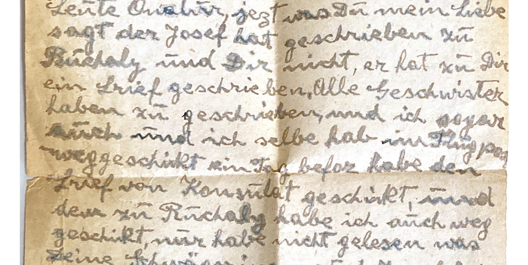

**Verdict.** no coded message. Emigration logistics under pressure (affidavit, ship tickets, HIAS, telegram, IKG refusal), with one censorship-shaped phrase about Josef in Opole.

## Letter 51 — 1941-04-07 (?), Chaja Willner → Ewa Bermann, Jakob Willner (1)

[Drive link (private)](https://drive.google.com/file/d/1bGb6UQL9UqBqMHlP1I7E29QLOZ6vIDDP/view?usp=drivesdk) — original scan of letter 51

### i) Visible text: plain-sight references — confidence: medium

"Leider habe das Pakerl noch nicht erhalten der Josef glaubt fon dort wird schwerer nach U.S.A. zu kommen" ("Unfortunately I haven't received the parcel yet; Josef thinks it will be harder to get to the USA from where he is" — *HH footnote 1*: "'from there' is the intended meaning"); "fileicht könnt man zu Schlojmen schicken er sol im geben fon hier könnt man nicht schicken. Schlojme wird fileicht ja können" ("perhaps something could be sent to Schlojme for him to give to him; it isn't possible to send him anything from here, but Schlojme might be able") — a relay person ("Schlojme" = Yiddish form of Salomon/Schlomo) as a parcel channel to Josef; the parcel cannot go direct "from here" (Vienna); "Ich habe von Erna [Unclear]nstein eine Karte, daß sie haben schon sehr lang kein schreiben auch von Lily Hönig" ("I got a postcard from Erna [surname unclear]stein saying they haven't had any mail for a long time, also from Lily Hönig" — HH footnotes 4-5: surname very unclear, first name possibly Ewa, initial H/K/Z/W/B; the passage "very unclear in the original and the translation quite uncertain"; "Hönig" could be "König" (cf. letter 1)); corner note "106" (upper left, pencil) — archival mark; the year "1941" in "Wien den 7/4 1941" is itself marked [?] in the transcript — the final digit smudged/uncertain on the scan. the letter's substance is parcel-relay logistics for Josef via a third party because direct sending from Vienna is impossible — censorship-circumvention logistics stated plainly. No cipher in the readable text.

### ii) Lighter words vs. surrounding text — confidence: medium

Ink uniformly blue; the many blots are DARKER than text. No words written lighter than surroundings. The pencil "106" is lighter but archival.

### iii) Subtle markings near words — confidence: low

blots most plausibly accidental; the red mark over "Lily Hönig" noted as an unidentified anomaly, not evidence of coding.

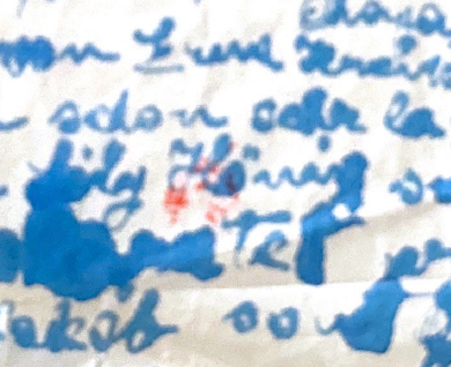

### iv) Word skips and insertions — confidence: low

Single crumpled sheet, text fills it normally; no margin writing; no insertions above/below lines visible through the blur. Nothing found (with the caveat that blur could hide small insertions).

### v) Same spelling, different letter order — confidence: high

Scripted permutation check (48 words ≥5 letters): only hit "Grüße/grüße" (capitalization variant). "Schlojme"/"Schlojmen" is a declension, not a transposition. "Pakerl" is dialect spelling of Packerl.

### vi) Jewish religious code patterns — confidence: medium

None — no holiday mention, no Hebrew insertions, no liturgical quotes in the readable text.

### vii) Cryptography and messaging techniques — confidence: medium

Line-initials (5 lines: `WLLCI`), sentence-initials (2: `WS`), line-finals (`1RSRA`) — no acrostic content. The uncertain year digit is a readability limit, not an anomaly. No "as I wrote..." references.

### viii) WWI Austrian plain-sight conventions — confidence: medium

Sending parcels to Josef via an intermediary ("Schlojme") because "fon hier könnt man nicht schicken" is exactly the kind of logistics these letters conduct in the open. No euphemism beyond the ordinary.

**Verdict.** a badly blotted/blurred single page whose readable substance is parcel-relay logistics for Josef via "Schlojme." Heavy ink blots (likely accidental) and one small unidentified red stain over "Lily Hönig" are the physical facts; no cipher evidence in any family, with readability honestly limiting families ii–iv and vi–vii.

## Letter 5 — 1941-04-28, Salomon Willner → Ewa Berman, Jacob Willner (2 (card))

[Drive link (private)](https://drive.google.com/file/d/1kpQDAgjH66_zmReb3chV3RLwQMJ0Svod/view?usp=drivesdk) — original scan of letter 5

### i) Visible text: plain-sight references — confidence: medium

"Obiger [?] habe Josefn geschickt 20 zł, den er hat ferlangt fon mir. S." ("I sent Josef the 20 zł that he asked me for. S." — HH footnote: "Obiger" is squeezed between lines and ambiguous — reads either as "Ojwiger" (familiar form of Owadie) or "Obiger" ("the above-mentioned"); if a name, unclear whether Salomon or Owadie sent the money; if "obiger", the money may have gone via Etel's address); "auch Josef schreibt – fon Lublin – das er ferdient" ("Josef writes — from Lublin — that he's earning" — Lublin, April 1941); "bitte schreibt ob Ihr ferdient?"; "die Kinder sind wohl gesund auch wir ferdienen"; "bekomt Ihr schreiben fon Etlen?" (with "Etlen" heavily blacked out — see iii); address side: red censor stamp with swastika, "GENERALGOUVERNEMENT" stamp, postmark "STRZYZOW a. WISLOK"; printed "11.41"; illegible pencil marks along the lower edge of both sides (per HH; visible as faint pencil squiggles, unresolvable). no coded message. The 20-złoty remittance to a named person in Lublin and the "ferdient" formula are open, plain-sight logistics.

### ii) Lighter words vs. surrounding text — confidence: high

Uniform dark ink throughout the message side; the inserted "obiger" is written smaller between lines but in the same ink. No selectively lighter words.

### iii) Subtle markings near words — confidence: medium

the "Etlen" blackout is the only deliberate concealment-like mark in this letter batch; authorial. Flagged as an observation with unknown motive — not evidence of a code system.

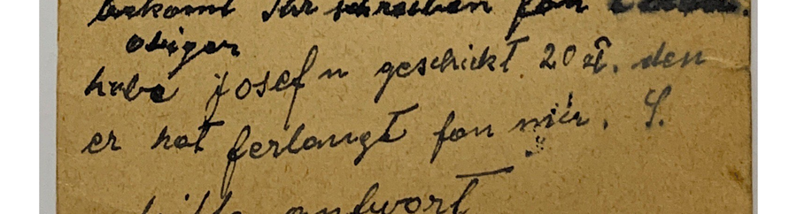

### iv) Word skips and insertions — confidence: high

"obiger" squeezed in small script between the "bekomt Ihr schreiben fon Etlen?" line and the "habe Josefn geschickt 20 zł" line — an interlinear afterthought insertion clarifying the 20-złoty sentence. No other insertions; no margin cramming.

### v) Same spelling, different letter order — confidence: high

"Joel"/"Josef" — distinct people; "daser"/"dener"/"unser" — transcription artifacts of run-together words ("das er", "den er"). No true transpositions.

### vi) Jewish religious code patterns — confidence: high

None — no Hebrew insertions, no holidays, no liturgical language.

### vii) Cryptography and messaging techniques — confidence: high

Line-initials (SLTFBBASPM), sentence-initials (SLTASFBSFWBOHSBASBPM), line-lasts (VRTRSTRUEA), sentence-lasts (VRTNDTETSRNRRSTRWUEA) — no words. Numbers: "28/IV 941", "20 zł", "11.41" (printed), pencil squiggles — all ordinary. No acrostic, no n-th-letter pattern, no book-cipher reference.

### viii) WWI Austrian plain-sight conventions — confidence: medium

The 20-złoty remittance to a named person in Lublin and the "ferdient" formula are open, plain-sight logistics of the kind documented for this period — no jargon-code second meaning evidenced. The blacked-out "Etlen" is unusual but isolated; Holocaust-era civilian letters do show occasional self-censorship of names, which is the historically normal reading.

**Verdict.** no coded message. Two concrete facts: 20 złoty sent to Josef in Lublin (sender ambiguous: Salomon or "Ojwiger"/via Etel), and an authorial blackout of the name "Etlen" whose motive is unknowable.

## Letter 32 — 1941-05-13, Mali Bermann → Ewa Bermann (3)

[Drive link (private)](https://drive.google.com/file/d/1-Z45DtHblhmS0tTZkUN0P2-oM7kbHdGR/view?usp=drivesdk) — original scan of letter 32

### i) Visible text: plain-sight references — confidence: low

*Method.* manual skim of both sides (English, brown ink, paper torn at edges); compared phrasing against plain-sight conventions.

p.1 (front): "Kfar Haroe, May 13th, 1941. / My best loved Mummy! [Hebrew: ב״ה] / Perhaps you remember when I was here in Kfar Haroe [^a year ago^ inserted] go with our cousin Mirjam Klipper who is [Chana's?/Ella's?] sister *[uncertain]*. Also now they invited me to stay with [them?] for 2 weeks, and I kept this invitation with [joy?] *[uncertain]*. I feel very well here, they are men of high [moral?] *[uncertain]* very good character. They are the only men in the land whom I can understand with. They love this country as only 'chalutzim' can do it. ... Kfar Haroe is a [Hebrew word, uncertain] that is a village where each farmer has the [his own?] peace of earth [piece of earth?] his own house and everyone can live his own family life as he like it, not as in a kibbutz. ... I also learned cooking here and at 'Every day I cook for the whole family.' If it is [not struck through] possible tell to Malwine and Helga to write to her. The address is: Mirjam and Schlomo Klipper, Kfar Haroe Hedera P.O.B. 22." p.3 (reverse): "Three weeks ago I leaved [left] the Beth Zeiroth and I stayed with auntie Leni *[uncertain]* for the first 2 weeks. ... But before I came here I lost my position and without money I cannot enter into the Beth Zeiroth to live there. I must know that the Beth-Zeiroth was made [?] *[uncertain]* that means, that we can live eat there, but we must pay for it. I already began to make my papers for coming to you, but still I did not finish with anything. You must tell to Louis Zellinger [uncertain spelling] to send me [Hebrew word, uncertain — possibly 'affidavit' in Hebrew letters] [marginal Hebrew line, uncertain] I could not write him for I have no address. ... Have you to work very hard? What is with the earning? Have you some letters from Daddy? Why do not you write to him? ... [Bottom line, struck through: '...m Bermann' — the signature crossed out.] [Diagonal along right edge: '...and yours [affectionate?] ... Mali' *[uncertain]*.]" Several odd phrasings, all plausibly non-native-English renderings: "you can see here your trouble not to be for the 'bargain'" ("bargain" in quotation marks); "they are men of high [moral?] very good character"; "I also learned cooking here and at 'Every day I cook for the whole family.'" (a misremembered German idiom rendered into English); "What is with the earning?". Message-routing: "You must tell to Louis Zellinger to send me [Hebrew word]" (asks mother to relay to a third party); "tell to Malwine and Helga to write to her". Facts producing primary sources: the Klipper address; "I already began to make my papers for coming to you" (emigration paperwork); "I lost my position" (employment); confirmation that Beth Zeiroth charged for board. the quoted "bargain" and the struck "not" are the only phrasings that read like they might mean something else; both more economically explained as a non-native speaker's corrections. The relay instructions are ordinary family message-routing. No deportation euphemisms; no money amounts.

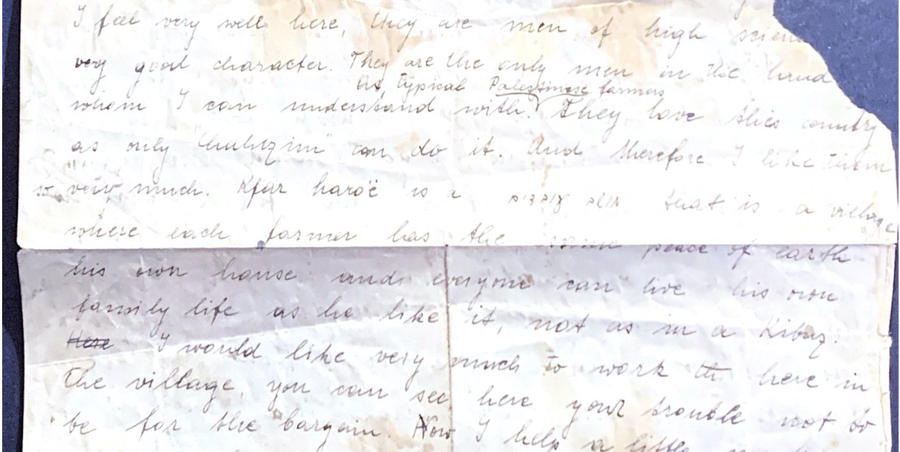

### ii) Lighter words vs. surrounding text — confidence: medium

Ink uniformly brown-gray; fainter patches coincide with folds and stains. The diagonal closing is slightly fainter but same pen. Hebrew words darker, not lighter.

### iii) Subtle markings near words — confidence: low

"not" struck through in "If it is ~~not~~ possible tell to Malwine and Helga to write to her" (correction of a double negative); the signature line "...m Bermann" [Mali Bermann] crossed out with a horizontal stroke at the torn bottom edge; quotation marks around "chalutzim" (natural) and around "bargain"; a small dark mark after "Kfar Haroe" where "a year ago" is inserted; a Hebrew word after "send me" written darker. The struck signature plus diagonal replacement closing is unusual layout behavior — possibly she signed, then decided the closing needed the diagonal instead. Not evidence of code.

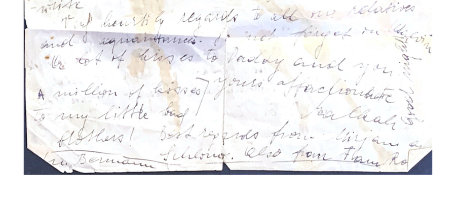

### iv) Word skips and insertions — confidence: medium

"a year ago" inserted above the line on p.1 (producing the jumbled word order "when I was here in Kfar Haroe a year ago go with our cousin"); signature struck through and closing rewritten diagonally up the right edge; text runs to the torn edges. Insertions are ordinary self-corrections.

### v) Same spelling, different letter order — confidence: high

Names/places listed (Mirjam, Schlomo, Klipper, Malwine, Helga, Louis Zellinger, Leni, Beth Zeiroth, Kfar Haroe, Hedera, P.O.B. 22): no repeated word with altered spelling; no letter-permutation pairs.

### vi) Jewish religious code patterns — confidence: medium

ב״ה at top; "chalutzim" in quotes; Beth Zeiroth (the school/home). No biblical quotes, no holiday double meanings, no liturgical placements.

### vii) Cryptography and messaging techniques — confidence: medium

32 sentence-initial letters ("P A I T T A K H T N I I T I T S B I I Y W H W H W I H I K D A A") — no word or name forms. Word-initial patterns and repeated unusual words ("very", "little") are ordinary emphasis, not nulls. No date/number anomalies beyond P.O.B. 22; no book-cipher references.

### viii) WWI Austrian plain-sight conventions — confidence: medium

No "emigrated/resettled" euphemisms; the letter is from Palestine, outside Nazi censorship; cheerful tone matches a genuine visit account. "Bargain" in quotes is the only jargon-like item, without a recoverable prearranged meaning.

**Verdict.** no hidden or coded message found. The letter's anomalies (struck signature + diagonal closing, struck "not", quoted "bargain", jumbled insertions) are best explained by a young non-native English writer correcting herself. No transcript or translation existed; readings are a manual skim, several words marked *[uncertain]*.

> **Private annotation.** Data quality: no transcript or translation existed for this letter; readings are a manual skim with several words marked [uncertain].

## Letter 45 — 1941-06-02, Chaja + Maly → Ewa Bermann, Jakob Willner (1)

[Drive link (private)](https://drive.google.com/file/d/1hp1S-lH0NqY_n0qRiPDwEkZjXRgcEtFI/view?usp=drivesdk) — original scan of letter 45

### i) Visible text: plain-sight references — confidence: high

"Eueren lieben Brief 16/4 1941 und von 6/5 1941 welchen Ihr zu Frau Stern beigelegt hat habe Dankend erhalten" (letters of 16 April and 6 May, the latter enclosed with Mrs. Stern's); "Liebste Mina was Du schreibst wegen Dein Schwager habe leider gleich gehört auch Deine Schwester und Frau Werner wissen schon" ("dearest Mina, I had unfortunately already heard the news about your brother-in-law; your sister and Mrs. Werner know too" — death via the standard "already heard the sad news" formula); "habe von der Hias aus Lisboa Portugal ein Liebesgaben Paket erhalten in welches es war Reis, Kaffe, Tee, Kakau, Zucker Bohnen, und P. Mehl Alles ist in guten Zustand angekomen" (HIAS care package from Lisbon: rice, coffee, tea, cocoa, sugar, beans and P. flour, all in good condition; HH: the 'P' before flour may indicate a type, unclear); "habe auch von der Berlin[er] Hamburg–Amerika Linie bekommen ein Brief daß Du liebe Mina mir 40 RM geschickt hast" (letter via the Hamburg-Amerika Linie, Berlin office, that Mina sent 40 RM — the blotted word reads "Berliner" per lab forensics); "die Josefine hat die Tante Lea eingeladen sie ist sehr eine gute, so wie die Berta es geht ihr sehr gut" ("eingeladen" in 1941 plausibly = an immigration invitation/affidavit, stated plainly); signed along the left edge: "von Chaja und Maly". 40 RM from Mina via the Hamburg-Amerika Linie (shipping line, Berlin office) = a remittance channel, stated openly; HIAS Lisbon parcel = a relief channel, stated openly. Primary-source leads: the HIAS Lisbon parcel record; the Hamburg-Amerika Linie Berlin remittance letter for the 40 RM; Josefine's invitation to Tante Lea.

### ii) Lighter words vs. surrounding text — confidence: high

Uniform blue ink; no lighter words/lines.

### iii) Subtle markings near words — confidence: high

What first looked like a vertical margin squiggle alongside the HIAS/40-RM paragraph resolves on closer crop as the paper's vertical crease/fold line — no marginal marking exists (initial impression corrected). Ink blots: top-left edge, mid-page over "der Berlin[er]", right edge over "Berta", bottom-right — physical blots. No dots, ticks, underlines, circled words.

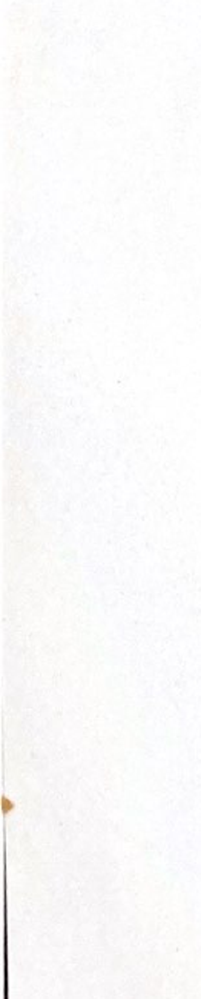

### iv) Word skips and insertions — confidence: high

The right ~15% of the sheet is folded over/under so its text appears mirrored ("...der Hias aus Lis" + mirrored "aobsiL lagutroP..."); the transcript correctly reconstructs the full sentence across the fold. Physical fold, not hidden text. No squeezed-in words, cross-outs, or margin cramming beyond the edge signature.

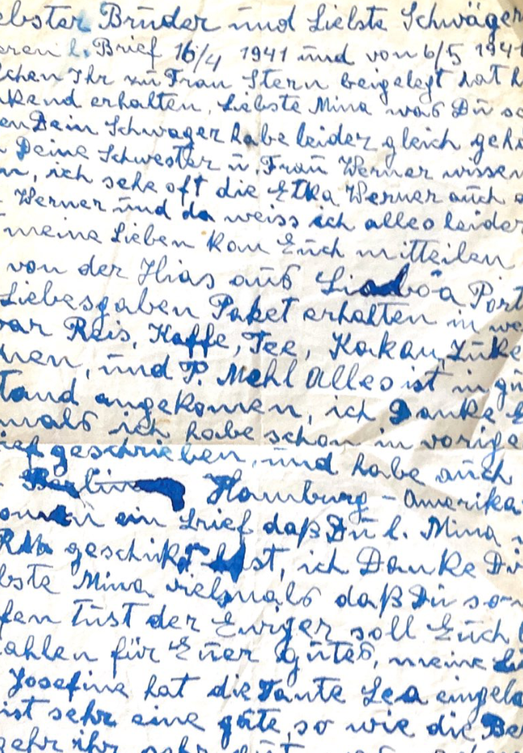

### v) Same spelling, different letter order — confidence: high

Only pair: 'Alles'/'alles' (case). Names consistent (Mina, Werner/Etka Werner, Josefine, Lea, Berta, Maly, Chaja, Stern).

### vi) Jewish religious code patterns — confidence: high

"der Ewiger soll Euch Alle bezahlen für Euer Gutes" (standard thank-you formula). No holidays, no Hebrew insertions, no gematria-adjacent numbers (only dates and 40 RM).

### vii) Cryptography and messaging techniques — confidence: high

Line-initials of the 31 physical lines ("WLEWDAWSFJHEBZVBDB4LHBBDSEEGGGEV"), line-finals, sentence-initials ("WLM"), finals ("NPY"), paragraph-initials ("WLEV"), word-frequency — no words/names; "Eueren lieben Brief 16/4 1941 und von 6/5 1941" and "ich habe schon im vorigen Brief geschrieben" are ordinary references, not cipher pointers. Misspellings ("Kakau", "bekomen") are normal weak spelling.

### viii) WWI Austrian plain-sight conventions — confidence: high

No deportation euphemisms; the one death uses the ordinary "already heard the sad news" formula. HIAS parcel and 40 RM remittance are the open documented relief channels of 1941. No forced cheerful deception (private letter, pre-Briefaktion).

**Verdict.** no hidden or coded message. Thank-you note (HIAS Lisbon food parcel; 40 RM from Mina via the Hamburg-Amerika Linie, Berlin) + acknowledgment of a brother-in-law's death. The blotted "Berliner" is the physical-forensics team's domain.

## Letter 40 — 1941-06-05 (?), Chaja Willner (+ Maly) → Eva (2)

[Drive link (private)](https://drive.google.com/file/d/1epjHUWT3IgJi8wINRaS6LdgsYMunwV30/view?usp=drivesdk) — original scan of letter 40

### i) Visible text: plain-sight references — confidence: high

"mit die Rosa Hirsch ihr Glück sie hat ein grosses Glück unberufen erreicht" ("unberufen" = knock-on-wood idiom) — Rosa Hirsch's emigration good fortune, a research lead, not code; "bitte geht zu Hias erkundigt Euch wegen unsere U.S.A. fahrt... fürs Kind wird die K.G. doch die Schiffskarte geben" (HIAS + Kultusgemeinde + ship tickets, plain-sight logistics); "Du kanst schicken Lebensmittel Pakete an Josef schicken durch (G. Gerhardi)" + green postscript "G. Gerhardi per Adr. Norddeutsche Lloyd Bremen / eine bekante von mir beko[mm]t oft von die Adresse Pakete" (food parcels via a Norddeutscher Lloyd contact — a real forwarding channel, plain-sight; HH footnotes 3, 4); p.2 green continuation ("...schreibt gleich Antwort... Alle gesund...") extremely faint and partly overwritten — not readable beyond the transcript despite enhancement. No money, no deportation euphemisms, no "write that..." instructions.

### ii) Lighter words vs. surrounding text — confidence: high

The ENTIRE postscript (p.1 bottom) and p.2 continuation are greenish pencil crayon, markedly fainter than the blue body — a MEDIUM CHANGE (different implement, likely switched mid-letter or added later), not selected lighter words.

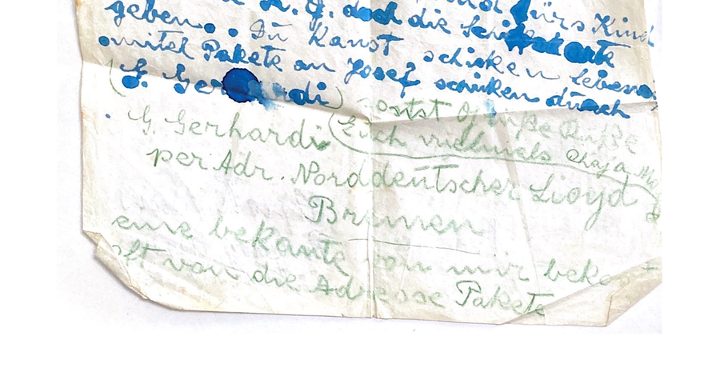

### iii) Subtle markings near words — confidence: medium

~6 blue drips, same ink as body: (a) round drip fully covering the month in "Wien den 5/[?] 1941" (month unrecoverable; *HH footnote 1*); (b) on "Gebe"; (c) near "soll schon gesund"; (d) on "Schiffskarte"; (e) large drip on "(G. Gerhardi)"; (f) on "durch". Drip-shaped with splatter = leaking fountain pen, random distribution; NOT bar-shaped censor redactions. P.2: dark-pencil "Opole Kreis / Pulawy distrikt / Lublin Deut[sch...]" written directly OVER the green text in a larger, bolder, different hand — a LATER address memo (recipient/family member) partially obscuring authorial text; material interference, not code. Pencil "76" top-left is a cataloguer's mark.

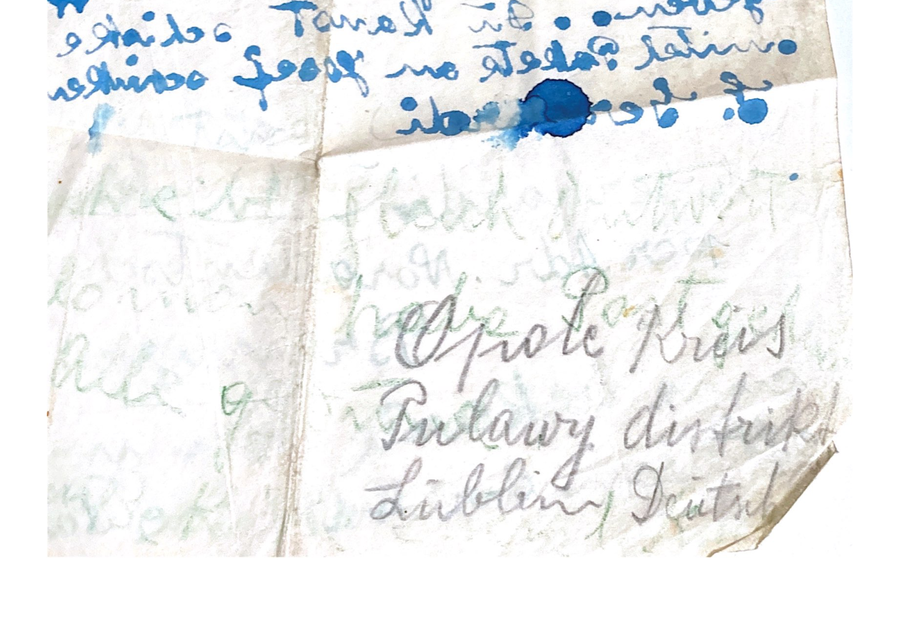

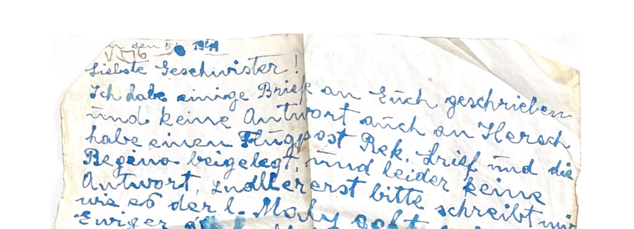

### iv) Word skips and insertions — confidence: high

Normal flow; green P.S. below blue sign-off. Nothing.

### v) Same spelling, different letter order — confidence: high

"Maly"/"Mali", "Hias", "Loyd" (sic) — phonetic, no pairs.

### vi) Jewish religious code patterns — confidence: high

"Gebe der Ewiger die l. Maly soll schon gesund..."; "unberufen" idiom. Idiomatic only.

### vii) Cryptography and messaging techniques — confidence: medium

Initials ("L I a z G m i w f D s G e") form nothing; repeated words are topic vocabulary, not nulls; the blue→green shift correlates with letter position (postscript), not sensitivity.

### viii) WWI Austrian plain-sight conventions — confidence: high

"U.S.A. fahrt", "Schiffskarten", "Hias", "Kultusgemeinde", parcel channel — standard 1941 plain-sight emigration register. No deportation euphemisms.

**Verdict.** no coded messages. Material notes: the green postscript is fainter by medium (not code); the blots are a leaking pen (the date's month is lost); a later dark-pencil "Opole Kreis Pulawy distrikt Lublin" memo overwrites the green continuation on p.2.

## Letter 29 — 1941-07-29, Josef Bermann → Ewa Bermann (4)

[Drive link (private)](https://drive.google.com/file/d/1itcRt9WZTYR1-S9UWuq4aBiEBZqaKb1f/view?usp=drivesdk) — original scan of letter 29

### i) Visible text: plain-sight references — confidence: medium

date line "Dienstag 29. VII 1941" — weekday verified: 29 July 1941 was a Tuesday (`date -d 1941-07-29`), so weekday and year are internally consistent, supporting 1941 as the correct year despite the CSV note ("Year unclear. Ink implies after Feb 1941"); the word "Dienstag" is retraced in darker ink than "29. VII 1941" (zoom-crop verified) — an ink anomaly on the date line itself; "es freut daß die Kinder von der Schule guten Ausweis bekommen haben" (good report cards); "Masel Tow, daß die J[unclear] Hersch geheiratet hat" (*HH footnote 0*: first name unclear, likely J + vowel; ambiguous whether the mazel tov attaches to the report cards or the wedding); "Ich habe Dich x mal gebeten mir zu schreiben auf welcher Art Du Dich fortbringst ob Du soviel verdienst was man zum Leben brauch ob Du welche Unterstützung bekommst" ("I have asked you umpteen times to tell me how you are getting by and whether you are earning enough to live on or if you are getting any support" — money/work questions); "auf welcher Art Du Dich fortbringst" could in principle encompass escape logistics, but the plain livelihood reading is fully adequate; "mir alte Kleider zu schicken die konnte ich sehr gut brauchen ... oder vielleicht ist es möglich etwas von Lebensmittel zu schiken ... Geld brauchst Du mir nicht schiken" ("send me some old clothes ... perhaps also a little food ... Don't send me cash" — parcel mentions with an explicit money refusal); "Ich befinde mich immer auf derselbe Ortschaft wie früher" ("I am still in the same village as before" — unnamed; contrast letter 26's "near your brother Schlojme": his stated location changed between the letters and remains unnamed in both); "was macht die Mali schreibt sie oft? In letzten hast nicht geschrieben von Mali" ("Mali" = Malka); penciled "3/30 [?]" upper-left (filing number); TRANSCRIPTION DISCREPANCY: p.2 line "ich denke immer darüber [nach]" — the HH transcript reads "nach", but the scan (zoom-cropped at 3x) appears to read "wache" ("immer darüber wache" = "I lie awake over it [all the time]"), which would echo letter 27's "schlaflose Nächte"; marked *[uncertain]*; recommend re-check against the original — a reading question, not a code finding; *HH footnote 1*: the 'o' in "Gs.d" is omitted in the original, presumably deliberately (religious orthography). logistics-heavy plain-sight content with no jargon code; the letter pleads too directly ("x mal") to read as composed code.

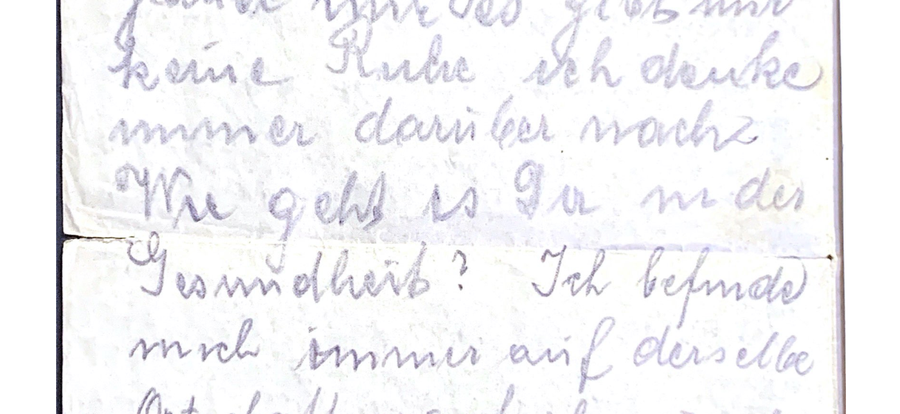

### ii) Lighter words vs. surrounding text — confidence: medium

Light purple-gray ink overall on onion-skin paper (heavy bleed-through throughout); darker-ink spots: "Dienstag" retraced in the date line (p.1); "schliesse" in "Ich schliesse mein Schreiben" (p.4, crop-verified darker than "Ich" and "mein"); a slight darkening on "mehr zu tragen sind oder" (p.3) that looked significant at full-page view but marginal under zoom — downgraded to likely re-dip. Re-dip/retracing emphasis, natural fountain-pen behavior; no systematic lighter-word pattern.

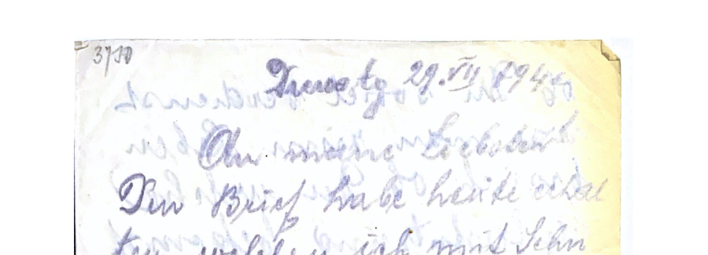

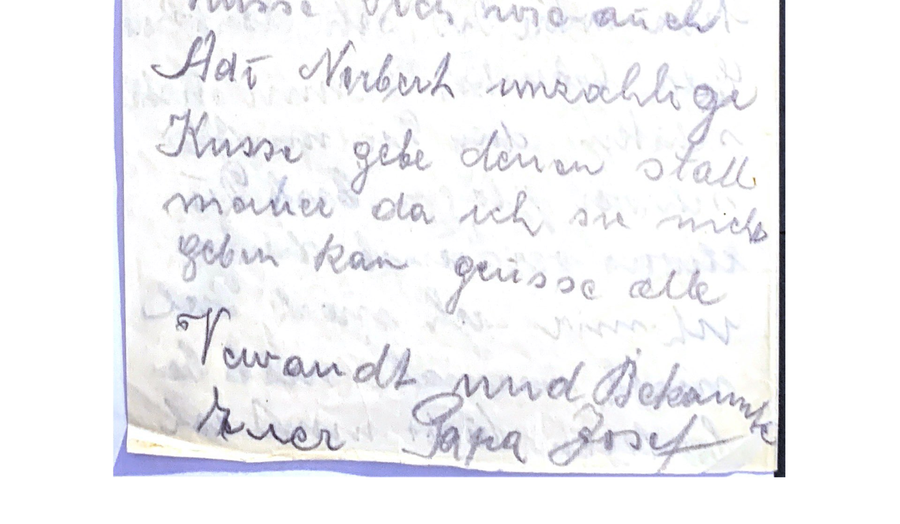

### iii) Subtle markings near words — confidence: medium

P.4 shows a long horizontal stroke through the "grüsse u kusse" line region; under zoom it aligns with the paper's horizontal fold crease (visible crossing the whole page) — judged a fold, not a strikethrough. No dots, dashes, circles, or margin ticks anywhere.

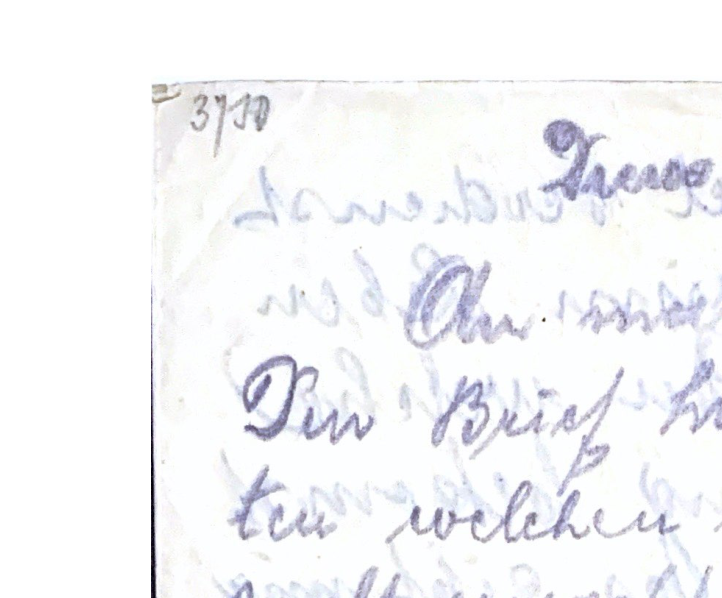

### iv) Word skips and insertions — confidence: high

Ordinary hyphenated line-breaks ("erhal-ten", "Sehn-sucht", "schi-ken", "be-lasten"); no margin cramming, no interlinear insertions, no crossed-out-and-rewritten words.

### v) Same spelling, different letter order — confidence: high

Scripted pair search over all 262 words (len > 4): zero pairs. Josef's spellings ("wan", "braich" for "brauch", "bekomst", "schiken", "Sehnsucht" with h) are his stable phonetic idiolect, consistent within the letter.

### vi) Jewish religious code patterns — confidence: high

"Masel Tow", "G[o]t soll helfen bei unseren Kindern", "Gs.d" with the 'o' omitted (*HH footnote 1*) — standard Orthodox formulas and divine-name orthography. Nothing coded.

### vii) Cryptography and messaging techniques — confidence: medium

Sentence-initials ("D V A D L I W I H G S I I"), handwriting-line initials per page from the scans, word-initial triples, 2nd-letter sequences, last-letters — no sequence forms a word or name in any test. Cross-references ("Habe letztens geschrieben") are ordinary. The date-line ink anomaly is noted above; the weekday/year internal consistency argues the date is genuine.

### viii) WWI Austrian plain-sight conventions — confidence: medium

Parcel-request letters with unnamed locations are typical of censored wartime correspondence, but nothing here matches jargon-code (Decksprache) or null-cipher conventions; the letter's direct repeated pleading cuts against composed coding.

**Verdict.** no coded message. Notables: retraced darker "Dienstag" in the date line (29 July 1941 verified as a Tuesday, supporting the 1941 year); darker "schliesse"; a possible transcript misread ("nach" vs image-apparent "wache") flagged for re-check; logistics-rich plain text (clothes/food parcels, explicitly no money; unnamed "Ortschaft").

## Letter 48 — 1941-09-08, Josef Bermann → "Meine Liebsten" (1)

[Drive link (private)](https://drive.google.com/file/d/1_cMdGV6y2J2VGs8RwbqBP2B6O_dQIgP2/view?usp=drivesdk) — original scan of letter 48

### i) Visible text: plain-sight references — confidence: high

"Es ist schon beinahe 2. Monat sogar vorüber daß ich von Dir kein Schreiben bekam bin sehr nachdenklich darüber"; mail-routing description: "habe Dir schon einige mal geschrieben daß Du brauchst nicht darauf schauen wann ich dir so wenig schreibe es ist nicht wegen Schreibfaul sondern ich muß erst an Cha[unclear]e schreiben und sie befördert weiter" ("don't mind that I write so little; it is not laziness — I must first write to Chajcze and she forwards it on") — explicit mail-forwarding arrangement (Vienna → Chajcze → Eva in America), given as the reason for infrequent direct mail; historically informative about the correspondence network, not a code; "Liebe Eva! Ich habe Dich schon einige mal gebeten wan es Dir möglich ist mir einige Kleidungsstucke schiken wan es Dir schwer fallt durch unser Familie da mochst Du mich beim Lebenerhalten" ("send me some clothes if you can; if hard, through our family; you would be keeping me alive by it" — HH: 'lifesaver' meant fairly literally); "wunsche Euch zum Jahreswechsel das Beste" (Rosh Hashanah, Sept 1941 — natural seasonal greeting); penciled "1834" top-left (filing number, different hand). No money sums, ships, or euphemisms. no coded message; the forwarding arrangement and the clothes request are the notable plain-sight content. Primary-source lead: the Chajcze forwarding channel (who/where was she in Sept 1941).

### ii) Lighter words vs. surrounding text — confidence: high

Whole letter uniformly very light (pencil or very faded ink) — normal medium; "1834" is darker pencil (later hand); one small blue ink squiggle near "besser küsse Dich" — a tiny pen mark, not a word. No selectively lighter words.

### iii) Subtle markings near words — confidence: high

"IX" in "8. IX 1941" may have a short underline [uncertain — possibly normal date emphasis]. Otherwise no underlines, dots, ticks, margin marks, corrections, circled words. "1834" is a filing number in a different pencil hand.

### iv) Word skips and insertions — confidence: high

No skipped/squeezed/crossed-out words, insertions, or margin text. Clean layout.

### v) Same spelling, different letter order — confidence: high

No pairs; "Eva", "Cha[..]e" (= Chajcze) consistent.

### vi) Jewish religious code patterns — confidence: high

"zum Jahreswechsel" (Rosh Hashanah) — natural seasonal greeting, no double meaning; "beim Leben erhalten" — HH confirms literal. No Hebrew insertions, no gematria.

### vii) Cryptography and messaging techniques — confidence: high

Sentence-initials ("IMLI"), finals ("GERAF"), paragraph-initials ("MAE") — nothing; "einige" ×3 natural; no book-cipher references or encoding-potential misspellings.

### viii) WWI Austrian plain-sight conventions — confidence: high

No deportation euphemisms; no forced cheer; the forwarding arrangement is stated openly (a logistical note, not evasion). The clothes request is explicit.

**Verdict.** no hidden or coded message. Notable plain-sight content: the explicit mail-forwarding arrangement (Josef writes to Chajcze, who forwards to Eva) and the repeated urgent clothes request ("you would be keeping me alive"). "1834" is a later filing number.

## Letter 52 — 1941-09-16, Chaja + Maly → Ewa Bermann (1)

[Drive link (private)](https://drive.google.com/file/d/1PZU5iMqYrN-p6vqN7yKv70GEV7DtsNwi/view?usp=drivesdk) — original scan of letter 52

### i) Visible text: plain-sight references — confidence: medium

"Vor allem wünsche Euch alles beste zum Jahreswechsel Gebe der Ewiger die liebe Maly soll schon gesund zuhause sein." ("Above all I wish you the best for the new year; may the Everlasting grant that dear Maly soon be well and at home." — dated 16 Sept 1941, just before Rosh Hashana (began evening of 22 Sept 1941): timely, natural); "ich geglaubt der Josef wird mich zu Feuertage besuchen" ("I thought Josef would visit me for the holidays" — "Feuertage" = "Feiertage", High Holidays; an expected visit that didn't happen); "wan Du kanst nur Alte Wäsche Kleider zu Salomon für Josef schicken, bitte sonst nichts." ("if you can, send ONLY old linen/clothes to Salomon for Josef, please nothing else." — an oddly specific parcel restriction: only old clothes/linen, nothing else; practical (customs/censorship) or coded-protocol reading both possible; stated plainly); "sollt Ihr alles mögliche anwenden um uns herunter zu nehmen" ("you should do everything possible to take us down/over" — *HH footnote 3* flags the unusual verb "herunternehmen" ("get us over there"/"take us in"): a direct emigration plea to the US family, in slightly off-standard German); "Bei mir ist Gott sei dank dafür ich zahle alein den Zins" ("Thank God, I am paying the interest alone" — a financial detail: rent interest paid solo); "was schreibt die liebe Maly hast Du oft von ihr Post" ("what does dear Maly write, do you get mail from her often") + "sie mecht nur gern schon bei Euch sein" ("she'd just love to be with you already") — Maly is neither in Vienna nor America: away, unwell ("soll schon gesund zuhause sein"), receiving post somewhere; her location is unstated — a primary-source-producing gap; "den man hat geschrieben solst den Josef was schicken" ("someone wrote saying you should send Josef something" — an instruction relayed from an unnamed third-party letter; Ewa's silence attributed to poverty, "Du selbst nicht reich bist"); edge note "1837/2 v2158" (upper edge, pencil) — archival. no cipher; the letter is a Rosh-Hashana greeting carrying a direct emigration plea, a peculiar parcel-content restriction, and an unlocated Maly. All are plain-sight facts worth tracing, not code.

### ii) Lighter words vs. surrounding text — confidence: medium

One phrase written in markedly DARKER/bolder blue ink than the surrounding text: "nur Alte Wäsche Kleider" ("only old linen/clothes") — crop-verified; the rest of the page uniform. No lighter words. The darker ink is emphasis for the recipient (the "nothing else" restriction), consistent with the pleading register — not a code signal per se, but a genuine physical anomaly: the only deliberate emphasis marking in its batch.

### iii) Subtle markings near words — confidence: medium

None besides the darker-ink emphasis above. No underlines, circles, or margin marks by the author. The bottom-left corner is folded over (physical damage hiding text — noted in the CSV).

### iv) Word skips and insertions — confidence: high

Continuous prose, no margin writing, no interlinear insertions; ends "bitte gleich Antwort. Chaja u. Maly." The fold is damage, not layout.

### v) Same spelling, different letter order — confidence: high

Scripted permutation check (132 words ≥5 letters): only "Liebste/liebste" (capitalization). "stilschweigen"/"Stillschweigen", "geergert"/"geärgert", "alein"/"allein" are dialect spellings, stable.

### vi) Jewish religious code patterns — confidence: high

"zum Jahreswechsel" + "zu Feuertage" (Feiertage) = Rosh Hashana/Yamim Noraim, exactly timely for 16 Sept 1941; "Gebe der Ewiger", "Gott sei dank", "der liebe Got" — natural pious register; "unberufen" (touch wood / kein ayin hara) — standard. All natural and timely; no double-meaning signals.

### vii) Cryptography and messaging techniques — confidence: medium

Line-initials (4 lines: `WLVB`), sentence-initials (6: `WIBBBC`), line-finals (`1R..`) — no acrostic content; "bitte" ×6 is ordinary pleading, not nulls; no "as I wrote" references; numbers 16/9/1941, 26/8/1941 consistent.

### viii) WWI Austrian plain-sight conventions — confidence: medium

"um uns herunter zu nehmen ... wie am schnelsten" ("to get us over as fast as possible") is the standard direct emigration appeal. The "only old clothes, nothing else" restriction matches parcel-censorship prudence. Nothing in the forced-deception (Briefaktion) register.

**Verdict.** a Rosh-Hashana 1941 letter with a direct emigration plea, one physically emphasized parcel restriction ("nur Alte Wäsche Kleider" in darker ink), and an unlocated, unwell Maly receiving post somewhere. No cipher in any family.

## Letter 10 — 1941-09-17, Malka Berman → Ewa Bermann (2)

[Drive link (private)](https://drive.google.com/file/d/1j--4OBU3TjWNjPjaNIHx_-WbnxN6609O/view?usp=drivesdk) — original scan of letter 10

### i) Visible text: plain-sight references — confidence: high

"Von amerik[anischem] Konsul habe ich keinerlei Verständigung, ich war aber dort und da sagte er mir, daß das Affidavit zu schwach wäre, außerdem fehlt die eidliche Aussage über den Verwandtschaftsgrad. Ohne diese Dinge kann ich hier nichts unternehmen." (names two specific missing documents: a weak affidavit and a missing sworn relationship statement — cf. *HH footnote 1*); "daß ich an Leiser [?] nicht schreiben konnte, da ich als das Affidavit ankam nicht in Tel Aviv war und als man mir die Papiere in einen anderen Kouvert nachsandte ging seine Adresse bei verloren" (*HH footnote 2*: name uncertain) — lost address via re-enveloping; "Es war dies die schlimmste und zugleich lehrreichste Zeit meines bisherigen Lebens. Weiter will ich nicht davon sprechen sondern bloß Gott danken, daß die Sache jetzt anders ist." (deliberate vagueness about "die Sache" — reticence, not provably euphemism); "Hoffentlich aber bringt uns dieses Jahr allen eine endgültige Erlösung." (written days before Rosh Hashanah 5702; "Erlösung" possibly double (rescue/emigration) but standard holiday language — treated as natural); "Diesen habe ich lange geschrieben, konnte ihn aber nicht wegschicken. Da nun beide Briefe zusammen zu schwer gewesen wären, habe ich diesen auf klein umgeschrieben" (postage-weight constraint explains the compact hand). affidavit logistics are primary-source-adjacent; no coded message.

### ii) Lighter words vs. surrounding text — confidence: medium

TWO writing layers: a light blue-gray pencil under-draft between/above the lines, final text inked over it in dark ink. It reads in normal (non-mirrored) orientation, so it is not reverse-side show-through; it parallels the ink text (first pass, then inked). Individual pencil words not recoverable at 170 dpi. Writing-process artifact, not a hidden message; the unrecovered underlayer is an enhancement candidate.

### iii) Subtle markings near words — confidence: high

Asterisk "*" after "Schwierigkeiten" ("Mit den kleinen technischen Arbeiten hatte ich anfangs Schwierigkeiten"), with footnote "*wie immer wo es sich um Hausarbeiten handelt" added along the bottom edge (the transcript renders it inline) — a genuine bottom-of-page insertion. Top of p.1: a Hebrew/Yiddish line in dark ink above/around "Meine innigst geliebte Mutti!" — NOT transcribed (only "[Hebrew/Yiddish]"); partially legible, right-to-left with an apparent abbreviation ending in ה' [uncertain — no reliable reading]. A second "[Hebrew/Yiddish]" sits between "von deiner Mali" and the rewrite note on p.2 (Hebrew script visible near signature). The two Hebrew lines are a transcription gap for a Hebrew reader, not a code finding.

### iv) Word skips and insertions — confidence: high

The rewrite note squeezed along p.2's bottom edge — space-driven, self-explained. No crossed-out words.

### v) Same spelling, different letter order — confidence: high

521 words checked: zero pairs; no inconsistent spellings.

### vi) Jewish religious code patterns — confidence: medium

"Gott danken", Rosh Hashanah timing ("ein gutes Jahr", "ein neues Jahr"), "endgültige Erlösung" — natural holiday language; no gezeirah shava, no gematria. The untranscribed Hebrew lines are the open item.

### vii) Cryptography and messaging techniques — confidence: high

Sentence-initials ("pVlKWIuEIVDMNIBANWWWIDVOIJHGTTD") form no words; no n-th-letter or book-cipher patterns.

### viii) WWI Austrian plain-sight conventions — confidence: high

Affidavit mechanics match known 1941 US-consulate practice; no deportation euphemisms (she is in Tel Aviv).

**Verdict.** no hidden message. Two genuine forensic observations: (1) a pencil-draft underlayer beneath the ink throughout; (2) two Hebrew/Yiddish lines the transcript marks but does not transcribe — process/gap notes, not code.

## Letter 34 — 1941-10-08, Malka Bermann → Ewa Bermann (2)

[Drive link (private)](https://drive.google.com/file/d/1mLzV-D-baSbRgvc-Fg0c97Uqp_Ras5Bj/view?usp=drivesdk) — original scan of letter 34

### i) Visible text: plain-sight references — confidence: medium

"Wie wär es, wenn Du Onkel Schlomo das nötige Geld gäbst, so daß er Kleidung für Papa besorgt, er kann das doch sicher!! Versuch's mal!" ("How about if you sent Uncle Schlomo the necessary money so that he can get clothes for Papa" — money tied to a person, not a border); affidavit paperwork specified: "die zum Affidavit nötigen Zuschriften zu besorgen. Zusatzaffidavit, und beeidete Aussage über den Verwandtschaftsgrad im Beisein von 3 Zeugen."; work claim: "Gegenwärtig ernähre ich mich so wie alle mittellosen Studenten durch Stundengeben" (giving lessons); "Die Sache im Kindergarten war nur vertretungsweise für 3 Monate"; named persons producing leads: Jenny (Menahelet) and the Youth Aliyah stipend ("daß ich von der Jugendaliyah ein Stipendium dazu bewilligt bekomme, denn Jenny (Menahelet) setzt sich sehr dafür ein"); "Was macht Erich?" (an otherwise unexplained name); "Dornhelms" (greetings — same family as letter 33's Frau Dornhelm); Beth Zeiroth/Beth Zeirot (*HH footnote 3*); "Wo ist sie eigentlich [Tante Chaja], ich wurde aus ihrem Brief nicht klug! Wann kommt sie nach Amerika?" (confusion about Chaja's whereabouts); "Als Du mir von Malis Krankheit erzähltest war ich ganz weg" (Mali's illness — cross-letter thread). No euphemisms; no coded phrasing. The "100000000000000" (15 zeros) kisses formula mirrors letter 33's 17-zero version — a house style with inconsistent counts. the Schlomo-money-for-Papa's-clothes chain and the affidavit document list are the primary-source-relevant facts. "Erich" is an unidentified name worth noting.

### ii) Lighter words vs. surrounding text — confidence: medium

Uniform pencil-gray ink; rewritten words ("Papa" in "Kleidung für Papa besorgt", "klug" in "aus ihrem Brief nicht klug") are darker, not lighter.

### iii) Subtle markings near words — confidence: medium

Small "x" deletion marks with struck words rewritten inline: "Was machen sie den ganzen Tag?" struck and rewritten; "aber ich kann doch leider nicht [struck word] zu ihm schreiben?!"; "in der Hoffnung auf genaueste Antworten [struck: gehe] gehe ich nun daran"; "Dir auch meinen Lebensroman [struck word] zu schildern"; "ein paar Leute mit denen man zusammen lernt, [x] ins Konzert geht". "Dornhelms" is underlined. "Papa" and "klug" retraced darker (emphasis). ב״ה at top; an untranslated Hebrew closing line at the bottom of p.1. All deletions are ordinary self-corrections (false starts rewritten immediately); the "Dornhelms" underline and darker retraces are emphasis, not code markers.

### iv) Word skips and insertions — confidence: high

No margin cramming; no insertions above/below lines beyond the inline strike-and-rewrite corrections; letter fills two full pages normally.

### v) Same spelling, different letter order — confidence: high

"Adi" vs "Nobi" (diminutive of Norbert) — not permutations. No letter-permutation pairs; no inconsistent spellings of one word within the letter.

### vi) Jewish religious code patterns — confidence: medium

"unberufen" after praising Norbert (*HH footnote 1*: anti-evil-eye interjection, "knock on wood" equivalent); Hebrew/Yiddish interjections for Shabbat observance ("auf eine [Hebrew] mit Kerzen und [Hebrew] nicht verzichten"); "G[ott] s[ei] D[ank]". All natural for the author's observant life in Tel Aviv; the footnote confirms "unberufen" is idiomatic, not placed.

### vii) Cryptography and messaging techniques — confidence: high

~60 sentence-initials ("A I W A N N L N W S L M W D B W Z V W K H W B L D A W V B W W H W A I W W W I S D I M [H] G D D I B J M E Ü S A D I A A D A S A A Z S 1") — no words/names; paragraph initials (A, G, D) nothing; repeated unusual words ("wirklich", "sehr") are ordinary intensifiers; no book-cipher references; no n-th-letter pattern.

### viii) WWI Austrian plain-sight conventions — confidence: medium

Tel Aviv, no Nazi censorship; emigration-paperwork vocabulary (affidavit, beeidete Aussage, 3 Zeugen) is literal and matches US visa procedure. No euphemisms, no forced phrases.

**Verdict.** no hidden or coded message found. A straightforward, detailed life letter. Primary-source value: the affidavit document checklist, the Schlomo→Papa clothing-money chain, the Jenny/Youth Aliyah stipend lead, the unidentified "Erich", and the Mali-illness thread.

## Letter 42 — 1941-10-20, Josef Bermann → Eva (2)

[Drive link (private)](https://drive.google.com/file/d/1T1WsXimDEV3RXSu2l4AP63LOn7B_dw1g/view?usp=drivesdk) — original scan of letter 42

### i) Visible text: plain-sight references — confidence: high

"daß die Kinder auf Erholung waren" (children on a recuperation break, likely literal, a factual lead); "auch das Pakerl was du mir durch Lisabon gesendet hast habe erhalten" (PARCEL VIA LISBON (neutral Portugal) to Opole — named wartime mail route, plain-sight, notable logistics); "da ich sonst sehr nachdenklich bin" (worried, emotional plain-sight); "brauchst nicht besorgt sein um mich" (reassurance); "ich kann n[text loss] so oft schreiben" — fold damage, not redaction. No money, no deportation euphemisms (Josef states Opole factually), no forwarding.

### ii) Lighter words vs. surrounding text — confidence: high

Body uniform light blue; sign-off "Euer Papa welcher wünsch sich mit Euch zu sehen / Jossel" (p.2) in markedly DARKER ink/bolder hand — different pen or heavier pressure for the signature; a material fact, not a lighter-word layer.

### iii) Subtle markings near words — confidence: high

The X-like feature over p.1's top resolves at 2x into diagonal crease lines + mirror show-through of the p.2 sign-off; no pen-drawn X. "9" top-left is a cataloguer's mark.

### iv) Word skips and insertions — confidence: high

Normal; [text loss] spots at folds. Nothing.

### v) Same spelling, different letter order — confidence: high

"Lisabon", "Pakerl", "Norber", "Jossel"/"Josef" — stable phonetic/dialect spellings; no pairs.

### vi) Jewish religious code patterns — confidence: high

"gebe der Allmachtige daß wir soll bald beisammen sein können", idiomatic.

### vii) Cryptography and messaging techniques — confidence: medium

Initials ("O A D e g a L i i i i S E") form nothing; "Den Brief von 22/VIII" ordinary.

### viii) WWI Austrian plain-sight conventions — confidence: high

"durch Lisabon" is a genuine neutral-country postal route stated plainly — the opposite of euphemism; Josef dates/locates openly from deportation.

**Verdict.** no coded messages. Notable: parcel reached Opole via Lisbon. The apparent "X" resolves into crease lines + show-through; the darker sign-off is a pen/pressure change.

## Letter 3 — 1941-10-20, Salomon Willner → Jakob Willner (2 (card, no scan))

[Drive link (private)](https://drive.google.com/file/d/1azeiAUyydrdOTL1sLyrywO2J_qkHzo7S/view?usp=drivesdk) — original scan of letter 3

### i) Visible text: plain-sight references — confidence: medium

"Lieber Bruder Trachte doch wegen die Chaje sie sol zu Euch komen den sie ist sehr Elend und arm" ("My dear brother, please try and fix it so that Chaje can come to you. She is in a desperate state and very poor." — a direct plea to arrange Chaja's emigration); HH footnote: the following sentence is grammatically broken (modal verb + past participle), translation approximate: "von Etlen habe wenig schreiben warscheinlich m[unclear]cht sie auch [?] von die stitze [?] ferlangt" ("I haven't had much mail from Etel. Probably she could also use support from her [or: from you — HH notes 'dir' may have been meant]"); work formula: "wir ferdienen G[ott] s[ei] d[ank]"; "schreibe ob Kalman ferdient"; "fon Josef habe oft schreiben er mächt auch fahren nach Ameryka" ("I get mail from Josef often. He wants to go to America too"); "How is Chawe?" (Ewa); "die Mina zu grüssen"; "bitte gleich Antwort"; address discrepancy: this card is addressed to "14 Sheriff Str[eet]" while letters 1, 5, 6, 7 all use "94 Sheriff St" — without the scan this cannot be resolved (likely a transcription misread of "94", but flagged as unverifiable); HH footnote: "11.41" printed on the card, "12 54" handwritten along the lower edge; smudged official stamp; postmarks 'STRZYŻÓW … KRAKÓW DISTRICT'; "GENERAL GOVERNMENT" postage stamp; possibly a pencil note along the right edge too faint to read; the "über Lissabon" routing is the wartime mail route. no coded message in visible text. The Chaja-emigration plea and the Etel-support sentence are the substantive logistics content.

### ii) Lighter words vs. surrounding text — confidence: none

Cannot test, no scan. Nothing in the transcript/notes indicates lighter passages. (no confidence recorded in findings)

### iii) Subtle markings near words — confidence: none

Cannot test, no scan. HH notes a possibly penciled note along the right edge "too faint to make out with any certainty" — unresolvable. (no confidence recorded in findings)

### iv) Word skips and insertions — confidence: none

Cannot test, no scan. (no confidence recorded in findings)

### v) Same spelling, different letter order — confidence: medium

"Chaje" (Chaja), "Chawe"/"Chawen" (Ewa/Chava, accusative) — distinct people, not variants; "Elend" (misery) vs "Etlen" (Etel, cf. letter 5) is a coincidental near-miss with unrelated meanings. No true transpositions.

### vi) Jewish religious code patterns — confidence: medium

"gebe Gott imer f[unclear] Euch gutes" ("May God provide good things for you always") — standard pious wish. No Hebrew insertions, holidays, or liturgical quotes identified by HH.

### vii) Cryptography and messaging techniques — confidence: medium

Line-initials (SLLGASPMÜ), sentence-initials (SLFLVFBWFBWGASWKGPMJNÜ), last-letters — no words (the X is from the Roman-numeral date "20/X 941", standard period usage). Numbers ("20/X 941", "5/IX", "11.41" printed, "12 54" handwritten) all ordinary postal/date marks. The broken grammar noted by HH ("möcht … ferlangt") reads as limited literacy, not deliberate misspelling.

### viii) WWI Austrian plain-sight conventions — confidence: medium

Open discussion of emigration ("sie sol zu Euch komen", "er mächt auch fahren nach Ameryka") and of poverty ("sehr Elend und arm") — the opposite of euphemistic concealment. The "ferdient" formula recurs. No jargon-code or null-cipher structure.

**Verdict.** No coded message in the visible text (transcript + translation + footnotes only; no scan exists). The Chaja-emigration plea and the Etel-support sentence are the substantive logistics content.

## Letter 7 — 1942-01-19, Malka Berman → Ewa Bermann (2)

[Drive link (private)](https://drive.google.com/file/d/1ppulyu6qEMvbev4VEGhpdoMdKE8SGkxu/view?usp=drivesdk) — original scan of letter 7

### i) Visible text: plain-sight references — confidence: high

"Die 5 Dollar von denen Du mir vor etwa 4 Monaten schriebst, erhielt ich diese Woche nachdem ich die Hoffnung, sie jemals zu bekommen schon ganz aufgegeben hatte, da das Geld sonst immer schon nach c[irk]a 2 Monaten ankam." ("The five dollars that you wrote to me about around four months ago arrived this week. I had already completely given up hope of ever receiving them as money has usually always arrived after about two months." — US entry into the war, Dec 1941, disrupted mail); "Gibt es irgend etwas Besonderes?" ("Is there something happening?" — anxious about the 3-month letter gap); "Liebste Mutti! Hast Du schon etwas wegen [deletion] der Ergänzungen zu meinem Affidavit unternommen? Wie steht es damit?" ("Have you done anything yet about the additions to my affidavit?" — concrete: affidavit additions being pursued — primary-source-producing (affidavit/immigration files); a word scribbled out before "der Ergänzungen"); work/health news, plainly stated: "Paul hat bis jetzt fürstlich verdient ist aber im Moment ohne Stellung. In seinem Beruf wird er aber ohne Schwierigkeit etwas finden können."; "Tante war jetzt sehr sehr krank, sie hatte ein arges Geschwür auf der Brust und mußte operiert werden."; "Salo wurde vorigen Freitag an einer Beinhautentzündung im Gesicht operiert." (specific medical details, plain telling); "Nun noch 10000000000000000000 innige Küsse an Euch alle Papa Mama und noch ein Extra für Adi u[nd] Norbert" (see vii); "Tel-Aviv, [deletion]" — the street address after "Tel-Aviv," in the dateline is heavily blacked out (see iii). Places named plainly (Tel Aviv; "Tante Rachel Lea, Chaja, Chatsche"). no coded message. The $5 remittance delay and the affidavit additions are the concrete primary-source facts.

### ii) Lighter words vs. surrounding text — confidence: medium

The whole letter in faded blue-grey ink, uniformly light — consistent with age fading on thin paper, plus heavy show-through from the reverse (onion-skin). A few words darker where the pen was pressed ("Adi raufen! z.B.!!"). No selectively lighter words.

### iii) Subtle markings near words — confidence: medium

The dateline reads "Jan 19th 1942 / Tel-Aviv, [heavy blackout]" — the street address is densely scribbled out in dark ink. A writer blacking out her own return address is unusual for a letter needing a reply — more likely a later privacy redaction (by the family before donation) than an authorial or censor act; motive unknowable from the image. Several authorial scribble-outs in the body: "macht mir [deletion] sehr viel Freude", "Oder [deletion] spielen", "wegen [deletion] der Ergänzungen" — ordinary self-corrections in the same ink. No dots, ticks, circles, underlines.

### iv) Word skips and insertions — confidence: high

Dense two-page letter on thin paper with heavy show-through; a few small inserted carets/corrections. No margin cramming, no skipped-word gaps, no text in margins/corners beyond normal layout.

### v) Same spelling, different letter order — confidence: high

"Papa"/"Paul", "Mali"/"Mama", "Mama"/"Mina" — distinct people/words; "Lang"/"lang" case pair. No true transpositions.

### vi) Jewish religious code patterns — confidence: high

The greeting "Meine liebste Mutti und liebster Papa [Hebrew/Yiddish]" carries a standard Hebrew abbreviation (ב"ה-style, per the transcript's [Hebrew/Yiddish] tag) — conventional, not placed. No holidays, no liturgical quotes, no gezeirah-shava-style repeated phrase.

### vii) Cryptography and messaging techniques — confidence: high

Line-initials (JTMLNLNV), sentence-initials (JTMLDAIDSPWDWBHTISBKANDFASBPILHWAEZOELIWWIGNV), line-lasts (HNHKNNTA), sentence-lasts — no words formed. Numbers ("Jan 19th 1942", "5 Dollar", "4 Monaten", "2 Monaten", "3 Monate") all ordinary. The zero-chain: "Nun noch 10000000000000000000 innige Küsse" — at 300 dpi the "zeros" resolve to a single continuous hand-drawn looping flourish (a wavy line of connected loops), NOT discrete countable digits; the transcript's 20-character "10000000000000000000" is a transcription artifact imposing digits on a flourish. It is the conventional "a million kisses" closing flourish, not a number anomaly and not countable. Misspellings: none beyond normal writing ("c[irk]a" is the transcriber's expansion).

### viii) WWI Austrian plain-sight conventions — confidence: high

January 1942, Tel Aviv to Vienna: mail delays openly discussed ($5 taking 4 months vs the usual 2), anxiety openly stated ("Gibt es irgend etwas Besonderes?"). No euphemism, no forced-cheer formulas, no jargon code. The affidavit question is open immigration logistics.

**Verdict.** no coded message. Notable physical facts: the dateline address blackout (origin ambiguous) and the "kisses" zero-flourish, which is not a countable number. Concrete content: the delayed $5 remittance and the affidavit additions.

## Letter 16 — 1942-06-11 (CSV: 07-11), Kalman Willner → Eva Berman (2 (card, Yiddish))

[Drive link (private)](https://drive.google.com/file/d/1hXx_cqsnrYJqM3OQ_BFOKmPiujJlIcw1/view?usp=drivesdk) — original scan of letter 16

### i) Visible text: plain-sight references — confidence: low

*Method.* 170 dpi renders (both sides); 300 dpi partially blocked by a full /tmp (only page 1 completed); visual word-spotting; tesseract `-l deu` attempt = garbage (no yid/heb data installed).

address side: sender written vertically at left: "K. Willner 314 1/2 S. State Str. Los Angeles California" [uncertain: "S. State"]; recipient "Mrs. Eva Berman, 94 Sheriff Street, New-York City, N.Y."; postmark "LOS ANGELES JUN 11 11 AM 1942 CALIF." (1¢ Jefferson postal card). Message side: dense cursive Yiddish, right-to-left; spot-read words include "איר/אייער" (your), "ליבע" (dear), "בריף" (letter), "ערהאלטן" (received), "געזונט" (health), "שרייבט" (write), "גרוס" (greetings) — the standard family-letter vocabulary. No ב״ה opening visible. A vertical (rotated) continuation runs down the right edge. Two small bluish stains mid-left are paper stains, not ink. ordinary family postcard vocabulary as far as can be read; no content-level anomaly visible.

### ii) Lighter words vs. surrounding text — confidence: low

Single dark ink throughout; no placed marks; no insertions or crossings-out visible at this resolution; the right-edge vertical text is a space-economy continuation.

### iii) Subtle markings near words — confidence: low

Single dark ink throughout; no placed marks; no insertions or crossings-out visible at this resolution; the right-edge vertical text is a space-economy continuation.

### iv) Word skips and insertions — confidence: low

Single dark ink throughout; no placed marks; no insertions or crossings-out visible at this resolution; the right-edge vertical text is a space-economy continuation.

### v) Same spelling, different letter order — confidence: none

Not testable without transcription (gap stated). (no confidence recorded in findings)

### vi) Jewish religious code patterns — confidence: low

No Hebrew formulas spotted; no holiday refs visible.

### vii) Cryptography and messaging techniques — confidence: low

Acrostic/initials not extractable (gap stated). Numbers: "314 1/2" (address), "JUN 11 1942" (postmark). Nothing.

### viii) WWI Austrian plain-sight conventions — confidence: medium

Yiddish in 1942 US domestic mail needs no censorship motive; nothing about the card suggests concealment.

**Verdict.** no code detectable at the available resolution. Index correction: the postmark is JUN 11 1942, not July — the CSV date 1942-07-11 appears to be an error.

## Letter 30 — 1943-04-18, Rosi Hirsch → Ewa Bermann, Adi (2)

[Drive link (private)](https://drive.google.com/file/d/1Dn58cEdg1alLpNcz8jIkLz_AObf3ttrQ/view?usp=drivesdk) — original scan of letter 30

### i) Visible text: plain-sight references — confidence: medium

"Schule und Arbeit hält mich so busy" (work claim — nursing student/nurse); "Gestern Sonntag habe ich bei Renée verbracht. Sie sowie mein lieber Schwager und Gestérl [?] sind Gottlob gesund" (*HH footnote 0*: "Gestérl" is unclear in the original — initial looks like G; possibly "Esterl" was meant in light of what follows); "ob Esterl schon einen reichen Bräutigam hat ... sie jedem boy welchen sie trifft von 5–30 Jahre aufwärts fragt 'Will you marry me?'" (English words embedded in the German: "boy", "City", "busy", "Will you marry me?" — a humorous child anecdote); "Morgen abends haben wir eine Sederfeier im Hospital. Den zweiten abend gehe ich zu Verwandten" (Passover plans, plain holiday reference); "Obwohl ich am Samstag arbeite, was bei Nursing unvermeidlich ist, ich fahre noch immer nicht am Samstag" (Sabbath-observance statement, plain); DATE ANOMALY: the letter is dated "Chicago, April 18, 1943" — verified: 18 April 1943 was a Sunday — but the text says "Gestern Sonntag" ("yesterday, Sunday") for the visit to Renée. Yesterday was Saturday. Genuine inconsistency: a slip, or the letter was actually written Monday; English addendum to Adi (*HH footnote 2*: written in English in the original, wording exact): "I only wish, you will have all the luck you really deserve." — non-native phrasing (ESL), not code; "Is he still as darling as he was?" re Norbert; "Mit den besten Wünschen und einen koscheren Jontew" (*HH footnote 1*: "Jontew" = "yontev"). no code. Written from the US in 1943 — no Nazi-censorship motive; anomalies are linguistic (ESL) and calendrical (the Sunday slip).

### ii) Lighter words vs. surrounding text — confidence: high

A clear ink change mid-page: light gray-brown ink for the first ~8 lines through "bei Renée verbracht. Sie sowie mein", then dark black-brown ink from "lieber Schwager und Gestérl sind Gottlob gesund" to the end — the change occurs mid-sentence (crop-verified). Pen re-ink or pen change mid-letter; natural, not code.

### iii) Subtle markings near words — confidence: high

No dots, dashes, underlines, or circles; brown foxing spots upper-right of p.1; fold creases.

### iv) Word skips and insertions — confidence: high

Standard layout; one hyphenated break ("geantwor-tet"); no margin text, no insertions.

### v) Same spelling, different letter order — confidence: high

Scripted pair search over all 229 words (len > 4): zero pairs. The "Gestérl/Esterl" uncertainty is a handwriting-reading question (*HH footnote 0*), not a transposition.

### vi) Jewish religious code patterns — confidence: high

"unberufen" (Yiddish apotropaic "knock on wood") in "Sie ist unberufen sehr goldig"; "koscheren Jontew"; "Sederfeier"; the Sabbath non-travel statement — all standard observant-Jewish cultural markers, placed naturally.

### vii) Cryptography and messaging techniques — confidence: high

Sentence-initials ("C L I G S I Z Z S M D O W Y K M D W I I S I L"), handwriting-line initials, triples, 2nd-letter sequences, last-letters — no sequence forms a word or name. The "Gestern Sonntag" vs Sunday-dating inconsistency is genuine but mundane (slip or Monday writing).

### viii) WWI Austrian plain-sight conventions — confidence: high

A 1943 Chicago letter has no censorship motive for coding; the content matches plain immigrant-family correspondence (nursing school, seder plans, child anecdotes).

**Verdict.** no coded content. Notables: a mid-sentence pen/ink change on p.1; the "Gestern Sonntag" date slip against a Sunday date; ESL phrasing in the English addendum; the "Gestérl/Esterl" reading uncertainty (HH footnote).

## Letter 15 — 1943-10-03, Israel Kohn → Ewa Bermann (2 (card, Yiddish))

[Drive link (private)](https://drive.google.com/file/d/1S7juahckzDO32JG01y92-okDhmTNHUci/view?usp=drivesdk) — original scan of letter 15

### i) Visible text: plain-sight references — confidence: low

*Method.* 170 dpi + 300 dpi message-side crops; manual Yiddish reading (tesseract has no yid/heb data; `-l deu` = garbage). Observations (RTL, *[uncertain]* throughout): top: "10/3" (Latin) and "ב״ה יום ג׳ הארטפארד" ("B"H, Tuesday[?], Hartford") — note: 3 Oct 1943 was a SUNDAY, so "יום ג׳" (Tuesday) mismatches the "10/3" date (either a weekday slip or a misreading of the weekday letter); salutation: "ליבע … חוה תחי׳" ("dear … Chava, may she live") — the recipient is addressed as "Chava" (Ewa's Hebrew name), confirming the family link; "אייער ליבע בריף … האב איך ערהאלטן" ("your dear letter … I received"); mid: "שרייבט מיר בשורות טובות" ("write me good news" — standard closing formula, clearly legible); signature block: three lines beginning "אייער" ("your"), including "אייער טרייער" ("your faithful") and a name reading *[uncertain]* "יענקל" (Yankl) — which does NOT match the address-side sender "Israel Kohn". Unresolved: a second family member may have written/signed, or the reading is wrong ("ישראל" misread). Address side: sender "Israel Kohn, 155 Edgewood St, Hartford Conn."; recipient "M. Ewa Bermann, 94 Sheriff Street, New York, N.Y."; postmark "HARTFORD OCT 4 6:30 PM 1943 CONN."; 1¢ Jefferson postal card with "WAR SAVINGS BONDS AND STAMPS" slogan. Card date "10/3" vs. 4 Oct postmark: consistent.

an ordinary family postcard (acknowledges a letter, asks for news, standard formulas).

### ii) Lighter words vs. surrounding text — confidence: medium

None observed; single ink throughout.

### iii) Subtle markings near words — confidence: medium

Pencil doodle: 2–3 short diagonal strokes at the bottom-right corner (pen-test scribbles, not placed marks). Vertical dotted smudges down the center are postmark-machine ink transfer, not writing.

### iv) Word skips and insertions — confidence: medium

Full card used, ~16 lines, no insertions, no edge-writing, no crossings-out observed.

### v) Same spelling, different letter order — confidence: none

Not testable without a transcription; no inconsistent spellings spotted in the words read.

### vi) Jewish religious code patterns — confidence: medium

"ב״ה" (be'ezrat hashem) opening, "תחי׳" (tichye) after Chava's name, "בשורות טובות" closing — all standard epistolary formulas, used naturally. No holiday refs, no liturgical quotes, no gematria-adjacent numbers.

### vii) Cryptography and messaging techniques — confidence: low

Line-initial acrostic not extractable without reliable transcription (gap stated). Numbers: "10/3" (date), "155" (street address) — address/date, not cipher.

### viii) WWI Austrian plain-sight conventions — confidence: medium

Yiddish in Oct 1943 US domestic mail is unremarkable (no German-only rule applied outside occupied Europe); no censorship motive for this Hartford→NYC card. The "write me good news" formula is the normal diaspora-letter close, not a signal.

**Verdict.** no code detectable in a partial reading; an ordinary Yiddish family postcard. Two flags for follow-up: (1) the "יום ג׳" vs. Sunday 10/3/1943 mismatch [uncertain reading]; (2) the signature-name reading "יענקל" vs. sender "Israel Kohn" — needs a Yiddish reader.

> **Private annotation.** Identity flag: the Yiddish signature reads (uncertain) "Yankl", which does not match the address-side sender "Israel Kohn" — needs a Yiddish reader.

## Letter 21 — 1943-10-07, Kalman Willner → Ewa Bermann (2 (card, Yiddish))

[Drive link (private)](https://drive.google.com/file/d/1313F7g7s1sX1N4nGgvCTlj5dqg-onCs6/view?usp=drivesdk) — original scan of letter 21

### i) Visible text: plain-sight references — confidence: none

*Method.* visual skim at 170 dpi and 300 dpi crops; no reliable transcription possible (small faint pencil cursive; no Yiddish/Hebrew tesseract data).

address side: sender "Kal. Willner / 330 1/2 So. State St / Los Angeles"; recipient "Mrs Berman / 94 Sheriff St / New York / N.Y."; postmark "LOS ANGELES, OCT 7, 1 PM, 1943"; US postal card with "BUY WAR SAVINGS BONDS AND STAMPS" machine cancel. Message side: ~20 lines of handwritten Yiddish in Hebrew-script cursive, pencil, faint, right-to-left; isolated uncertain guesses: top-right line may open with ב"ה ("b"H") *[uncertain]*; a middle line may contain קארטל ("kartl", card) *[uncertain]*. content unknown; honest gap. The card is US domestic (LA to NYC), 1943; Yiddish used openly, consistent with no censor to evade (Nazi postal rules banning Yiddish applied to mail under German control, not US domestic mail).

### ii) Lighter words vs. surrounding text — confidence: medium

The entire message is uniformly light pencil; no word or line selectively lighter/darker. The lightness is the writing medium, not selective emphasis.

### iii) Subtle markings near words — confidence: medium

No underlines, dots, circles, or margin marks attributable to the writer beyond normal script; no censor stamps (only the US postmark and war-savings cancel).

### iv) Word skips and insertions — confidence: medium

Regular horizontal lines, right-to-left, filling the card; no insertions, cross-outs, margin cramming, or orientation changes.

### v) Same spelling, different letter order — confidence: none

Not applicable without transcription.

### vi) Jewish religious code patterns — confidence: none

Possible ב"ה opening *[uncertain]*; no identifiable liturgical quotes or holiday references confirmed.

### vii) Cryptography and messaging techniques — confidence: none

None applicable without a readable text.

### viii) WWI Austrian plain-sight conventions — confidence: high

US domestic postcard, October 1943, Yiddish used openly, no censor marks — no plausible censorship motive; Yiddish is the family vernacular, not a cover.

**Verdict.** no code indicators in the accessible features; content inaccessible (partial skim only) — a Yiddish reader should transcribe it before any content-level verdict.

## Letter 22 — 1944-08-09, Israel Kohn → Ewa Bermann (2 (card, Yiddish))

[Drive link (private)](https://drive.google.com/file/d/1Vpd1pAAIchCzYf2-GzI_d0Y0rytV2sFt/view?usp=drivesdk) — original scan of letter 22

### i) Visible text: plain-sight references — confidence: low

*Method.* visual skim at 170 dpi and 300 dpi crops; no Yiddish tesseract data; partial uncertain readings only.

address side: sender "Israel Kohn / 1307 Main St / Hartford Conn."; recipient "M. E. Berman / 94 Sheriff St. / New York / N.Y."; postmark "HARTFORD CONN, AUG 9, 10:30 PM, 1944"; vertical blue-ink notation at right edge reading "n 1521" (the "n" may abbreviate "number") — matching the style of penciled numbers on letters 23 ("2511-1399a") and 25 ("1820–2622"): likely a family filing number or processing number, origin undetermined. Message side: ~14 lines of Yiddish in Hebrew-script cursive, black ink, right-to-left; a large accidental-looking ink blot covers part of the left side (lines ~9-11); the top line begins with "9/8" in Latin digits followed by Yiddish text (the written date, matching the Aug 9 postmark); bottom line appears to end with a signature-like word resembling "ישראל" (Yisroel/Israel) *[uncertain]*; one mid-card line may read "בשורות טובות" ("b'suros tovos", good tidings — a standard Yiddish closing formula) *[uncertain]*. content largely inaccessible; the two uncertain readings, if correct, are conventional formulae, not code. Primary-source facts: sender Israel Kohn, 1307 Main St, Hartford, Conn.; recipient styled "M. E. Berman".

### ii) Lighter words vs. surrounding text — confidence: medium

Uniform black ink; the superimposed vertical strokes (see iii) are in a greyer medium but are not script. No content word selectively lighter.

### iii) Subtle markings near words — confidence: none

the two ~7-stroke clusters are the most anomalous non-textual feature in the letter batch — flagged as an unexplained marking, not a cipher.

### iv) Word skips and insertions — confidence: medium

Regular right-to-left lines; aside from the blot, no insertions, cross-outs, or margin cramming.

### v) Same spelling, different letter order — confidence: none

Not applicable without transcription.

### vi) Jewish religious code patterns — confidence: low

Possible "בשורות טובות" closing *[uncertain]*; date line "9/8" in Latin digits. No identifiable liturgical quotes.

### vii) Cryptography and messaging techniques — confidence: none

None applicable without a readable text; the two 7-stroke clusters were considered as possible tallies — two groups of ~7 with no accompanying key or context, no textual anchor; not decodable.

### viii) WWI Austrian plain-sight conventions — confidence: high

US domestic postcard, August 1944, Yiddish used openly, no censor marks — no plausible censorship motive.

**Verdict.** no code indicators in the accessible features; content largely inaccessible (partial uncertain skim only). Two unexplained clusters of ~7 tally-like strokes superimposed on the text are the one anomaly worth a closer look.

## Letter 50 — 1946-06-26, Yeshiva R. Solomon Kluger → Mrs. Berman (1)

[Drive link (private)](https://drive.google.com/file/d/1L-ZhfZMRW4ow8gN7VudCW-yqjRlg2Xc2/view?usp=drivesdk) — original scan of letter 50

### i) Visible text: plain-sight references — confidence: high

*Method.* visual read of full receipt + `tesseract -l eng` OCR (OCR poor on handwriting; printed text confirmed visually).

printed header: "YESHIVA & MESIFTA RABBI SOLOMON KLUGER / 376-380 EAST HOUSTON STREET, NEW YORK 2, N.Y. / Phone: ALgonquin 4-8570" with Hebrew "ישיבה ומתיבתא רבנו שלמה קלוגער". Red stamped serial "H22006". Handwritten (pencil): "New York, June 26, 1946" (the final "6" written in the margin — the form prints "194"); "Received from Mrs. Berman"; "Address 94 Sheriff St" with "NYC" scrawled below; "Donation $1"; "Total $1"; "Received by" with script initials [uncertain — reads like "n h" or "R h"]. "Through" line blank. a $1 donation receipt to Ewa Berman (94 Sheriff St, NYC — her known address). The yeshiva's address, 376-380 E. Houston St, is on the same street as Moses Schumer's 316 E. Houston St (Biller/Schumer family connection) — a geographic coincidence worth one line, not a finding. No coded content; the receipt is itself a primary source (donation record).

### ii) Lighter words vs. surrounding text — confidence: high

All handwriting is one pencil hand; no lighter/darker words; no underlines, dots, or margin marks beyond the marginal "6" (required by the pre-printed "194"); no anagrams applicable (form text); no religious code (Hebrew header is institutional print); no acrostic/cipher (a filled form); no historical anomaly (1946 New York, no censorship motive).

### iii) Subtle markings near words — confidence: high

All handwriting is one pencil hand; no lighter/darker words; no underlines, dots, or margin marks beyond the marginal "6" (required by the pre-printed "194"); no anagrams applicable (form text); no religious code (Hebrew header is institutional print); no acrostic/cipher (a filled form); no historical anomaly (1946 New York, no censorship motive).

### iv) Word skips and insertions — confidence: high

All handwriting is one pencil hand; no lighter/darker words; no underlines, dots, or margin marks beyond the marginal "6" (required by the pre-printed "194"); no anagrams applicable (form text); no religious code (Hebrew header is institutional print); no acrostic/cipher (a filled form); no historical anomaly (1946 New York, no censorship motive).

### v) Same spelling, different letter order — confidence: high

All handwriting is one pencil hand; no lighter/darker words; no underlines, dots, or margin marks beyond the marginal "6" (required by the pre-printed "194"); no anagrams applicable (form text); no religious code (Hebrew header is institutional print); no acrostic/cipher (a filled form); no historical anomaly (1946 New York, no censorship motive).

### vi) Jewish religious code patterns — confidence: high

All handwriting is one pencil hand; no lighter/darker words; no underlines, dots, or margin marks beyond the marginal "6" (required by the pre-printed "194"); no anagrams applicable (form text); no religious code (Hebrew header is institutional print); no acrostic/cipher (a filled form); no historical anomaly (1946 New York, no censorship motive).

### vii) Cryptography and messaging techniques — confidence: high

All handwriting is one pencil hand; no lighter/darker words; no underlines, dots, or margin marks beyond the marginal "6" (required by the pre-printed "194"); no anagrams applicable (form text); no religious code (Hebrew header is institutional print); no acrostic/cipher (a filled form); no historical anomaly (1946 New York, no censorship motive).

### viii) WWI Austrian plain-sight conventions — confidence: high

All handwriting is one pencil hand; no lighter/darker words; no underlines, dots, or margin marks beyond the marginal "6" (required by the pre-printed "194"); no anagrams applicable (form text); no religious code (Hebrew header is institutional print); no acrostic/cipher (a filled form); no historical anomaly (1946 New York, no censorship motive).

**Verdict.** an ordinary $1 donation receipt, June 26, 1946, from Mrs. Berman of 94 Sheriff St, NYC, to Yeshiva Rabbi Solomon Kluger. No hidden or coded content by any technique.

## Letter 6 — 1952-01-16, Owadie Berman (+ Lea, Susi, Sali) → Eva Bermann (6)

[Drive link (private)](https://drive.google.com/file/d/1PJZoxyBHRdpdnEYzjvof7Aj4tBp80vqB/view?usp=drivesdk) — original scan of letter 6

### i) Visible text: plain-sight references — confidence: high

parcel logistics — a long explanation about a parcel: letters crossed ("so das die Briefe gekreuzt haben"), Owadie waited to reply until the parcel arrived, thanks, and "da hier ein Ges Gesetz herauskam das mann nur einmal in 6 Monate was senden kann" ("a law has come out here that you can only send something once every 6 months" — concrete: Israeli export/parcel regulation, Jan 1952); "freut mich seher das du wenigstes den [Hebrew/Yiddish] erhalten hast wernd der lieber Gerson wie auch Kalman dieselben nicht erhalten haben obwohl ich in ein Tag durch einen Expeditor versenden habe lassen" ("I am really pleased that you have received the [Hebrew/Yiddish] at least, as Gerson and Kalman have not, although I sent them on the same day through the same shipping agency" — HH footnote: bracketed text obscured by a blot/water damage on the original); the recurring Mali silence: "warum schreibt nicht mal die l[iebe] Mali?" (Owadie), and Susi at length: "Warum lässt die l[iebe] Mali nichts von sich hören… Ist es ihr die Mühe nicht wert oder ist sie wirklich so busy… Ich habe ihr schon paar mal geschrieben ohne welche Erwiderung." ("Why does Mali never get in touch… Is it too much effort for her, or is she really so 'busy'… I have written to her a few times with no reply." — HH footnote: 'busy' is written in English); Susi: "Habe gehört dass das Kind von der l[iebe]n Sali [?] sehr goldig ist, wie heisst es eigentlich sie haben uns den Namen nicht geschrieben." (the child's name is asked for, not given); "unberufen sehr goldig" (idiom); "Die l[ieben] Eltern schöpfen viel [Hebrew/Yiddish]" (HH renders as [Hebrew/Yiddish], text unclear); P.S. by Sali with two illegible names: "Die l[iebe] [Unclear]in u[nd] l[iebe] [?] [Unclear]am grüssen alle." (HH: the names remain unclear; the second looks like 'Ilam' or 'Ham'). No money amounts, no euphemisms, no "write that…" instructions. no coded message. The 6-month parcel law and the crossed-letters explanation are the concrete facts. The Mali-silence thread is family friction, stated openly.

### ii) Lighter words vs. surrounding text — confidence: medium

The greeting line "Liebe Schweigrin Chawze" is written in visibly LIGHTER/fainter blue ink than the body text that follows ("Habe von der lieber Ruchale…"), with a small ink blot on the final "e" of "Chawze" (300 dpi crop). The body is in a uniform darker blue. Plausibly the greeting was written with a drier pen or at a different moment; the blot suggests the pen was misbehaving at that spot. A writing-session/pen artifact, not a code channel.

### iii) Subtle markings near words — confidence: high

Two blue-ink blot deletions by Owadie: one after "macht Uns eine seher grosse freude [deletion] wann wir ein Paket von dir erhalten tun" (a word blotted out in the same blue ink) and the salutation area; Susi's letter has one [deletion] ("tadelt schon [deletion] weil ich ihm kein Platz…"); the aerogram exterior has a dark blot/water stain obscuring text (HH footnote); no underlining, circling, ticks, or marginal dots. Ordinary self-corrections.

### iv) Word skips and insertions — confidence: high

The aerogram is filled in multiple orientations — Susi's letter runs along the bottom panel, continues vertically (rotated 90°) up the side panels, and ends with Sali's note + P.S. also vertical — space-maximising on a fixed-size aerogram, standard. No interlinear insertions; no crossed-out-and-rewritten words beyond the blot deletions.

### v) Same spelling, different letter order — confidence: high

"Mali"/"Sali"/"Salo"/"Susi" — four distinct people; "dasich"/"ichdas" — transcription missing-space artifacts ("das ich", "ich das"), not real words. No true transpositions.

### vi) Jewish religious code patterns — confidence: high

Hebrew/Yiddish insertions: "den [Hebrew/Yiddish] erhalten" (Owadie's letter, text lost to the blot), "Der l[ieben] Eltern schöpfen viel [Hebrew/Yiddish]", "Unsere kleine ist auch unberufen sehr goldig" (unberufen = "touch wood", apotropaic idiom, natural). No holidays, no liturgical quotes, no repeated unusual phrase linking two passages.

### vii) Cryptography and messaging techniques — confidence: medium

Line-initials, sentence-initials, line-lasts, sentence-lasts listed. The sentence-initial string ends "…EYUSA" — the letters U-S-A appear at the end, but this is an artifact of the transcript's editorial sentence segmentation (the transcript's line breaks are editorial, not the author's; the final sentences are "…geküsst. Susi" / "…zu sehen. Sali" / "P.S. …grüssen alle."). With authorial line structure unavailable on the rotated panels, no acrostic can be responsibly claimed; the "USA" tail is segmentation-dependent coincidence, explicitly discounted. No n-th-letter pattern, no book-cipher references, no deliberate misspellings ("Schmonzes" is Yiddish per HH, not a misspelling).

### viii) WWI Austrian plain-sight conventions — confidence: high

1952, Israel-to-USA family aerogram; no censorship motive for coding. Open discussion of parcels, regulations, and family friction.

**Verdict.** no coded message. A post-war family aerogram; concrete facts are the Israeli 6-month parcel regulation and the crossed-letters explanation.

## Letter 20 — 1952-04-23, T. Mandelkorn → Malka Berman (2 (card))

[Drive link (private)](https://drive.google.com/file/d/1aQX5hNAJ3kgW5iIoWVXO-tLiMxcG0XyK/view?usp=drivesdk) — original scan of letter 20

### i) Visible text: plain-sight references — confidence: high

*Method.* own transcription (handwriting is clear English cursive, high-confidence except where marked); read against the image, checked every noun/number for double meaning.

"4/23/52 / Dear Malka, / How are you and the family? / The directions for coming here are: / 1 Take Lincoln Transit Co. bus at Port Authority Terminal 8th Ave. + 40th N.Y.C. going to Lakewood. / At Lakewood ask directions to 4th St. On 4th St. ask for East 4th St. which is the eastern section of the st. / Walk along East 4th St. till you reach Dewey Ave. / The walking distance is about 9 blocks. If you write the time you are coming I will meet you at the station". The message ends at the bottom edge ("station" slightly clipped but legible). NO signature on the message side; the sender is identified only via the address side: "T. Mandelkorn / 346 Dewey Ave. / Lakewood, N.J."; recipient "Miss Malka Berman / 94 Sheriff St. / New York 2, N.Y."; postmark "LAKEWOOD, N.J., APR 23, 2:30 PM, 1952"; printed "THIS SIDE OF CARD IS FOR ADDRESS". The text is mundane bus directions, internally consistent and factually accurate: the Port Authority Bus Terminal is at 8th Ave/40th St; Lincoln Transit Co. was a real NJ bus operator; the sender's own address is 346 Dewey Ave, Lakewood, matching the destination. "4th St." repeated three times ("to 4th St. On 4th St. ask for East 4th St."), "about 9 blocks" given. the repetition of "4th St." is ordinary wayfinding redundancy (distinguishing 4th St. from East 4th St.), not a code pattern. Nothing reads as jargon code. This is a 1952 US domestic card; no censorship motive.

### ii) Lighter words vs. surrounding text — confidence: medium

The date "4/23/52" (top) is written in a visibly thinner/lighter hand than the body text (thick black ink). Within the body, "the eastern section of the st." is written slightly smaller but in the same ink. One light smudge sits right of "the" in line 2. The lighter date hand suggests the date was added with a different pen — possibly by the recipient when filing, or by the writer before picking up the thicker pen. No content word is selectively lightened.

### iii) Subtle markings near words — confidence: none

A large curved pen stroke brackets the words "for East 4th St. which is" on the left (like a parenthesis drawn around the phrase). Three to four vertical pen strokes run down the left margin alongside the last four lines ("The walking distance is / about 9 blocks. If you / write the time you are / coming I will meet you at the station"), crossing the text — same black ink as the body. Small ink dots after abbreviations ("40th.", "N.Y.C.", "St.") are the writer's normal periods. The curve and the vertical margin strokes are deliberate pen marks emphasizing the final instructions, but their authorship is unknown (writer's emphasis vs. a later reader's). They carry no decodable content. Noted, not a cipher.

### iv) Word skips and insertions — confidence: high

Text fills the message side top to bottom; the last word "station" is clipped by the bottom edge. No squeezed insertions, no cross-outs, no margin cramming beyond the edge clip, no skipped words.

### v) Same spelling, different letter order — confidence: high

All content words listed; checked for letter-permutations and inconsistent spellings: none. Spelling standard.

### vi) Jewish religious code patterns — confidence: high

None present.

### vii) Cryptography and messaging techniques — confidence: high

Line-initials of the 18 message lines ("D-H-T-T-C-T-N-A-t-f-t-W-t-T-a-w-c-s"); sentence-initials and final letters; null-word patterns; book-cipher references; deliberate misspellings — initials form no word or name in either direction; no n-th letter regularity; no misspellings at all.

### viii) WWI Austrian plain-sight conventions — confidence: high

1952 US domestic postcard, no censor marks, English (not German/Yiddish). No "emigrated/resettled" language, no forced cheerful formulas. No censorship motive exists for this item; it is almost certainly in the corpus only as family context ("Tante Malka").

**Verdict.** no hidden or coded message. A plain 1952 directions postcard. The only anomalies are non-textual margin strokes of unknown authorship and a lighter-weight date hand. Genealogical side-note (not code): the "Miss Malka Berman" / "M. E. Berman" (letter 22) recipient forms at 94 Sheriff St alongside "Mrs Berman"/"Ewa Bermann" suggest Malka may be Ewa's Jewish name — flagged as an identity lead with the privacy caveat, no further work done.

> **Private annotation.** Identity lead (privacy-respecting, no further work done): the "Miss Malka Berman" / "M. E. Berman" recipient forms at 94 Sheriff St alongside "Mrs Berman"/"Ewa Bermann" suggest Malka may be Ewa's Jewish name.

## Letter 2 — undated, Klara (CSV: Chaja, contradicted) → ? (1 (fragment))

[Drive link (private)](https://drive.google.com/file/d/1YE57sO8VdAhB-Xzd9LetKA4JIZlvEF_4/view?usp=drivesdk) — original scan of letter 2

### i) Visible text: plain-sight references — confidence: high

health inquiry: "wie geht es die l[iebe] Mali bitte schreib ob sie schon G[ott] s[ei] d[ank] gesund ist"; document logistics: "die Fr[au] Goldberg bittet solst sagen die Rosa daß sie soll ihr die felende Papiere gleich zu schicken, die Goldberg hat zu ihr Rekomandiert geschrieben und auch Telegrafiert und sie hat keine Antwort" ("Mrs. Goldberg asks you to tell Rosa to send her the missing documents right away; Mrs. Goldberg has written to her by registered mail and also telegraphed, and she has had no reply" — concrete: registered letter + telegram about missing papers — primary-source-producing); work formula: "ihr Mann ferdient im[m]er auch der Josef" ("her husband is still earning, Josef too" — HH footnote: the word 'still' is uncertain, partially illegible due to a crease); penciled number in the corner: "1338". No money amounts, no places/routes beyond the people named, no euphemisms, no "write that…" instructions. no coded message. The Goldberg/Rosa missing-documents passage is the concrete logistics fact.

### ii) Lighter words vs. surrounding text — confidence: medium

The entire fragment is in uniformly light brown/faded ink — consistent with age fading, not selective lightness. A few words overwritten darker ("Rekomandiert" area, parts of the "Grüße"/"Glück" corrections) — the reverse pattern (darker corrections on a light base). No individual words selectively lighter than their neighbours.

### iii) Subtle markings near words — confidence: high

None beyond the darker overwrites and the penciled "1338". No underlining, circling, or marginal ticks.

### iv) Word skips and insertions — confidence: medium

The fragment begins mid-sentence ("sonst bitte schreibe…"); the beginning of the letter is on a missing page/scan. No insertions, no margin cramming on the surviving page. (Caveat: the missing first page cannot be checked.)

### v) Same spelling, different letter order — confidence: high

"Mali" (in "die l[iebe] Mali") vs "Maly" (in "auch meine Maly") — the same person spelled two ways within this one fragment: ordinary orthographic inconsistency by a semi-literate writer (cf. letter 1 "Maly", letter 4 "Mali", letter 7 "Mali"), not a transposition cipher. No other pairs.

### vi) Jewish religious code patterns — confidence: high

"G[ott] s[ei] d[ank]" — standard pious formula, natural in context. No Hebrew insertions, no holidays, no liturgical quotes.

### vii) Cryptography and messaging techniques — confidence: high

Initials/last-letters listed (line-initials SVAD, sentence-initials SVAD, last-letters EANF) — no words. Number "1338" (pencil, likely an archival/house number, not authorial). No misspellings beyond the writer's normal phonetics (felende, Rekomandiert, Telegrafiert, ferdient).

### viii) WWI Austrian plain-sight conventions — confidence: high

Plain family letter with a document-chasing errand (Goldberg/Rosa papers) — the kind of open logistics also seen in letters 1, 4, 5. No euphemism, no deception structure.

**Verdict.** No coded message. The Goldberg/Rosa missing-documents passage (registered letter + telegram about missing papers) is the concrete logistics fact.

> **Private annotation.** Data quality: the CSV attributes this fragment to Chaja Willner, but it is signed "von Euere immer gutwünschende Klara" in a different hand — the CSV attribution looks wrong.

## Letter 9 — undated, Tauba Ettel (+ Josef) → sister (2)

[Drive link (private)](https://drive.google.com/file/d/1xqc2OGPKw7bh853i610f-WzZnEyf2cN0/view?usp=drivesdk) — original scan of letter 9

### i) Visible text: plain-sight references — confidence: medium

"Liebe Schwester bitte die Karte meinen Sohn die über geben. Hab sonst kein geduld sie schreiben" ("please pass the card on to my son; I have no patience to write it" — routing instruction for an unspecified "Karte"). Josef adds: "Rachel Lea lässt dich herzlich grüssen sie kommt nicht an[?] da sie nicht zu Hause war"; left-edge vertical note "Chaje und die lieben Kinder lassen dich grüssen" [uncertain, faint]. the "Karte" routing is the only actionable content; which card and why via the sister is unstated — a gap, not a finding.

### ii) Lighter words vs. surrounding text — confidence: high

Entire letter uniformly faint pencil; "505" bottom-left p.2 slightly darker. No intra-letter contrast.

### iii) Subtle markings near words — confidence: high

"505" penciled bottom-left of p.2 — archival numbering hand (like letter 8's "162[?]/1906"), not authorial. No dots/underlines/corrections.

### iv) Word skips and insertions — confidence: high

Second author's note starts mid-line at the signature line; Chaje note runs vertically up the left edge — normal shared-card space-filling.

### v) Same spelling, different letter order — confidence: medium

~95 words visually checked; no transposed name/place variants.

### vi) Jewish religious code patterns — confidence: high

None present.

### vii) Cryptography and messaging techniques — confidence: medium

Line-initials (p.1 "LddHHlF"; p.2 "gmKTal") form no words; too short for deeper analysis.

### viii) WWI Austrian plain-sight conventions — confidence: medium

Ordinary family card; "pass the card to my son" is normal relay practice.

**Verdict.** No coded message. The "Karte" routing instruction (please pass the card on to my son) is the only actionable content — a gap, not a finding.

## Letter 11 — undated, unknown (Chaja?) fragment (1)

[Drive link (private)](https://drive.google.com/file/d/1scBoTRqeypL98NLLTu4XtVm11BtsiQ4h/view?usp=drivesdk) — original scan of letter 11

### i) Visible text: plain-sight references — confidence: medium

repeated "ferdienen" (phonetic "verdienen"): "bitte schreibt [ob?] ihr ferdient jetzt, komt Ihr zu[recht?], ferdienen die schon, Kalman, J[oel?], Erna, Hirsch, Abraham" and "Salomon ferdient auch... jetzt kent Ihr wissen wie schön er G[ott] s[ei] d[ank] ferdient" — the "X is earning" pattern as family news/reassurance; "Jom Kipur h[a]t er frei gehat erew Jom Kipur haben sie überstunden gearbeitetet bis 9 Abend" (holiday scheduling, natural; overtime until 9pm on Erev Yom Kippur stated plainly); "Josef wird uns vielleicht bald besuchen, ich hab geglaubt zu Jom Kipur derweil hat er keine Zeit gehat" (Josef traveling to visit); "Etel hat im geschrieben, sie h[a]t vorigen Monat eine Tochter geboren" ("Etel hat ihm geschrieben" — birth announcement relayed secondhand: describing another message). plain-sight conventions; "ferdienen" is consistent phonetic spelling, not code.

### ii) Lighter words vs. surrounding text — confidence: high

Uniform dark ink; no lighter words.

### iii) Subtle markings near words — confidence: high

Ditto marks: "erew " " haben sie überstunden gearbeitetet" — the marks stand in for "Jom Kipur"; ordinary scribal ditto. No underlines/circles.

### iv) Word skips and insertions — confidence: medium

Vertical edge note "[?]r alles beste" [uncertain, likely "Dir alles beste"] — normal sign-off overflow. Torn top/right edges cause the text loss.

### v) Same spelling, different letter order — confidence: high

128 words: zero pairs.

### vi) Jewish religious code patterns — confidence: medium

"Jom Kipur", "erew Jom Kipur", "G.s.D." — natural scheduling context; no double meaning, no gezeirah shava/gematria.

### vii) Cryptography and messaging techniques — confidence: medium

Fragment too short for acrostics ("pJ" sentence-initials); line-initials form no words.

### viii) WWI Austrian plain-sight conventions — confidence: medium

"Earning" claims + holiday scheduling = documented plain-sight reassurance convention.

**Verdict.** torn fragment of ordinary family news; "earning" repetitions and holiday scheduling are plain-sight conventions, not code.

## Letter 12 — undated, Josef Bermann → Ewa Bermann (2)

[Drive link (private)](https://drive.google.com/file/d/1waNEZ3yUpMYENXmhn_VF-_3DT76sTN7P/view?usp=drivesdk) — original scan of letter 12

### i) Visible text: plain-sight references — confidence: medium

"ich befinde mich wie ich Dir bereits mitgeteilt habe in der Nähe deines Bruders Schlojme" (location given only relationally, never named); "ich glaube für derzeit sollst [?] es an Chajczes [?] Adresse einsenden" + "Wann Du [unclear] schreibst so kannst Du für mich dazuschreiben" (mail routing: affidavit via Chajcze's address; piggyback his mail on letters to Schlojme); "daß Du mir das Avidavid [?] schicken [?] wirst" ("Avidavid" is phonetic "affidavit", not code); "daß ich nicht so oft schreiben kann da ich selber nicht aufgeben kann" ("I can't post letters myself" — implies restricted postal access); "ist denn die rumänische Quote aufgehoben oder auf Dein Gesuch herauf was du gemacht hast... ist noch niemand auf rumänische Quote gefahren und von hier ist noch gar niemand gefahren" (Romanian-quota thread continued from letter 8); "gebe Gott daß es für mich die Möglichkeit gebe daß ich soll fahren können." mail-routing instructions + unnamed location are the operational content, stated plainly.

### ii) Lighter words vs. surrounding text — confidence: medium

selective brown re-inking = emphasis/legibility enhancement (author re-reading or later hand); the emphasized thread restates the overt plea — no separate hidden message.

### iii) Subtle markings near words — confidence: medium

The brown re-inking IS the marking phenomenon; no other underlines/circles/margin marks.

### iv) Word skips and insertions — confidence: high

No marginalia, cross-outs, or insertions; both pages filled normally.

### v) Same spelling, different letter order — confidence: high

214 words: zero pairs; "Avidavid", "Chajczes", "Schlojme" are phonetic/uncertain readings.

### vi) Jewish religious code patterns — confidence: high

"gebe Gott", "Gott sei Dank" — natural pietism; no holidays/Hebrew/patterns.

### vii) Cryptography and messaging techniques — confidence: high

Sentence-initials ("pWWWG"), line-initials ("LDdJ") — no words. The brown re-inked words' initials (L D A g g G) form nothing — tested negative.

### viii) WWI Austrian plain-sight conventions — confidence: medium

Third-party-address routing + "can't post myself" fit restricted-postage settings; quota thread consistent with letter 8.

**Verdict.** no hidden message. Notable forensic feature: selective brown-ink re-tracing of the emigration-plea keywords over the violet-crayon base — emphasis, not code — plus mail-routing via Chajcze's address.

## Letter 26 — undated, Josef Bermann → Eva Bermann (2)

[Drive link (private)](https://drive.google.com/file/d/1J5cdNEwqpb0eOOySLuiVhuGLe145CKpC/view?usp=drivesdk) — original scan of letter 26

### i) Visible text: plain-sight references — confidence: medium

"Den Brief von 17. welchen Adi und Norbert dazugeschrieben haben habe erhalten." ("I received your letter of the 17th with the message from Adi and Norbert." — references a specific incoming letter); "Habe bereits in vorigen Brief geschrieben daß ich mich jetzt in der Nähe von dein Bruder Schlojme befinde" ("I wrote already in my last letter that I'm not far from your brother Schlojme currently." — location given ONLY by person-reference; no place name; verifies the CSV hint; letter 12 itself was outside this worker's scope); "daß ich an Ruchalen einmal geschrieben" ("that I wrote to Ruchalen once" — "Ruchalen" (dative; a woman, likely Ruchal/Ruchel) is the trigger of a domestic dispute in the letter; a genealogical person-reference); "wer weiss wan ich drankomme zu Euch zu kommen" ("who knows when it will be my turn and to come and join you" — "drankomme" ambiguous: get one's turn / be released / be transported; the plain reading is adequate); addendum: "wan ich zu Euch kommen werde was schones mitbringen" ("When I come and join you I will bring you something nice."); penciled "3405" in upper-left corner (filing number, pencil, different hand); HH footnote (translation-26, id 0): "Grüße" rendered as "hugs" for the children's addendum though literally "greetings" — an interpretive translation choice, not code. historically rich plain-sight content (location-by-relative, dated incoming-letter reference, named third person), no jargon code detected.

### ii) Lighter words vs. surrounding text — confidence: medium

Brown-gray ink with natural variation. The single standout is the word "nimmst" (p.1, line "nimmst Du es so cronisch" / "you take it so badly"), written in markedly darker/bolder ink than the lines above and below (crop-verified) — one emphasized word at the emotional pivot of the complaint ("you TAKE it so badly"): expressive emphasis, not a code marker.

### iii) Subtle markings near words — confidence: medium

Dark smudge/blot over "geschrie[ben]" (p.1, "Ruchalen einmal geschrie/ben") consistent with an overwritten correction; vertical fold crease down the center; foxing spots top-right of p.2. No dots, dashes, underlines, circles, or margin ticks near words.

### iv) Word skips and insertions — confidence: high

The sign-off continuation "sich baldigst [?] zu sehen" ("to see you very soon") written vertically up the right edge of p.2 — the only margin-cramped text; the page was otherwise full, consistent with space-saving. No skipped words, no interlinear insertions, no crossed-out-and-rewritten words.

### v) Same spelling, different letter order — confidence: high

Scripted letter-permutation pair search over all 184 words longer than 4 letters: zero pairs. "Eva" (here) vs "Ewa" (letters 29/30) for the same person is a German/Polish spelling variant across letters, not within-letter transposition. "wan/wann", "cronisch" for "chronisch" are Josef's stable idiolect.

### vi) Jewish religious code patterns — confidence: high

"G[ott] s[ei] d[ank]" once; no holiday references; no biblical/Hebrew phrases.

### vii) Cryptography and messaging techniques — confidence: high

Sentence-initials ("A D W L D H S L E W E"), sentence-last-letters, handwriting-line initials from the scans (p.1: "A D A h D i e i b R b n a l i u d k w"; p.2: "D H g i S G m m z B u L E h e m w w b E E s"), word-initial triples in groups of three (Pryor-style), 2nd-letter-of-word sequences — no initials sequence forms a word or name in any test. Cross-references ("Habe bereits in vorigen Brief geschrieben", "Den Brief von 17.") are ordinary letter references, not book-cipher pointers. No n-th-word patterns, no diagonal/zigzag reads, no deliberate misspellings beyond idiolect, no underlining/capitalization system.

### viii) WWI Austrian plain-sight conventions — confidence: medium

The plain-sight features (unnamed location via a relative; "when it will be my turn to come") fit a censored-correspondence setting where a writer avoids specifics, but nothing matches documented jargon-code (Decksprache) or null-cipher conventions; the raw emotional register (jealousy over Ruchalen, marital complaint) is inconsistent with a composed code letter.

**Verdict.** no hidden or coded message found. The only physical anomalies — one darker-ink emphasized word ("nimmst") and one vertical margin sign-off line — have mundane explanations. Plain-sight value is high: location-by-relative (Schlojme), a dated incoming-letter reference, and the person "Ruchalen".

## Letter 27 — undated, Tauba Ettel + Rachel Lea → Schwägerin (1)

[Drive link (private)](https://drive.google.com/file/d/13zSZes-Ee4PZATAhbyTt3ruzmB3Exy1y/view?usp=drivesdk) — original scan of letter 27

### i) Visible text: plain-sight references — confidence: medium

"Der liebe Josef ist in jeden Brief den er uns wöchentlich schreibt und fragt ob es von Dir Nachricht ist, er ist direkt verzweifelt" ("Our dear Josef writes to us every week asking if we've heard from you and is completely at his wits' end." — verifies the CSV hint; the letter's entire subject); "Bitte Dich gleich bei Erhalt des Briefes, per Luftpost antworten, den auch wir sind sehr besorgt" ("Please answer by airmail as soon as you get this letter because we are all very worried." — an explicit instruction about a future message, mundane in content); "Du kannst Dir kaum denken wie du mich erquickt hat mit der Zuschrift von lieben Kalman, sorge dafür er soll mir zuschreiben, den ich verbringe schlaflose Nächte weil der liebe Kalman mich mit dem Schreiben vernachlässigt" ("You cannot imagine how much good you did me by sending me that note from my dear Kalman. Make sure he sends me a note again when you write — I have sleepless nights because Kalman neglects me with his letter-writing." — message-routing conducted through the recipient); "Von der l[ieben] Mala haben wir leider auch keine Silbe" ("Sadly, we haven't heard a word from our dear Mala either." — "Mala" is a Malka diminutive (cf. "Mali" in letters 29/31): identity-consistency note, not code); second letter (same hand as the first, per transcript): "was hast mir geschrieben von der l[ieben] Mala u[nd] Perez" (a person "Perez" named); "Gebe ihnen ein Ausputz sie sollen nicht so schreibfaul sein" ("Give them a telling off for being so lazy with their letter-writing" — "Ausputz" = scolding, Yiddish-flavored); "Liebe teuere Chawczu leben" ("leben" is Yiddish "lebn" (life), a term of endearment); penciled "1820–2622" upper-left (filing number, not the letter's hand). the densest message-about-message content in the corpus (Josef's weekly unanswered letters, the airmail-reply instruction, Kalman's note, scolding non-writers) — all with plain domestic meaning. No amounts, routes, or jargon.

### ii) Lighter words vs. surrounding text — confidence: medium

Uniform blue ink throughout. The sign-off lines looked slightly darker at first glance, but the zoom crop shows essentially the same blue as the body — first impression downgraded.

### iii) Subtle markings near words — confidence: high

No dots, dashes, underlines, circles, or margin marks; only fold creases.

### iv) Word skips and insertions — confidence: high

Two letters by two named authors on one page, both written in the same hand (per transcript) — the notable feature (one sister writing for both), mundane, not code. No insertions, no margin cramming, no corrections.

### v) Same spelling, different letter order — confidence: high

Scripted pair search over all 185 words (len > 4): zero pairs. "Chawcze" vs "Chawczu" is diminutive vowel variation of "Chava" within the letter — natural, not transposition.

### vi) Jewish religious code patterns — confidence: high

"Der Allmächtige soll Dir und deinen l[ieben] Mann und liebe Kinder alles Gute geben" — a standard blessing; "leben" endearment. Standard formulas only.

### vii) Cryptography and messaging techniques — confidence: high

Sentence-initials ("M D B B D D G V L I G G"), all 30 handwriting-line initials from the scan, last-letters, word-initial triples, 2nd-letter sequences — no sequence forms a word or name in any test.

### viii) WWI Austrian plain-sight conventions — confidence: medium

Message-coordination language ("reply by airmail immediately", "see to it he writes to me") is exactly what plain family correspondence under separation looks like; no euphemism system, no forced cheerfulness, no jargon.

**Verdict.** no coded content. The letter is a web of message-about-message coordination (Josef's despair at Eva's silence, the airmail instruction, the Kalman scolding), all plain. (translation-27.docx contains no footnotes.xml — no HH footnotes exist for this letter.)

## Letter 38 — undated, Josef → Eva; Josef → Mali; Klara → Mali (3)

[Drive link (private)](https://drive.google.com/file/d/1avvpGrGE2gVyUtdlOIPc8con_kD34qwq/view?usp=drivesdk) — original scan of letter 38

### i) Visible text: plain-sight references — confidence: high

"Hast Du schon welche Nachricht wegen meine Ausreise nach America" / "Do you have any news yet about me coming to America?" (p.1); "sollst mir schreiben ob Du schon welchen Verdienst hast" / "write and tell me if you have any kind of income yet"; "Deine Prüfung hast Du hoffentlich gut uberstanden da hast aber nicht herausgeschrieben was fur eine ob von der Schneiderei oder von Gymnas[unclear]" / exam in dressmaking or high school (p.2). No money amounts, no named routes, no "write that..." forwarding, no deportation euphemisms. ordinary emigration-hope correspondence; the exam detail (Schneiderei vs Gymnasium) is a primary-source lead (school/apprenticeship records), not a code.

### ii) Lighter words vs. surrounding text — confidence: high

Uniform blue ink; mild mid-page fading is pen-running-dry variation. Nothing systematic.

### iii) Subtle markings near words — confidence: high

no authorial marks; the "palimpsest" is two-sided correspondence, fully transcribed.

### iv) Word skips and insertions — confidence: high

None; normal flow.

### v) Same spelling, different letter order — confidence: high

"Mali"/"Maly" spelling variation only; no permutation pairs.

### vi) Jewish religious code patterns — confidence: high

"G[ott] s[ei] d[ank]" twice, idiomatic; no holidays, no gematria.

### vii) Cryptography and messaging techniques — confidence: medium

Sentence-initials: Josef→Eva "A D D b L i i i S I"; Josef→Mali "L D I D u V A W I D"; Klara→Mali "L I i G D s G"; last letters likewise form nothing. No nulls, no cipher-key references, no underlining/diagonal text.

### viii) WWI Austrian plain-sight conventions — confidence: high

No euphemism vocabulary; "Ausreise nach America" literal. No match to coded conventions.

**Verdict.** no hidden or coded messages. The dark interlinear script is reverse-side show-through, confirmed by mirror test.

## Letter 39 — undated, Josef Bermann → Eva (1)

[Drive link (private)](https://drive.google.com/file/d/1I8fb6rPT7ymAQRTnDPGLEoDv2z1kqXc6/view?usp=drivesdk) — original scan of letter 39

### i) Visible text: plain-sight references — confidence: high

"Wegen meiner Reisegelegenheit hast Du schon was unternommen" / emigration logistics, plain-sight; "daß ich zur Mali fahren ist momentan ausgeschlossen" / Mali unreachable, factual; "möchte aber daß [blot: ~2 words] du sollst schauen zu beschleunigen wegen meiner Ausreise" — blot covers ~2 words but the plain meaning (expedite my departure) is fully recoverable; "schicke 1000000000 Bussi" — playful, not a number code. TRANSCRIPTION CORRECTION: image reads "3 oder 4. Briefe" (3 or 4 letters), NOT "3 oder 5" — the "4." is clear. No money, routes, forwarding, or deportation euphemisms.

### ii) Lighter words vs. surrounding text — confidence: high

Uniform pencil; pressure variation only. Nothing.

### iii) Subtle markings near words — confidence: medium

Blot is blue-green fountain-pen ink ON TOP of pencil text (applied after writing; physical forensics is another team's domain — visible-text impact only: ~2 unreadable words). One isolated dot above "zusammen sein" [uncertain: pen blob]. "145–1398a" top-left is a cataloguer's mark. No authorial underlines/ticks.

### iv) Word skips and insertions — confidence: medium

"dazu" in "die Kinder sollen mir immer dazu schreiben" may sit slightly high *[uncertain]*; otherwise normal. Nothing of coding significance.

### v) Same spelling, different letter order — confidence: high

"Scheiben"/Schreiben etc. are Josef's phonetic habit; no pairs.

### vi) Jewish religious code patterns — confidence: high

No G-d references, holidays, or quotes; "1000000000" is hyperbole, not gematria.

### vii) Cryptography and messaging techniques — confidence: medium

Initials ("L D e I a I D I d h W w W d m m S W W h s") form nothing; "Deinen Brief von 23 VII" is an ordinary date reference.

### viii) WWI Austrian plain-sight conventions — confidence: high

"Reisegelegenheit"/"Ausreise" literal; no deportation euphemisms.

**Verdict.** no coded messages. Blot obscures ~2 words of an otherwise plain sentence. Transcription correction: image reads "3 oder 4. Briefe", not "3 oder 5".

## Letter 41 — undated (1 May, year?), Tauba Ettel → Rosa Hass (2)

[Drive link (private)](https://drive.google.com/file/d/1z0roEEtfU8SEqBOt3XTgII_7wlfhPrgB/view?usp=drivesdk) — original scan of letter 41

### i) Visible text: plain-sight references — confidence: high

"samt Inhalt von 2 Dollar" / $2 enclosed, plain-sight; "datiert vom 1. April, und heute ist 1. Mai also leider ein 1 Monat unterwegs" / month-long post, plain-sight; "das Konsulat Sie verständigt hat das die Papiere gekommen sind" (Gina) / consulate papers, plain-sight; "der Herr Ginsberg [?] nicht bereuen wird seine Güte" / affidavit sponsor, plain-sight; "den alle fahren über Italien" / NAMED EMIGRATION ROUTE via Italy, plain-sight, primary-source lead; ship-ticket financing rules ("die hälfte sich selbst zahlt, oder jemand bei der Hias die helfte erlegt... das Komitee gibt absolut keine ganze Schifskarten") and visa procedure (papers checked → medical exam → visa), plain-sight. RUTHI PASSAGE — the most veiled wording seen by this worker: "leider ist sie nicht zu Hause, Gina hat mir geschrieben das die von Ihr eine Karte bekommen haben, darüber kann man leider den Onkel nicht anfragen, da er keine Antwort geben kann, die sind alle sehr trauig sind. Gott gibs das Sie gesund nach Hause kom[m]t." / "she isn't home... we can't ask uncle because he isn't able to reply... Please G-d, she will return home safely." "Nicht zu Hause" + an uncle who "cannot reply" = caution-driven veiling about someone missing/detained — sensitivity, NOT cipher; Ruthi's fate is a research lead. "Hast Du die Affidavids von den Kindern bekommen?" plain-sight; "Josels Frau... ich soll ihm nach Wien zu ihren Mann schicken... sage ihr das der Brief heute abgeht" / forwarding instruction ("tell them..."), plain-sight, and "nach Wien" is a dating clue (fits pre-deportation May; year uncertain); "den Pesach haben wir leider bei keinen eigenen Tisch verbracht... Mazzes haben wir vom Komitee bekommen... ich habe etwas verdient" / literal displaced Passover + plain work claim, no double meaning.

### ii) Lighter words vs. surrounding text — confidence: high

Uniform ink; nothing.

### iii) Subtle markings near words — confidence: medium

Tiny mark atop p.2, possibly "16" with underline flourish *[uncertain]* — matches *HH footnote 2*; looks like small Latin figures, likely pagination/archival, no coding significance determinable. Two brown spots = foxing. No authorial underlines/dots.

### iv) Word skips and insertions — confidence: high

"die sind alle sehr trauig sind" is dittography (*HH footnote 4*), an ordinary slip. Nothing.

### v) Same spelling, different letter order — confidence: high

"Komitee"/"Komittee" variants; "Affidavids" (sic); no pairs.

### vi) Jewish religious code patterns — confidence: high

"Gott soll dennen helfen... amen", "Gottseidank", "Gottlob"; Pesach literal. Idiomatic only.

### vii) Cryptography and messaging techniques — confidence: medium

38 sentence-initials ("L D u e d v u G I h G I d n d d a d L l G d d G H B b I H b e u d a i I u b") and last letters form nothing; no nulls/underlining anomalies.

### viii) WWI Austrian plain-sight conventions — confidence: high

Emigration register (Papiere, Konsulat, Visum, Affidavits, Schifskarten, Hias, Komitee, "über Italien") is standard plain-sight 1940-41 usage; no deportation euphemisms.

**Verdict.** no coded messages. Richest plain-sight logistics of its batch. The Ruthi "nicht zu Hause" passage is caution-veiled, not cipher.

## Letter 43 — undated (7 Jan, 194x), Chaja (signing "Klara"+Mali) → siblings (1)

[Drive link (private)](https://drive.google.com/file/d/1aKEO-OLjJKgevmxpltXnzzIf_El-EXQP/view?usp=drivesdk) — original scan of letter 43

### i) Visible text: plain-sight references — confidence: high

"von Dresdner Berliner Bank... der liebe Jakob hat mir ein Weinachtsgeschenk geschickt 30 M." / 30 Marks via Dresdner Bank Berlin, plain-sight financial lead (*HH footnote 2*); "der Am. Konsul gibt kein Visum" / no US visas, plain-sight; "es kan sein wir werden Salomon besuchen" / named plan, plain-sight; "von [deletion] die Frau Werner ihre Kind und Karl Stern war Post" — one word before "die Frau Werner" HEAVILY scribbled out (multi-stroke cross-hatch, fully opaque, unreadable); thoroughness suggests deliberate removal, likely a name; the worker does not speculate which (*HH footnote 3* notes the alternative parse); "ich sehe oft die Frau Werner die Frau Erna [small correction scribble] komt zu Frau Werner" / social news, plain-sight; corner NOT folded — writing runs cramped to the edge, fully legible (answers CSV re-scan question: no fold, nothing hidden); "meine Mali ist unberufen sehr süs" / idiom; "(ich glaubte ich bin ganz) war ganz verzweifelt" / parenthetical self-correction, ordinary stumble; date "Wien den 7/1 194" with final digit TORN away at the paper edge (a tear, not a fold) — year 1940/41/42 per CSV range, unrecoverable here. No deportation euphemisms, no forwarding, no routes.

### ii) Lighter words vs. surrounding text — confidence: high

Uniform brown ink; nothing.

### iii) Subtle markings near words — confidence: none

The deletion: dense, deliberate, opaque — content unrecoverable. Small correction after "die Frau Erna", minor. "1842 1942a [?]" top-left is a cataloguer's mark. Foxing stains, not marks. No underlines/dots.

### iv) Word skips and insertions — confidence: high

The parenthetical is an abandoned clause, not a code; edge-crammed ending is complete. Nothing of coding significance.

### v) Same spelling, different letter order — confidence: high

"Werner"/"Erna"/"Salomon"/"Karl Stern"/"Mali"; "Busis", "schtielschweigen" (sic) phonetic; no pairs.

### vi) Jewish religious code patterns — confidence: high

"wir G.s.d. gesund sind", "aber der Ewiger ferlasst nicht", "unberufen" — idiomatic; "Weinachtsgeschenk" is a notable cultural-linguistic detail (Jewish family using the term for Jakob's year-end gift) but plain-sight; "30 M." literal, not gematria.

### vii) Cryptography and messaging techniques — confidence: medium

Initials ("L E b w w u b i i h i i d a i d d m s e s a v i d") form nothing; the deletion removes rather than encodes.

### viii) WWI Austrian plain-sight conventions — confidence: high

Bank/consul facts stated plainly; no euphemism conventions matched.

**Verdict.** no coded messages. One deliberately, thoroughly deleted word (unreadable, likely a name) before "die Frau Werner"; year's final digit torn away (194x); bottom-right corner is not folded.

## Letter 44 — undated (29/III, year?), Owadie → Rosa; → Schwägerin (2)

[Drive link (private)](https://drive.google.com/file/d/1IUUn46Skjv6N__gEoFQaYLpFuIsGJAC_/view?usp=drivesdk) — original scan of letter 44

### i) Visible text: plain-sight references — confidence: high

"Es Wundert mich seher das ihr mir auf meine 2 Briefe die ich Euch von hieraus geschrieben habe nicht geantwortet habt" (surprise at no reply to 2 letters); "ich bin schon hier cirka ein Jahr und habe bereits noch nichts verdint nicht einmal auf einen Monat Auskommen bis heute verdient" (here about a year, earned nothing yet, not even a month's living); asks Rosa to visit Saul Waldbaum (address she found) and plead: "bitte sei so gut und suche ihm auf und tue ihm Unsere Lage schildern vielleicht lasst Er sich erweichen" ("please look him up and describe our situation, perhaps he will soften"); "Er ist wirklich der Einziger der Uns aus der Not helfen kann"; a loan, not a gift: "ich verlange nicht Er soll mir schenken Er soll mir nur etwas Geld senden"; "Salo habe ich in der Lehre gegeben bei eine seher guten Friseur... Er verdint schon einen Pfund im Monat" (Salo apprenticed to a very good barber, earns a pound a month); "die Sahra geht in der Schul und spricht schon seher gut Ivrit wie auch etwas Englisch"; "Auch der Berta habe ich zwei oder drei mal geschreiben und bekomme keine Antwort habe Sie gebeten mir meine Dukomente zu senden die Sie mitgenommen hat" (Berta holds his documents); Schwägerin letter: "gebe der Herrgott die sollen schon Alle Ausgelest werden mit einer guter hilff Amen" ("may the Lord grant they are all released/freed with good help, amen" — HH footnote: 'ausgelest' is almost certainly 'ausgelöst', freed; author's ö→e spelling pattern); "habe vergessen der Rosa zuzuschreiben das Sie der Berta sagen soll sie soll mir den Auszug von Unsere Sachen senden auch den Brief von Dr Perlrot diese Sachen brauche ich seher dringend" ("forgot to tell Rosa she should have Berta send me the inventory of our things and the letter from Dr. Perlrot — I need these urgently"; HH: 'Auszug' = summary/statement/list; 'Perlrot' likeliest reading of an unclear name); "Die liebe Mali kommt öfters zu mir Sie schaut Unberufen seher gut aus"; edge note: "Grusse an Familie Brecher". No money sums named; no affidavits/ships; no "emigrated/resettled" euphemisms — from Tel Aviv, no censorship motive. no coded message; unambiguous begging letter + document chase. Primary-source leads: Saul Waldbaum's address (Rosa found it; business-loan ask); Berta holds Owadie's documents, an "Auszug" (inventory) of family property, and a Dr. Perlrot letter; Salo's barber apprenticeship in Tel Aviv. The untranscribed underlines (iii) all emphasize the plea.

### ii) Lighter words vs. surrounding text — confidence: high

Uniform brown ink throughout; no lighter/fainter words or lines. (Reverse: several words are DARKER — see iii.)

### iii) Subtle markings near words — confidence: medium

underlining/retouching is real and systematic, but every marked word belongs to the money-plea network (Auskommen/Stütze/Bitte/Waldbaum = the ask; meglichkeiten/kommen/Ausgelest = release hope; Sahra/Ivrit/Englisch = children's progress as proof of need). Natural authorial emphasis in a begging letter, not a cipher.

### iv) Word skips and insertions — confidence: high

Schwägerin letter continues along the upper edge of the page; "Grusse an Familie Brecher" runs along the top edge — space reuse on a crowded sheet. No skipped/squeezed words, no insertions, no margin cramming.

### v) Same spelling, different letter order — confidence: high

Scripted exact letter-permutation pair check, words ≥5 letters: one candidate, 'Sieder'/'dieser' — but "Sieder" is a transcription artifact: original reads "das Sie der Berta sagen soll" (transcribed without the space). Not a real word. All other pairs were case variants or missing-space artifacts. Name spellings consistent. Systematic misspellings (Schester/Schwagerin, verdint, seher, Ausgelest) are consistent phonetic spelling of a weak German writer.

### vi) Jewish religious code patterns — confidence: high

"Unberufen" twice — same conventional apotropaic phrase, not a linking device; "gebe der Herrgott", "hoffe zum lieben Herrgott", "Gottlob" — conventional. No holidays; no gematria-adjacent numbers; no liturgical quotes identified by HH.

### vii) Cryptography and messaging techniques — confidence: high

Sentence-initials (letter 1: "EWVAISSBLUBKNIDUH...EGD"; letter 2: "EGBWDAHMGLDADEIIDSUAEGG"), paragraph-initials ("TLEWHDBGLEDUG"), sentence-finals ("THTTSDNR") — no words/names; n-th-word scan; book-cipher-reference check; null-word frequency check. "habe auch von hier aus zum Saul Waldbaum dem du aufindlich gemacht hast von hier aus geschrieben" and "auf meine 2 Briefe die ich Euch von hieraus geschrieben habe" are ordinary letter references. No date/number anomalies. Underlined words spell no message. Top repeats (liebe/Kinder/hier/bitte) are natural.

### viii) WWI Austrian plain-sight conventions — confidence: high

No "emigrated/resettled/on a journey" euphemisms; no forced cheerfulness; no jargon with prearranged meanings. From Tel Aviv, censorship is not a plausible motive; the letter is explicit about everything.

**Verdict.** no hidden or coded message. Explicit begging letter (Owadie in Tel Aviv, ~1 year after arrival, destitute, seeking a business loan via Saul Waldbaum) + document chase (Berta holds his documents, an inventory of family property, a Dr. Perlrot letter).

## Letter 53 — undated (8/4, year?), Chaja (signing "Klara Mali") → cousins (1)

[Drive link (private)](https://drive.google.com/file/d/1ye5CSTlQ8LNuDJQ-3GvbLuPhK0AAZpk4/view?usp=drivesdk) — original scan of letter 53

### i) Visible text: plain-sight references — confidence: medium

"sie sekiert mich nur, warum ich so spet, registriert habe" ("she just badgers me about why I registered so late" — REGISTRATION, late; for what? Emigration? IKG? Unspecified; a primary-source-producing fact: registration lists); "ich freue mich, daß [כ״ה] der liebe Joel schon in Amerika ist" ("I'm delighted that dear Joel is already in America" — a completed emigration, stated with the protective כ״ה); "der Jossel mecht so gern zur Malw[en?] fahren, und ich selbe möchte er soll schon fahren hoffentlich wird er bald fahren" ("Jossel would so love to go to Malwin [?]; I too would like him to go already; hopefully he will go soon" — Jossel's desired travel; the destination word sits above a heavy blackout — see iii/iv); "wir haben noch von niemanden schreibens bekommen" (mail silence); "Liebste Kusinen!" (the recipients are cousins, unlike the sibling-addressed letters); date "8/4" with no year; signature reads "Euere Klara Mali" (crop-verified) while the study attributes the letter to Chaja Willner (CSV authors "Chaja, Maly"; cf. HH's note on letter 43: "Author very likely Chaja Willner (signed Klara and Mali)"). So "Klara" is the signature on a Chaja-attributed letter — an unresolved signature variance (nickname? code name? — the handwriting clearly reads "Klara", so not a misreading). no cipher in the prose; the registration remark and the "Klara"-vs-Chaja signature are the notable items.

### ii) Lighter words vs. surrounding text — confidence: low

the two inks (gray body vs. black redaction) suggest the blackout may have been made with a different pen, possibly at a different moment — consistent with second-thought redaction. Noted as an observation, not proof.

### iii) Subtle markings near words — confidence: low

the blacked-out destination is the strongest self-censorship signal in the corpus: the author wrote where Jossel wants to go, then obliterated it and substituted an ambiguous "Malw[en?]". This is exactly "a message designed to fool censorship" behavior — redaction of a travel destination. The original destination is unrecoverable from the scan.

### iv) Word skips and insertions — confidence: high

"Dankend" inserted above the line between "Euch" and "erhalten" (crop-verified). The "zur Malw[en?]" overtext sits above the blackout. No margin writing. Moderate show-through from letter 54 on the verso (mirror writing visible, a readability factor, not a marking).

### v) Same spelling, different letter order — confidence: high

Scripted permutation check (52 words ≥5 letters): no pairs. "Kusinen"/"Cousinen", "spet"/"spät", "sekiert"/"sekkiert", "Swester"/"Schwester" are dialect spellings.

### vi) Jewish religious code patterns — confidence: high

The כ״ה abbreviation after "meine Mali ist" and before "der liebe Joel" — standard protective usage. No holidays, no liturgical quotes, no gezeirah-shava-style repeated unusual phrases linking to other letters.

### vii) Cryptography and messaging techniques — confidence: medium

Line-initials (4 lines: `WLGE`), sentence-initials (1: `W` — the body is effectively one long unpunctuated sentence), line-finals (`4NSI`). No acrostic content. No book-cipher references, no null-candidates, no deliberate misspellings beyond dialect. Date "8/4" with no year — a dating gap, common in this corpus, not an anomaly.

### viii) WWI Austrian plain-sight conventions — confidence: medium

Authors in this corpus routinely name travel destinations ("nach (Jugoslawien)" in 54, "zu ihre Kusine" in 49) — the blackout here is the exception, and it covers exactly a destination. Under Nazi postal censorship, obliterating a destination one wrote by reflex is textbook self-censorship. The "registriert" remark fits the emigration-paperwork context (IKG registration/quotas).

**Verdict.** the standout of its batch — the author blacked out Jossel's travel destination in heavy black ink and wrote an ambiguous "zur Malw[en?]" above it: genuine self-censorship of a sensitive fact. Also notable: the late "registriert" remark (a records lead) and the "Klara Mali" signature on a Chaja-attributed letter. No mechanical cipher found.

> **Private annotation.** Identity flag: the signature reads "Euere Klara Mali" (crop-verified) while the letter is attributed to Chaja Willner — the same variance appears on letters 43 and 54; unresolved.

## Letter 54 — undated, Chaja (signing "Klara Mali") (1)

[Drive link (private)](https://drive.google.com/file/d/1-s4dXWb-V2opU6IxCLpWqFjhM88f3k_r/view?usp=drivesdk) — original scan of letter 54

### i) Visible text: plain-sight references — confidence: medium

"Ich war bei Rosa Hirsch wollte sie fragen ob sie von ihre Schwester ein schreiben, hat mir die Zimmer Frau gesagt daß sie am 10 März weggefahren ist, zu ihre Tante, nach (Jugoslawien) glaubt sie" ("I went to see Rosa Hirsch to ask if she'd had word from her sister; the landlady told me she left on 10 March for her aunt in (Yugoslavia), or so she thought"). "(Jugoslawien)" is in PARENTHESES — marking it as secondhand/uncertain ("glaubt sie"). A dated departure (10 March, year unstated) to a named country via a named intermediary (the aunt) — highly primary-source-productive (IKG/escape records; consistent with the known "illeg. nach Jug." Yugoslavia thread). "es tut mich wirklich wundern auf Dein stillschweigen weder Du, noch die Kinder noch die Mina schreibt ein Wort" ("I really can't understand your silence — not a word from you, the children, or Mina" — a third named non-writer: Mina); "ferdient Ihr, schon hast Du eine Wohnung" ("are you earning yet, do you have an apartment" — the "X is earning" work-claim probe, asked plainly); "von Salomon habe heute eine Karte [Hebrew/Yiddish] Alle gesund" ("I had a postcard from Salomon today; all well" — P.S. mail report); corner note "2026 [?]" (lower right, pencil) — archival; signature "Euere Klara Mali" with "Klara Mali" CIRCLED in the same gray ink (crop-verified) — see iii. no cipher in the prose; the parenthesized Yugoslavia departure is the letter's key factual claim, and the circled signature is its key physical anomaly.

### ii) Lighter words vs. surrounding text — confidence: medium

Body in uniform gray ink. The blackout (see iii) is much darker black ink — different pen, as in 53. No lighter words.

### iii) Subtle markings near words — confidence: low

the unrecorded blackout is the second redaction on this sheet (after 53's destination blackout) — a pattern of the author blacking out sensitive words with a different pen. The circle's authorship is unresolved.

### iv) Word skips and insertions — confidence: medium

The P.S. ("von Salomon habe heute eine Karte ... Alle gesund") sits at bottom-left; "Euere" + circled "Klara Mali" at bottom-right, roughly on the same baseline as the P.S. — a slightly unusual side-by-side closing layout, but within normal variation. No margin text; show-through from 53 on the recto.

### v) Same spelling, different letter order — confidence: high

Scripted permutation check (46 words ≥5 letters): only "Liebe/liebe" (capitalization). "still" vs "stilschweigen" share roots, not permutations. "ferdient"/"verdienst" dialect. No transposed name/place variants.

### vi) Jewish religious code patterns — confidence: high

One [Hebrew/Yiddish] insertion in the P.S. ("eine Karte [Hebrew/Yiddish] Alle gesund" — likely כ״ה or בע״ה). No holidays, no liturgical quotes, no gematria-adjacent numbers ("10 März" is a plain date).

### vii) Cryptography and messaging techniques — confidence: medium

Line-initials (4 lines: `LEKV`), sentence-initials (3: `LIE`), line-finals (`REID`) — no acrostic content. No "as I wrote" references. No deliberate misspellings. The letter is undated and 53 gives only "8/4" — dating gaps, not anomalies. "bitte gleich bei erhalt den Brief antwort zu schreiben" is ordinary urgency, not a null.

### viii) WWI Austrian plain-sight conventions — confidence: medium

Naming an escape destination in parentheses with "glaubt sie" (she thinks) is exactly how secondhand escape intelligence travels under censorship — the parens distance the author from the claim. Combined with 53's blacked-out destination on the same sheet, this sheet shows an author actively managing what a censor may read: one destination obliterated, one hedged in parentheses. This is censorship-aware writing confirmed at the visible-text level; no mechanical cipher.

**Verdict.** the parenthesized "(Jugoslawien)" departure report (Rosa Hirsch, 10 March, via her aunt, per the landlady) is a concrete escape-history lead; the letter also carries an unrecorded 2-3-word blackout in the closing line and a circled "Klara Mali" signature of uncertain authorship. No mechanical cipher in any family.

## Letter 28 — post-1948, private Hebrew letter → Malka Berman (2)

[Drive link (private)](https://drive.google.com/file/d/1VRJY5xQPjDWaopNhv95Sl6YUOlrJB2QP/view?usp=drivesdk) — original scan of letter 28

### i) Visible text: plain-sight references — confidence: none

Out of scope: post-1948 Hebrew letter (State-of-Israel airmail, Israel → USA), outside the 1940–42 Vienna window. Image skim + OCR attempt only; no content-level verdict rendered, privacy respected.

### ii) Lighter words vs. surrounding text — confidence: none

Out of scope: post-1948 Hebrew letter (State-of-Israel airmail, Israel → USA), outside the 1940–42 Vienna window. Image skim + OCR attempt only; no content-level verdict rendered, privacy respected.

### iii) Subtle markings near words — confidence: none

Out of scope: post-1948 Hebrew letter (State-of-Israel airmail, Israel → USA), outside the 1940–42 Vienna window. Image skim + OCR attempt only; no content-level verdict rendered, privacy respected.

### iv) Word skips and insertions — confidence: none

Out of scope: post-1948 Hebrew letter (State-of-Israel airmail, Israel → USA), outside the 1940–42 Vienna window. Image skim + OCR attempt only; no content-level verdict rendered, privacy respected.

### v) Same spelling, different letter order — confidence: none

Out of scope: post-1948 Hebrew letter (State-of-Israel airmail, Israel → USA), outside the 1940–42 Vienna window. Image skim + OCR attempt only; no content-level verdict rendered, privacy respected.

### vi) Jewish religious code patterns — confidence: none

Out of scope: post-1948 Hebrew letter (State-of-Israel airmail, Israel → USA), outside the 1940–42 Vienna window. Image skim + OCR attempt only; no content-level verdict rendered, privacy respected.

### vii) Cryptography and messaging techniques — confidence: none

Out of scope: post-1948 Hebrew letter (State-of-Israel airmail, Israel → USA), outside the 1940–42 Vienna window. Image skim + OCR attempt only; no content-level verdict rendered, privacy respected.

### viii) WWI Austrian plain-sight conventions — confidence: none

Out of scope: post-1948 Hebrew letter (State-of-Israel airmail, Israel → USA), outside the 1940–42 Vienna window. Image skim + OCR attempt only; no content-level verdict rendered, privacy respected.

**Verdict.** Out of scope for the 1940–42 coding question. Post-1948 Hebrew letter; no coded-message verdict rendered on its content.

---

## Cross-letter synthesis

**The null result is the headline.** Across 45 examinable letters (all except 3/no-scan, 49/dupe, 28/out-of-scope, 21-22/15-16 partial Yiddish), every mechanical test — sentence/line initials and final letters listed per letter, word-initial triples (Pryor-style), 2nd-letter sequences, strict anagram scans — returned no words, names, or patterns. The strict anagram test found exactly one true letter-permutation pair in the entire corpus, "Fröste"/"öfters" (letter 46), spanning two different authors and subjects: a coincidence. A second near-hit, "Frau"/"Rfua" (letter 18), spans two languages and a pen blot: also coincidence.

**What the letters actually are.** Open family correspondence conducting emigration business in plain sight. The recurring vocabulary — "Quote"/"Cwote" (quota), "Untersuchung" (consulate/medical examination), "Affidavit"/"Avidavid"/"Afidawid", "Schiffskarten", "Paket"/"Pakerl", "Fahrkarte", "Visum", "Konsul", "Hias", "Komitee", "Luftpost", "ferdient/verdient" (earning) — is the shared working language of 1940–41 Vienna emigration efforts, not a Decksprache: it appears in letters that demonstrably passed Wehrmacht censorship (letters 17, 19, 23), which is evidence against a hidden layer. Censors read this vocabulary and passed it.

**Self-censorship, not cipher.** The corpus's strongest "message designed to fool censorship" evidence is a small set of authorial redactions, all visible-text level:
- Letter 53: Jossel's travel destination blacked out in heavy black ink (different pen), ambiguous "zur Malw[en?]" written above (high confidence a redaction occurred; content unrecoverable).
- Letter 54: an unrecorded 2–3-word blackout in the closing line (transcript doesn't flag it), same two-ink pattern as 53 — the redactions cluster on one sheet.
- Letter 5: the name "Etlen" densely scribbled out with the author's own pen (motive unknowable).
- Letter 43: one heavily cross-hatched deleted word before "die Frau Werner" (opaque, likely a name, unrecoverable).
- Letter 17: three lines blacked out in heavy black ink after "soll die Ewa und Kinder mir schreiben" (author or censor — indeterminable).
- Letter 7: the Tel-Aviv dateline street address blacked out (origin ambiguous — possibly a later privacy redaction).
- Caution-veiled wording (sensitivity, not code): letter 41's Ruthi passage ("leider ist sie nicht zu Hause… darüber kann man leider den Onkel nicht anfragen, da er keine Antwort geben kann"); letter 36's "er hat bei sehr nette Leute Quartier" (censorship-shaped cheer reported from deported Josef's censored Opole letter); letter 54's parenthesized "(Jugoslawien)" hedging.
- The single censorship-shaped cluster that is a genuine unknown: letter 22's two groups of ~7 tally-like vertical strokes superimposed over the Yiddish text (unexplained marking, no decodable content).

**Plain-sight primary-source-producing facts (a researcher's hit list).** Affidavits and consulates: letter 8's phantom American-consul papers; letter 10's weak affidavit + missing sworn relationship statement + lost Leiser address; letter 12's "Avidavid" routed via Chajcze; letter 23's US-consul contact ~May 1940 re Mali's papers; letter 34's affidavit checklist (Zusatzaffidavit, beeidete Aussage, 3 Zeugen); letter 37's 14 consul forms and the 22 Sept 1940 stateless-persons decision; letter 7's affidavit additions. Money: letter 8's 300-Mark hand-carry ask; letter 5's 20 złoty to Josef in Lublin; letter 45's 40 RM via the Hamburg-Amerika Linie (Berlin); letter 41's $2 enclosed; letter 7's $5 remittance (4-month delay); letter 43's 30 Marks via Dresdner Bank Berlin; letter 34's Schlomo→Papa clothing-money chain. Parcels: letter 35/49's Amsterdam-instead-of-Antwerp parcel (sender Abrahams); letter 40's G. Gerhardi / Norddeutscher Lloyd Bremen food-parcel channel; letter 42's parcel to Opole via Lisbon; letter 45's HIAS Lisbon food parcel; letter 51's parcel relay via "Schlojme". Routes: letter 41's "den alle fahren über Italien"; letter 23's Lisbon ship-ticket request; letter 54's Rosa Hirsch 10-March departure "nach (Jugoslawien)". People and records: letter 31's Dec 1 sailing of the children; letter 24's 20 April 1940 examination appointments and Bertha's missing affidavit; letter 46's 10 Feb 1940 telegram, Herzog's placement of Adi, and Lea Fröhlich's missed "Transport"; letter 44's Saul Waldbaum loan ask, Berta's held documents, the family-property "Auszug", and the Dr. Perlrot letter; letter 32's Louis Zellinger relay and Klipper address; letter 34's Jenny/Youth Aliyah stipend; letter 2's Goldberg/Rosa missing-papers errand; letter 40's Rosa Hirsch emigration; letter 29's "wache" vs "nach" reading question; letter 54's circled "Klara Mali" signature and the Chaja/"Klara" signature variance (letters 43, 53, 54).

**Identity and data-quality notes (not code).** Three distinct Malis/Malys must not be conflated: (a) Mali/Maly, daughter of the New York recipients Jakob Willner & wife (letters 17, 18, 19 — ill in 18/19); (b) "Maly B." = Maly Bermann, Ewa's daughter in New York (letter 18); (c) "Maltschi" = Maly Willner, Chaja's own daughter in Vienna (letters 17, 18, 19). Plus Chaja Willner's Mali/Maly in Vienna (letter 23) vs Josef and Ewa's daughter Mali already abroad (letter 25). Letter 2's CSV author ("Chaja Willner") is contradicted by the fragment's own "Klara" signature. Letter 1's hand date "10/8 40" conflicts with July 1940 postmarks (CSV's 1940-07-10 likelier). Letter 3's "14 Sheriff St" vs "94 Sheriff St" is unverifiable (no scan). Letter 16's CSV date 1942-07-11 is contradicted by the JUN 11 1942 postmark. Letter 14's scan resolves "June or Aug" to 28/8. Letter 19's postmark (2.2.41) predates its letter date (11/2/41) by 9 days — most plausibly a dating slip. Letter 29's "Dienstag 29. VII 1941" is a verified Tuesday, supporting the 1941 year. Letter 30's "Gestern Sonntag" contradicts its Sunday date. Letter 15's "יום ג׳" vs Sunday 10/3/1943 and its "יענקל"[?] signature vs sender "Israel Kohn" need a Yiddish reader. Page-count mismatches: 4.pdf has 3 pages (CSV: 4); 6.pdf has 6 (CSV: 5). "Malka"/"M. E." recipient forms at 94 Sheriff St (letters 20, 22) suggest Malka may be Ewa's Jewish name — flagged as an identity lead, privacy-respecting, no further work.

**Filing numbers (a consolidated check, per worker request).** Penciled/office numbers in later or different hands recur across the corpus: "162[?]/1906" (8), "505" (9), "1463" (33), "2466-1533"/"0406-1533" (35), "509" (36), "1338" (2), "382/67" (4), "3405" (26), "1820–2622" (27, 25), "3/30" (29), "1473 1419b" (47), "1834" (48), "1654"/"764" stamps + "326" (46), "145–1398a" (39), "1398a" (14), "1268–1345" + "1517" stamp (17), "184–1682" + "282"/"23b" stamps (18), "962–29" (19), "2004–2010" (38), "76" (40), "9" (42), "1842 1942a" (43), "106" (51), "1837/2 v2158" (52), "2026" (54), "2511-1399a" (23), "n 1521" (22). Most plausibly archival/censor/family filing marks, not message content; none decoded. The one notable stratigraphy: letter 47's "1473 1419b" was added after writing (the last line runs over it).

**Mechanical negatives (all letters).** Acrostics (line-/sentence-initials and line-/sentence-finals listed for every German letter — no words or names), anagrams (scripted pairwise check — only capitalization variants and the two coincidences above), gematria (no exact/unusual numbers; kisses zero-strings are hyperbole, and letter 7's is a hand-drawn flourish, not digits), book-cipher references (none), null-cipher candidacy (untestable without a key; "bitte" repetitions are ordinary pleading register).

**Method limits (stated honestly).** Letters 15, 16, 21, 22 (Yiddish) had no transcripts and no usable OCR (no yid/heb traineddata installed); content-level verdicts there are partial or absent — a Yiddish reader should transcribe them. Letter 3 has no scan (families ii–iv untestable). Letter 9 has no transcript (worked from translation + scan). Letters 35 and 54 have .docx transcripts only. Heavy blur (51), faint pencil (9, 12, 47, 48), onion-skin bleed-through (29, 7), and show-through between 53/54 cap some families at low-medium confidence. Null ciphers and n-th-letter schemes are untestable without a key; negatives are reported only for the mechanically listed patterns.

*Report compiled 2026-10-16 by the coordinator from nine fresh-eyes worker reports (workers/w1–w9). No prior analysis files were read; no context graph used. All German quotes are transcribed exactly from the workers' reports; uncertain readings are marked [uncertain].*